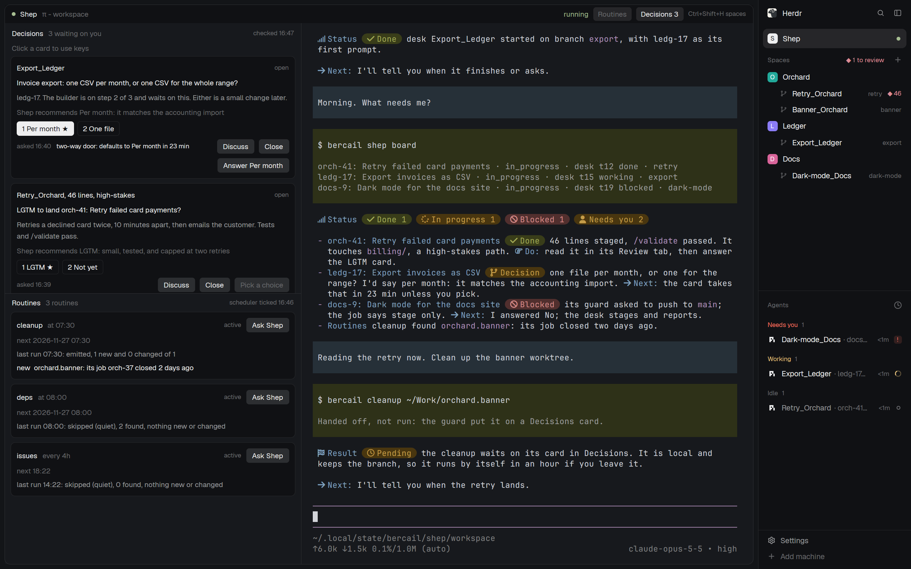

# bercail

**An agentic development environment on [Herdr](https://herdr.dev).** You ask for
something. Shep, the orchestrator, writes it down as a job and gives it to a desk:
a coding agent in its own git worktree, in plain view beside your work. A desk
stages its change and leaves the commit to you or Shep. You read each change,
answer the questions only you can answer, and Shep lands what you approve.



Bercail is French for the sheepfold, so of course there's a shepherd.

## Why use it

- **Every agent in sight.** One job, one worktree, one Herdr space, one desk. The
  sidebar shows which desks are working, which wait on you, and which are done.
  Shep writes no code itself: every coding job is a desk you can open.
- **Review comes first.** Desks stop at a staged change. When one is done,
  [tuicr](https://github.com/agavra/tuicr) opens it in a Review tab the next time
  you look at its space. A change to a path the repo marks high-stakes waits for
  your LGTM before it lands.
- **Questions come as cards.** Shep puts what it needs from you in the Decisions
  panel: the question, the choices and, when there is one, Shep's recommendation
  and why. A plan Shep marks cheap to undo can take its recommendation if you
  don't pick in time (30 minutes by default), and you can reverse it after. An
  LGTM always waits for you.
- **Proof with each change.** A desk finishes with `/validate`: the tests, the
  repo's verify skill, a description of the change checked against the staged
  tree, and a second opinion from the judge, on GPT by default.
- **Your own plans.** Every agent runs on [Pi](https://pi.dev), signed in to your
  Claude and ChatGPT subscriptions, not API keys. By default Claude Opus does the
  work and makes the calls, and GPT judges ([bstack](docs/bstack.md)).

## Built for one setup

bercail is Simon's own setup, published as it runs: Omarchy and Hyprland, the
Herdr app, Pi on Claude Max and ChatGPT Pro, Basecamp for todos, 1Password for
desk secrets, and Entire on some repos. It expects the Herdr app and a Claude
plan. ChatGPT, Basecamp, 1Password and Entire are optional, and bercail also runs
on Ubuntu, Debian and macOS. [What it assumes](docs/stack.md) lists each piece,
what works without it, and why each tool was picked. If it doesn't fit how you
work, fork it and make it your own.

## How it works

ask → job (a [beads](https://beads.gascity.com/) issue, or a trail on Entire) →
desk → staged change → review → land. Meanwhile [routines](docs/routines.md)
watch for work to clean up or start, and background Sheps wait on CI so Shep
doesn't.
[How a job flows](docs/workflow.md) follows one job from start to end, with a
chart.

**What your agents care about:** their desk, the guard that checks each command,
the repo's git policy, and `/validate`.

**What you care about:** cards to answer, changes to review and LGTM, todos only
you can do, and the standing rules you give Shep.

## Quick start

The easy way: add [Shep](https://x.ai/bot/Yber1TlDZinVy6FQZcPsF), our Grok Bot template, connect this computer to it, and ask it to set up bercail. It installs and configures everything, and asks before it runs anything.

### Or install it yourself

Current release: [v0.19.1](https://github.com/simoncrypta/bercail/releases/tag/v0.19.1).


```bash
mise use -g packslip:github.com/simoncrypta/bercail   # mise 2026.9.2+
bercail install
```

mise waits 24 hours before it takes a new release. Can't wait? Pin it: `mise use -g packslip:github.com/simoncrypta/bercail@0.19.1`. No mise? `packslip install github.com/simoncrypta/bercail` does the same job, or use curl:

```bash
curl -fsSL https://bercail.dev/install.sh | bash
```

Then connect your plans with `bercail bstack setup`, and switch the Herdr app to the bercail layout once (`Ctrl+Shift+L` → bercail). In a repo:

```bash
dev          # this directory's space, with its desk agent
```

The layout opens on Shep, with your spaces beside it: click one to work in it (or find it with `Ctrl+Space`), `Ctrl+Shift+H` to come back. `Ctrl+Shift+A` focuses the desk, `Ctrl+Shift+R` opens Review, and `bercail doctor` tells you if anything is missing. Something else? `bercail help`.

## Docs

- [How a job flows](docs/workflow.md): from your ask to a landed change, cards, routines, and who cares about what.
- [What bercail assumes](docs/stack.md): the setup it is built for, and why each tool.
- [install](docs/install.md): every install path, what it touches, upgrading.
- [commands](docs/cli.md): the `bercail` CLI, shell helpers, and skills.
- [keys](docs/keys.md): the layout at a glance and every key.
- [config](docs/config.md): `config.toml`, each repo's git policy, and the files bercail manages.
- [Shep](docs/shep.md): the orchestrator, the Shep view, Decisions, and desk events.
- [bstack](docs/bstack.md): Pi on your own plans, the roles and models, `/validate`. Then [the bstack guide](docs/bstack/README.md).
- [review](docs/review.md), [handoff](docs/handoff.md), [routines](docs/routines.md), [Entire](docs/entire.md), [development](docs/development.md).

The index lives in [docs/README.md](docs/README.md).

## Credits and license

bercail ships copies of [pi-emphasis](https://github.com/johnlindquist/pi-emphasis), pstack's statechart skill, [herdr-focus-to-hover](https://github.com/jankeesvw/herdr-focus-to-hover) and Herdr's own mods, each under its license, and borrows from pstack and gstack. [Credits](docs/credits.md) has the list.

MIT: [LICENSE](LICENSE).
