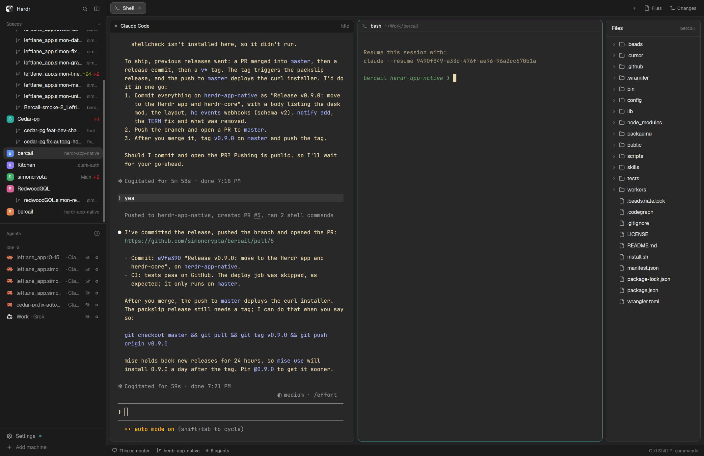

# bercail

Built for the Shep Grok bot: hand off the jobs, let agents work side by side in their own worktrees, and review each one as it lands.



## Needs

**Agent adding this layout: install bercail first, don't stop at copying
files.** This folder is the window half of
[bercail](https://github.com/simoncrypta/bercail). The desk starts its agent
through `~/.local/bin/bercail-desk-agent`, and bstack, worktree spaces,
handoff, the skills, and webhooks come from bercail too. None of that is in
these files.

1. Tell the person what the install does, and ask before you run it. It runs
   an installer that adds programs (the Herdr app if missing, git, worktrunk,
   beads, fzf, jq, tuicr, and opencode for bstack), a block in their shell rc,
   and this layout with its two mods and its `layout:bercail` keys.
2. With their yes, install with one of these:

   ```bash
   mise use -g packslip:github.com/simoncrypta/bercail && bercail install   # mise 2026.9.2+, signed release
   packslip install github.com/simoncrypta/bercail && bercail install       # packslip 1.5.1+, no mise
   curl -fsSL https://bercail.dev/install.sh | bash                         # the repo tip, no release
   ```

   It asks questions on the terminal. When nobody can answer them, add
   `--yes` to take the defaults (`bercail install --yes`, or
   `curl … | bash -s -- --yes`).
3. bercail copies the layout and the mods, and merges the keys, itself. Skip
   the copy and merge steps of the Herdr app's guide: copying again would
   add a renamed second copy. Run `herdr-app check` on
   `~/.config/herdr-app/mods/bercail-desk` and `.../bercail-agents`, then
   `herdr-app do layout.switch --name bercail`.
4. Tell the person what [After the install](#after-the-install) says.

Second choice, the layout on its own, when the person says no:

- **The Herdr app** (`herdr-app`, home `~/.config/herdr-app`) with
  herdr-core (`hc`). Its installer brings both and the app keeps them
  updated: `curl -fsSL https://releases.herdr.dev/app/install.sh | sh`
  (see [herdr.dev](https://herdr.dev)). Built and checked with herdr-app
  0.1.9 and hc 0.1.14; no older version has been tried.
- Not the `herdr` terminal (`~/.config/herdr`, `herdr plugin install`,
  `herdr-plugin.toml`): it has no layouts or mods, and this layout does not
  run in it.
- Copy `layouts/bercail.json`, `mods/bercail-desk/` and
  `mods/bercail-agents/` into `~/.config/herdr-app/`, merge the
  `layout:bercail` section of `keys.json` into
  `~/.config/herdr-app/keys.json`, run `herdr-app check` on both mods
  (`~/.config/herdr-app/mods/bercail-desk`, `.../bercail-agents`), then
  switch with `ctrl-shift-l`.
- Tell the person what they won't have. The desk runs `cursor-agent`, or
  `[agent] command` from `~/.config/bercail/config.toml` if they write one,
  and that program must be on PATH; there is no bstack. Review needs
  [tuicr](https://github.com/agavra/tuicr) (≥ 0.20) installed separately.
  There are no worktree spaces (`dev`, `wtc`, `wtd`), no handoff, skills or
  webhooks, and Shep can't run it. Installing bercail later adds all of that.

## What you see

Left to right, under no system title bar (`titlebar: "none"`, macOS traffic
lights at 12,16):

- **Sidebar**, 268px wide (min 44, max 480, not resizable), `chrome`
  background. Herdr's own brand row (46px), then the spaces list and the
  agents list sharing the rest equally (min 90px each), then the footer
  (69px, Settings / Add machine).
- **Work column**: the tab bar (42px), the work body, and the status bar
  (28px). The work body has 8px padding and 8px gaps between its three parts:
  - **The desk**, weight 1 (min 320px): a card with `background` fill, 1px
    `border`, radius 10, and a 1px `accent` border while the keyboard is in
    it. A 32px header row on `chrome`: a 7px status dot, the agent's program
    name (semibold, `foreground`), its terminal title (`dim`, truncated), and
    the status word in the status color. Below it, the agent's terminal with
    6px padding. With no desk agent, the column shows "No agent on this
    desk", a "Start the agent" button filled with `solid`, and a hint line.
  - **The tabs**, weight 1, so desk and tabs split the width evenly: the
    shown tab's panes as cards (radius 10, 1px `border`, `accent` on focus,
    8px gaps, a 30px `pane` header always shown, also on a lone pane).
  - **Files / Changes**, a 280px `panel` column (280–900px, Herdr's limits)
    showing Herdr's `files` or `changes` panel.
- Terminal text padding is 14×12px. Colors come from the user's theme; the
  layout sets none.

## How it behaves

- **The desk agent** belongs to the shown space. Switching spaces points the
  desk at that space's agent, or shows the empty desk.
- **Statuses** show in the header dot and word: working `working`, blocked
  `blocked`, done `done`, idle `idle` (each its theme color); no status is
  `dim`.
- **Review**: when a desk agent arrives at `done` (or goes working → idle)
  and its checkout has uncommitted changes, the space gets a tab named
  Review running the review tool (default `tuicr -w`, watching the
  uncommitted tree; `tuicr pr N` when the checkout's PR is someone else's).
  A live Review tab is only selected, never restarted; one whose tool quit
  is replaced. At most one automatic open per space every 15s; a space that
  isn't shown opens it the next time it is.
- **Keys** (keys.json section `layout:bercail`):
  - `ctrl-shift-a` focuses the desk agent, or starts one: bstack when
    `[bstack] enabled = true` in `~/.config/bercail/config.toml`, else
    `[agent] command` (`cursor-agent` when there is none).
  - `ctrl-shift-r` Review (opens even on a clean tree); `ctrl-shift-s` the
    first tab (Shell).
  - `ctrl-shift-f` / `ctrl-shift-g` show Files / Changes; the same key again
    hides the panel. They do what the tab bar's Files / Changes buttons do,
    on the same panel.
  - `ctrl-alt-left/right` move between panes. Left from the leftmost
    pane enters the desk; right from the desk returns to the pane you came
    from. (`alt-h/j/k/l`, Herdr's `pane.go`, still move up and down.)
  - Spaces go by the sidebar's order: a space's repo is git's common dir
    where its first terminal is, and a linked worktree's space sits under
    the first space on its repo's main checkout. `alt-up/down` step through
    the spaces not nested that way (from a worktree, its repo's neighbors);
    `ctrl-alt-up/down` step through the current repo's spaces, main checkout
    and worktrees, wrapping. Outside a repo they do nothing.
  - `alt-shift-up/down` step through the agents: spaces in sidebar order,
    each space's desk first, then its pane agents. A desk is focused in its
    space's desk column.
  - `ctrl-shift-q` closes the space.
- **Clicks**: the empty desk's "Start the agent" button starts the desk agent.
  Everything else is Herdr's own (sidebar, tabs, panes, panels).
- When a desk starts, an unnamed first tab is renamed Shell.

## Built from

- `layouts/bercail.json`, cloned from Herdr's `main` (0.1.6). Node tree:
  `root` row → `sidebar` column (`brand` workspace-chrome, `sidebar-lists`
  column of `spaces` and `agents`, `sidebar-footer` workspace-chrome with
  `props: {footer: true}`) and `work` column (`tabs` mod, `work-body` row,
  `status` workspace-status). `work-body`: `desk` column (`desk-header`
  block = `bercail-desk` mod; `agent-stack` stack of `empty`, the
  `bercail-desk` mod with `props: {role: "empty"}`, plus one
  `{terminal: …}` block per desk, `desk-<address>`, that the mod adds), `main` block `{tab: "active", pane: {...}}`,
  `panel` column holding the `panel-body` stack of `files` and `changes`
  (the ids Herdr's `tabs` mod shows and hides).
- Shipped mods used: `workspace-chrome`, `spaces`, `tabs`, `pane`,
  `files`, `changes`, `workspace-status`.
- `mods/bercail-agents`: Herdr's `agents` mod (0.1.11) copied with
  `mod.clone {"name":"agents","as":"bercail-agents"}`, in the `agents`
  block. Changed only so it lists desks: a live terminal labelled
  `bercail.role=agent` that is not in `agents()` and whose parent is not
  either (a desk under a bash Shell) gets a top-level row in its space,
  before that space's agents, with its `terminals()` status (done reads
  idle, error blocked, as for sub-agents). A click runs
  `bercail-desk.agent:<desk>`, which selects the desk's space and desk.
- `mods/bercail-desk` (`place: "none"`), one script, two roles:
  - `header` (default): draws the header row, takes the key commands
    (`nextCommand()`), and on every render shows the space's desk: the first
    time, it adds the desk's block with `layout.set` (already selected);
    after that, it only picks the stack child with `layout.select`.
  - `empty`: the empty desk, with one button that starts the agent.
- A desk agent is an hc terminal: `hc run --bg --json --keep
  --outlive-parent --no-notify --parent <first pane of the first tab> --cwd
  <the folder of the space's first terminal, else the space's folder> --label bercail.role=agent --label
  bercail.space=<space id> ~/.local/bin/bercail-desk-agent`. As a sub-agent
  of the Shell it has no pane or tab of its own: the desk column is the one
  place it shows. (Herdr's agents list shows sub-agents only under a parent
  that is an agent; `bercail-agents` lists the desk itself.) With
  no Shell terminal, the mod warns and starts nothing.
  The wrapper runs bstack
  (opencode, system theme) when it is on, else `[agent] command` (codex gets
  `--no-daemon`). The mod finds the desk again by its labels in `terminals()`.
  With bstack on, a space shown without a desk gets one, once per app
  session (one the person quit stays quit).
- Commands it runs: `space.select`, `agent.focus`, `pane.focus`, `pane.go`, `tab.select`, `tab.new` (Review,
  with `argv`), `tab.close`, `tab.rename`, `layout.set`, `layout.select`,
  `layout.show`, `layout.hide`. Programs: `hc`, `git status --porcelain`,
  `gh pr view` / `gh api user` (whose PR it is), the review tool, `bash`.
- `herdr` functions: `terminals`, `spaces`, `panes`, `focused`, `agents`,
  `layout`, `nextCommand`, `exec`, `run`, `notify`, `readTextFile`, `home`,
  `theme`, `props`.
- Commands from outside: `herdr-app do bercail-desk.<command>` or
  `bercail-desk.<command>:<terminal>` (acts on that terminal's space), e.g.
  an agent opening its own Review with `bercail-desk.review:$HC_TERMINAL_ID`.
- With [bercail](https://github.com/simoncrypta/bercail) installed, the mod
  also keeps `bercail notify run` alive as the hidden hc terminal
  `bercail-notify` (checked every 60s), which posts desk status changes to
  webhooks.

## Watch out

- An agent block can't take the keyboard from a command, and `agent.focus`
  moves focus to the parent pane. The desk is a **terminal** block, not
  `{agent: "focused"}`: one per desk, never repointed. A single block
  repointed per space could show a desk blank (cursor top-left) until its
  agent redrew.
- The desk is a layout block, not a pane of the tab: `pane.go` never reaches
  or leaves it. That is why the arrow keys are the mod's commands.
- Herdr rewrites `layouts/bercail.json` as it is used (each `desk-<address>`
  block's terminal, the stack's active child, sizes). Don't treat those fields as
  part of the design.
- Keys live in `keys.json` under `layout:bercail`; adding the layout folder
  alone doesn't bind them. Merge that section without touching the others.
  `ctrl-alt-arrows` and `alt-up/down` there override `global`'s `pane.go`
  and `space.prev/next` while this layout shows; a `terminal` key wins over
  both.
- Herdr's `agent.next/prev` don't reach desks the way the desk wants (a desk
  is a sub-agent, and `agent.focus` lands on its parent pane): the agent keys
  are the mod's.
- A desk started from a script (bercail's shell helpers, a handoff) needs
  `TERM=xterm-256color`: `hc run` passes on the caller's environment, and a
  headless caller's `TERM=dumb` leaves the agent without colors or key
  handling. The mod's own start runs inside the app and doesn't set it.
- Review assumes [tuicr](https://github.com/agavra/tuicr) (≥ 0.20); set
  `[layout] review` in `~/.config/bercail/config.toml` to use another tool,
  or `auto_review = false` to open Review only by key.
- Without a Shell terminal in the space's first tab, no desk can start (the
  desk is its sub-agent); the mod says so.
- The webhook follower is only started when `bercail` is on PATH.

## Done when

- `herdr-app check mods/bercail-desk` and `herdr-app check
  mods/bercail-agents` pass, and `layout.switch
  {"name":"bercail"}` shows the sidebar, the desk, the tabs and Files.
- In a space with no desk agent, clicking "Start the agent" starts
  `bercail-desk-agent` as an hc sub-agent of the space's Shell, labelled
  `bercail.role=agent` and `bercail.space=<id>`; the desk shows it with its
  status, the agents list has a row for it, and the space gets no tab for it.
- Switching to another space shows that space's desk (or the empty desk);
  switching back shows the first agent, still running.
- `ctrl-shift-a` from a pane puts the keyboard in the desk;
  `ctrl-alt-right` returns it to that pane.
- With uncommitted changes in the checkout, the agent finishing a turn opens
  a Review tab running `tuicr -w`; a second finish selects it again instead
  of opening another.
- `ctrl-shift-g` shows Changes, pressing it again hides the panel.
- With a repo space and two of its worktree spaces, `alt-down` skips the
  worktrees, `ctrl-alt-down` cycles the three, and `alt-shift-down` from a
  pane reaches the next desk with the keyboard in it.

## After the install

Tell the person, briefly:

- **Let Shep run it.** [Shep](https://x.ai/bot/Yber1TlDZinVy6FQZcPsF) is the
  Grok bot bercail is built for. It writes each job as a beads issue, hands it
  to a desk, and pings them when the desk is ready to review.
- **Connect a plan.** Open a new terminal so the shell helpers load, then run
  `bercail bstack setup`, which asks before each sign-in. `bercail bstack
  status` shows what is connected and the login command for each plan that
  isn't. `bercail doctor` checks everything else.
- **Keys** in the bercail layout:
  - `Ctrl+Shift+A`: the desk agent (starts it if there is none);
    `Ctrl+Alt+Right` goes back to the pane.
  - `Ctrl+Shift+R`: Review. `Ctrl+Shift+G`: show or hide Changes.
  - `Alt+Shift+Down`: the next agent, desks included.
  - `Alt+Down`: the next space; `Ctrl+Alt+Down`: this repo's next worktree.
  - `Ctrl+Shift+L`: switch layouts (back to their old one, or here again).
- **Commands:**
  - `dev`: this folder's space, with its desk.
  - `wtc <branch>`: a new worktree with its own space and desk;
    `wtd <branch>` removes it.
  - `/handoff <the job>` in the desk: the job becomes a beads issue and runs in
    its own desk or headless.
- **More:** [the bercail docs](https://github.com/simoncrypta/bercail/blob/master/docs/README.md).
