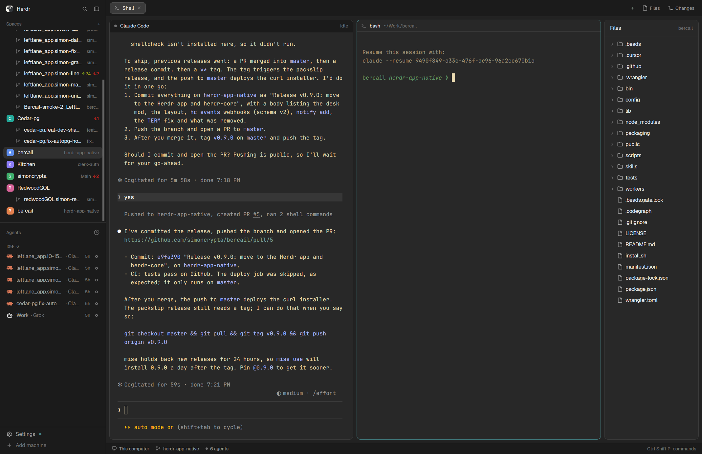

# bercail

Built for Shep: the window opens on Shep, the orchestrator on Pi, beside your spaces and agents. Hand off the jobs, let agents work side by side in their own worktrees, and review each one as it lands.



## Needs

**Agent adding this layout: install bercail first, don't stop at copying
files.** This folder is the window half of
[bercail](https://github.com/simoncrypta/bercail). The desk starts its agent
through `~/.local/bin/bercail-desk-agent`, and bstack, worktree spaces,
handoff, the skills, and webhooks come from bercail too. None of that is in
these files.

1. Tell the person what the install does, and ask before you run it. It runs
   an installer that adds programs (the Herdr app if missing, git, worktrunk,
   beads, fzf, jq, tuicr, and Pi for the desk), a block in their shell rc,
   and this layout with its mods and its `layout:bercail` keys.
2. With their yes, install with one of these:

   ```bash
   mise use -g packslip:github.com/simoncrypta/bercail && bercail install   # mise 2026.9.2+, signed release
   packslip install github.com/simoncrypta/bercail && bercail install       # packslip 1.5.1+, no mise
   curl -fsSL https://bercail.dev/install.sh | bash                         # the latest release, unsigned
   ```

   It asks questions on the terminal. When nobody can answer them, add
   `--yes` to take the defaults (`bercail install --yes`, or
   `curl … | bash -s -- --yes`).
3. bercail copies the layout and the mods, and merges the keys, itself. Skip
   the copy and merge steps of the Herdr app's guide: copying again would
   add a renamed second copy. Run `herdr-app check` on
   `~/.config/herdr-app/mods/bercail-desk`, `.../bercail-shep`,
   `.../bercail-spaces`, `.../bercail-agents` and `.../bercail-review`, then
   `herdr-app do layout.switch --name bercail`.
4. Tell the person what [After the install](#after-the-install) says.

Second choice, the layout on its own, when the person says no:

- **The Herdr app** (`herdr-app`, home `~/.config/herdr-app`) with
  herdr-core (`hc`). Its installer brings both and the app keeps them
  updated: `curl -fsSL https://releases.herdr.dev/app/install.sh | sh`
  (see [herdr.dev](https://herdr.dev)). Built and checked with herdr-app
  0.1.9 and hc 0.1.14; no older version has been tried.
- Not the `herdr` terminal (`~/.config/herdr`, `herdr plugin install`,
  `herdr-plugin.toml`): it has no layouts or mods, and this layout does not
  run in it.
- Copy `layouts/bercail.json`, `mods/bercail-desk/`, `mods/bercail-shep/`,
  `mods/bercail-spaces/` and `mods/bercail-agents/` into
  `~/.config/herdr-app/`, merge the `layout:bercail` section of `keys.json`
  into `~/.config/herdr-app/keys.json`, run `herdr-app check` on each mod
  (`~/.config/herdr-app/mods/bercail-desk`, `.../bercail-shep`,
  `.../bercail-spaces`, `.../bercail-agents`), then switch with
  `ctrl-shift-l`.
- Tell the person what they won't have. The desk runs plain `pi`, which must
  be on PATH; there is no bstack. Review needs
  [tuicr](https://github.com/agavra/tuicr) (≥ 0.26) installed separately,
  and the Shep view needs bercail (`bercail shep run` starts Shep); without
  it the view says so and the spaces work.
  There are no worktree spaces (`dev`, `wtc`, `wtd`), no handoff, skills or
  webhooks, and Shep can't run it. Installing bercail later adds all of that.

## What you see

Two views of one window, under no system title bar (`titlebar: "none"`,
macOS traffic lights at 12,16). The **Shep view** (what the app opens on):
Shep, then the sidebar on the right. The **space view**: the sidebar on the
left, then the work column. The root row is `shep`, `sidebar`, `work`; a view
is which of `shep` and `work` is hidden.

- **Shep**, weight 1 (min 320), 8px padding: a card like the desk's
  (`background` fill, 1px `border`, radius 10, `accent` border on focus). A
  32px `chrome` header (draggable: `window_drag`): a 7px dot (`ansi2` while
  Shep runs, `blocked` without bercail, else `dim`), "Shep" semibold, the
  terminal's title or "the orchestrator for every desk" in `dim`, the state word (running, starting, stopped, bercail missing), and
  "Ctrl+Shift+H spaces" at 11px. Below it, Shep's terminal with 6px padding.
  Without one: "Shep is not running", a "Start Shep" button filled with
  `solid`, and "Runs Shep on Pi, in its own session." in `dim`; without bercail: "bercail is not installed", what to do, a
  "Check again" button, and "Your spaces work without it".
- **Sidebar**, 268px wide (min 44, max 480, not resizable), `chrome`
  background. Herdr's own brand row (46px); the **Shep row** (44px): in the
  Shep view a selected (`selected`) row with an 18px `solid` tile "S",
  "Shep" and the dot; in the space view a chevron, "Back to Shep",
  "Ctrl+Shift+H" in `dim` and the dot. On the rail (narrower than 160px)
  only the tile. Then the spaces list and the agents list sharing the rest
  equally (min 90px each), then the footer (69px, Settings / Add machine).
  While Shep shows, no space reads as selected.
- **Work column**: the tab bar (42px), the work body, and the status bar
  (28px). The work body has 8px padding and 8px gaps between its three parts:
  - **The desk**, weight 1 (min 320px): a card with `background` fill, 1px
    `border`, radius 10, and a 1px `accent` border while the keyboard is in
    it. A 32px header row on `chrome`: a 7px status dot, the agent's program
    name (semibold, `foreground`), its terminal title (`dim`, truncated), and
    the status word in the status color. Below it, the agent's terminal with
    6px padding. With no desk agent, the column shows "No agent on this
    desk", a "Start the agent" button filled with `solid`, and a hint line.
  - **The tabs**, weight 1, so desk and tabs split the width evenly: the
    shown tab's panes as cards (radius 10, 1px `border`, `accent` on focus,
    8px gaps, a 30px `pane` header always shown, also on a lone pane).
  - **Files / Changes**, a 280px `panel` (280–900px, Herdr's limits)
    showing Herdr's `files` or `changes` panel.
- Terminal text padding is 14×12px. Colors come from the user's theme; the
  layout sets none.

## How it behaves

- **Views.** The app opens on the Shep view once per app session, whatever
  view was shown when it closed. Clicking a space (or making one with +)
  selects it and shows the space view; the Shep row or `ctrl-shift-h` shows
  the Shep view again. Hidden columns keep their terminals and mods running:
  switching starts and stops nothing.
- **Shep** is one hc terminal, `bercail-shep` (label `bercail.role=shep`),
  in no space, running `bercail shep run`, which runs Shep on Pi in the
  terminal. It starts on its
  own once per app session, after the core lists its terminals; a running
  one is shown again, never a second. One the person quits stays quit until
  "Start Shep". When Pi exits with an error, its message stays until Enter.
- **The keyboard** goes into Shep when the Shep view shows, and back where it
  was in the space (a pane, or the desk) when the space view returns.
- **Agents.** Clicking an agent, a desk or a sub-agent in the agents list
  opens its own terminal in a dialog (86% of the window) over either view,
  with a 34px bar: status dot, icon, name ("Desk" for a desk), space, title,
  status, "Show in space" and ✕. Keys go to that terminal while it is open;
  Esc is the program's. ✕ or a click beside it closes it and puts the
  keyboard back where it was; "Show in space" selects the space, shows the
  space view and, for a pane agent, focuses it.
- **The desk agent** belongs to the shown space. Switching spaces points the
  desk at that space's agent, or shows the empty desk.
- **Statuses** show in the header dot and word: working `working`, blocked
  `blocked`, done `done`, idle `idle` (each its theme color); no status is
  `dim`.
- **Review**: when a desk agent arrives at `done` (or goes working → idle)
  and its checkout has uncommitted changes, the space gets a tab named
  Review running the review tool (default `tuicr -w`, watching the
  uncommitted tree; `tuicr pr N` when the checkout's PR is someone else's).
  A live Review tab is only selected, never restarted; one whose tool quit
  is replaced. At most one automatic open per space every 15s; a space that
  isn't shown opens it the next time it is.
- **Keys** (keys.json section `layout:bercail`):
  - `ctrl-shift-h` switches between the Shep view and the space view.
  - `ctrl-space` opens Herdr's Go to… search (`mod.open {name: "picker"}`).
  - `ctrl-shift-a` focuses the desk agent, or starts one: bstack's Pi lead.
  - `ctrl-shift-r` Review (opens even on a clean tree); `ctrl-shift-s` the
    first tab (Shell).
  - `ctrl-shift-f` / `ctrl-shift-g` show Files / Changes; the same key again
    hides the panel. They do what the tab bar's Files / Changes buttons do,
    on the same panel.
  - `ctrl-alt-left/right` move between panes. Left from the leftmost
    pane enters the desk; right from the desk returns to the pane you came
    from. (`alt-h/j/k/l`, Herdr's `pane.go`, still move up and down.)
  - Spaces go by the sidebar's order: a space's repo is git's common dir
    where its first terminal is, and a linked worktree's space sits under
    the first space on its repo's main checkout. `alt-up/down` step through
    the spaces not nested that way (from a worktree, its repo's neighbors);
    `ctrl-alt-up/down` step through the current repo's spaces, main checkout
    and worktrees, wrapping. Outside a repo they do nothing.
  - `alt-shift-up/down` step through the agents: spaces in sidebar order,
    each space's desk first, then its pane agents. A desk is focused in its
    space's desk column.
  - In the Shep view these keys (and `ctrl-space`, `ctrl-shift-a`, `-r`, `-s`,
    `-f`, `-g`, `ctrl-alt-left/right`) show the space view first, with the
    keyboard back where it was in the space, then act from there.
  - `ctrl-shift-q` closes the space.
- **Clicks**: the empty desk's "Start the agent" button starts the desk agent;
  "Start Shep" and "Check again" in the Shep view; the Shep row; spaces and
  agents as above. Everything else is Herdr's own (tabs, panes, panels).
- When a desk starts, an unnamed first tab is renamed Shell.

## Built from

- `layouts/bercail.json`, cloned from Herdr's `main` (0.1.6). Node tree:
  `root` row → `shep` column (padding 8; `shep-card` column: `shep-header`
  block = `bercail-shep` with `props: {role: "header"}`, `window_drag`;
  `shep-stack` stack of `shep-empty`, `bercail-shep` with
  `props: {role: "empty"}`, plus the `{terminal: …}` block `shep-<address>`
  the mod adds; `shep-keys` block, 0px = `bercail-desk` with
  `props: {role: "keys"}`), `sidebar` column (`brand` workspace-chrome, `shep-nav`
  block = `bercail-shep` with `props: {role: "nav"}`, `sidebar-lists` column
  of `spaces` (`bercail-spaces`) and `agents`, `sidebar-footer`
  workspace-chrome with `props: {footer: true}`) and `work` column (shipped
  `hidden: true`; `tabs` mod, `work-body` row, `status` workspace-status). `work-body`: `desk` column (`desk-header`
  block = `bercail-desk` mod; `agent-stack` stack of `empty`, the
  `bercail-desk` mod with `props: {role: "empty"}`, plus one
  `{terminal: …}` block per desk, `desk-<address>`, that the mod adds), `main` block `{tab: "active", pane: {...}}`,
  `panel` stack holding the `panel-body` stack of `files` and `changes`
  (the ids Herdr's `tabs` mod shows and hides). `panel` is a stack: Herdr
  has saved the layout with the one-child `panel` column gone, keeping the
  one-child stacks.
- Shipped mods used: `workspace-chrome`, `tabs`, `pane`, `files`,
  `changes`, `workspace-status`.
- `mods/bercail-spaces`: Herdr's `spaces` mod (0.1.15) copied with
  `mod.clone {"name":"spaces","as":"bercail-spaces"}`. Changed only so a
  click on a space, + or a machine's + also runs `layout.hide {id: "shep"}`
  and `layout.show {id: "work"}` (in a layout with both), and so no space
  reads as selected while `shep` shows.
- `mods/bercail-shep` (`place: "none"`), one script, four roles:
  - `nav` (default): the Shep row. It is always shown, so it holds the logic:
    on its first render of the app session (a flag on `globalThis`, which a
    mod reload keeps) it shows the Shep view; once `terminals()` lists
    anything it starts Shep: `hc exec bash -lc 'command -v bercail'`, then
    `hc run --bg --json --no-parent --no-notify --rm --name bercail-shep
    --cwd <home> --label bercail.role=shep bash -lc <PATH fallback; exec
    bercail shep run>` (hc refuses a second live `bercail-shep`:
    `name_taken` is no error). On every render it
    adds Shep's block to `shep-stack` with `layout.set` (once per terminal,
    already active), selects it, or drops it when Shep ends, and moves the
    keyboard: `pane.focus {terminal: <Shep>}` in the Shep view when it is in
    a pane; on return to the space view, `pane.focus` to where it was in that
    space (kept per space while the space view shows). Its commands
    (`bercail-shep.toggle`, `.show`, `.space`, `.start`) switch views or
    start Shep. `.goto` opens the picker, and `.desk:<command>` runs
    `bercail-desk.<command>`: from the Shep view, once the space view shows
    and the keyboard is back in the space.
  - `header`, `empty`: the Shep column's bar and placeholder.
  - `modal`: the bar of an agent dialog, `props: {terminal, back}`.
- Agent dialogs: `openOverlay({kind: "dialog", width: 0.86, height: 0.86,
  layout: {type: "column", children: [{size: {px: 34}, content: {mod:
  "bercail-shep", props: {role: "modal", terminal, back: {pane,
  terminal}}}}, {content: {terminal}, padding: [6, 6]}]}})`. Its `close()`
  runs `pane.focus` back to `back`.
- `mods/bercail-agents`: Herdr's `agents` mod (0.1.15) copied with
  `mod.clone {"name":"agents","as":"bercail-agents"}`, in the `agents`
  block. Changed only so it lists desks: a live terminal labelled
  `bercail.role=agent` that is not in `agents()` and whose parent is not
  either (a desk under a bash Shell) gets a top-level row in its space,
  before that space's agents, with its `terminals()` status (done reads
  idle, error blocked, as for sub-agents). A click on any row (desk, agent,
  sub-agent) opens the agent dialog above instead of switching spaces.
  A pinned desk reads its pin from the `herdr.pinned` label, as agents do.
- `mods/bercail-desk` (`place: "none"`), one script, three roles:
  - `header` (default): draws the header row, takes the key commands
    (`nextCommand()`), and on every render shows the space's desk: the first
    time, it adds the desk's block with `layout.set` (already selected);
    after that, it only picks the stack child with `layout.select`. A saved
    layout whose `panel` column Herdr dropped gets it back, as the stack,
    with `layout.set`.
  - `empty`: the empty desk, with one button that starts the agent.
  - `keys`: draws nothing. In the Shep column, so it is the copy shown in
    the Shep view: it sends each key to `bercail-shep.desk:<command>`, and
    runs a `<command>:<terminal>` itself (it names its space).
- A desk agent is an hc terminal: `hc run --bg --json --keep
  --outlive-parent --no-notify --parent <first pane of the first tab> --cwd
  <the folder of the space's first terminal, else the space's folder> --label bercail.role=agent --label
  bercail.space=<space id> ~/.local/bin/bercail-desk-agent`. As a sub-agent
  of the Shell it has no pane or tab of its own: the desk column is the one
  place it shows. (Herdr's agents list shows sub-agents only under a parent
  that is an agent; `bercail-agents` lists the desk itself.) With
  no Shell terminal, the mod warns and starts nothing.
  The wrapper runs bstack's Pi lead. The mod finds the desk again by its
  labels in `terminals()`.
  A space shown without a desk gets one, once per app session (one the
  person quit stays quit).
- Commands it runs: `space.select`, `agent.focus`, `pane.focus`, `pane.go`, `tab.select`, `tab.new` (Review,
  with `argv`), `tab.close`, `tab.rename`, `layout.set`, `layout.select`,
  `layout.show`, `layout.hide`. Programs: `hc`, `git status --porcelain`,
  `gh pr view` / `gh api user` (whose PR it is), the review tool, `bash`.
- `herdr` functions: `terminals`, `spaces`, `panes`, `focused`, `agents`,
  `layout`, `nextCommand`, `exec`, `run`, `notify`, `readTextFile`, `home`,
  `theme`, `props`.
- Commands from outside: `herdr-app do bercail-desk.<command>` or
  `bercail-desk.<command>:<terminal>` (acts on that terminal's space), e.g.
  an agent opening its own Review with `bercail-desk.review:$HC_TERMINAL_ID`.
- With [bercail](https://github.com/simoncrypta/bercail) installed, the mod
  also keeps `bercail notify run` alive as the hidden hc terminal
  `bercail-notify` (checked every 60s), which posts desk status changes to
  webhooks.
- `mods/bercail-review` (`place: "none"`): the Stack tab of a `bercail
  review-pr` space, made by bercail with `tab.new {space, name: "Stack", mod:
  "bercail-review", props: {stack, bercail}}`. It needs bercail: everything
  it shows comes from `exec(<bercail>, ["review-pr", "state", "--stack",
  <stack>])`, run again when `watchFolder(<stack>)` reports a change other
  than a pass's logs. A 350px PR picker on `surface` (only for two or more
  PRs) sits beside the card. Rows have a semibold title, a one-line truncated
  code-inferred intent in `foreground`, and status/CI in `muted`. Above the
  picker is the desk's stack summary: overall purpose, order, risks and where to start.
  Its own scroll area is at most 260px tall; the picker below scrolls
  independently, so a long summary never pushes the PRs out of view.
  There is no second numbered PR list. The card's native header has `#N`
  muted, the title bold at 18px, a muted meta line, the pass status, and three
  buttons on `raised` with their key in a chip. The body has 16px bold `accent`
  section headings with spacing and rules. Decisions sit on `surface`,
  with separate labeled Kind, Summary, Evidence,
  Stated, Fit and Alternative lines. Code chips use JetBrains Mono 12.5px,
  `ansi6` on `raised`, without mid-path wrapping. Long paths show the basename
  and line, with the full path in a tooltip. A 30px key hint bar sits on `chrome`. Keys go
  through its focus handle: j/k pick; c, r and o (or the buttons) run Code
  review (`review-pr open`), Re-review (`review-pr rereview`) and Shell
  (`review-pr checkout`, then `tab.new {name: "Shell #N", folder}`). It runs
  c and r detached through `sh -c` (`setsid`, else `nohup`), because a pass
  or tuicr's wait outlasts exec's 30 s. Each appends its output to its log
  (`open.log`, `rereview.log`) and writes its exit code and last 40 lines to
  its own file in `~/.cache/bercail/review-jobs/`. While a job is pending a
  1 s timer reads that file, removes it, and shows a failure (or a blocked
  pass) in the bar and a toast. A reload that changes `current` moves the
  card to it. `lib/review-desk.sh` starts one read-only Pi session on
  this space's desk. Passes use that session serially. Once all cards are
  ready it synthesizes the stack summary, fingerprinted against the exact
  card inputs. Both the cards and summary are visible in that desk session.

## Watch out

- `layout.set` writes the whole tree: a `layout.show`/`layout.hide` sent in the
  same moment is undone. The Shep row writes a view it has just asked for
  into the tree it sets.
- At a mod's `init`, `layout()` is null and `terminals()` empty; right after,
  the layout arrives before the core's terminals. Starting Shep before
  `terminals()` lists anything would start a second one.
- `pane.focus {terminal}` on a terminal shown in a dialog focuses its model
  pane, switching spaces: never use it to put the keyboard in a dialog. The
  dialog takes the keyboard when it opens.
- A hidden column's panes get no keys, but the keyboard stays there: move it
  (into Shep, or back to the space) when the view changes.
- Hidden mods don't render, and `<mod>.<command>` reaches shown copies only:
  in the Shep view the `header` is hidden, so the `keys` copy takes the
  `bercail-desk` keys there. Exactly one of the two shows in each view.

- An agent block can't take the keyboard from a command, and `agent.focus`
  moves focus to the parent pane. The desk is a **terminal** block, not
  `{agent: "focused"}`: one per desk, never repointed. A single block
  repointed per space could show a desk blank (cursor top-left) until its
  agent redrew.
- The desk is a layout block, not a pane of the tab: `pane.go` never reaches
  or leaves it. That is why the arrow keys are the mod's commands.
- Herdr rewrites `layouts/bercail.json` as it is used (each `desk-<address>`
  block's terminal, the stack's active child, sizes). Don't treat those fields as
  part of the design.
- Keys live in `keys.json` under `layout:bercail`; adding the layout folder
  alone doesn't bind them. Merge that section without touching the others.
  `ctrl-alt-arrows` and `alt-up/down` there override `global`'s `pane.go`
  and `space.prev/next` while this layout shows; a `terminal` key wins over
  both.
- Herdr's `agent.next/prev` don't reach desks the way the desk wants (a desk
  is a sub-agent, and `agent.focus` lands on its parent pane): the agent keys
  are the mod's.
- A desk started from a script (bercail's shell helpers, a handoff) needs
  `TERM=xterm-256color`: `hc run` passes on the caller's environment, and a
  headless caller's `TERM=dumb` leaves the agent without colors or key
  handling. The mod's own start runs inside the app and doesn't set it.
- Review assumes [tuicr](https://github.com/agavra/tuicr) (≥ 0.26); set
  `[layout] review` in `~/.config/bercail/config.toml` to use another tool,
  or `auto_review = false` to open Review only by key.
- Without a Shell terminal in the space's first tab, no desk can start (the
  desk is its sub-agent); the mod says so.
- The webhook follower is only started when `bercail` is on PATH.

## Done when

- `herdr-app check` passes on `mods/bercail-desk`, `mods/bercail-shep`,
  `mods/bercail-spaces` and `mods/bercail-agents`, and `layout.switch
  {"name":"bercail"}` shows the Shep view: Shep's terminal running
  `bercail shep run` (one hc terminal `bercail-shep`) and the sidebar on
  the right.
- Restarting the app from the space view opens the Shep view again, on the
  same `bercail-shep` terminal; `hc ls` shows one.
- Clicking a space shows the space view with that space; "Back to Shep" (or
  `ctrl-shift-h`) shows the same Shep session with its history, the keyboard
  in it; going back to the space puts the keyboard where it was (the desk
  too). The desks and shells are untouched.
- Clicking an agent in the agents list, from either view, opens its terminal
  in a dialog; typing reaches that agent; ✕ closes it with the keyboard back
  where it was.
- With no `bercail` on herdr-core's PATH, the Shep view says "bercail is
  not installed" and the spaces work.
- In the space view, in a space with no desk agent, clicking "Start the agent" starts
  `bercail-desk-agent` as an hc sub-agent of the space's Shell, labelled
  `bercail.role=agent` and `bercail.space=<id>`; the desk shows it with its
  status, the agents list has a row for it, and the space gets no tab for it.
- Switching to another space shows that space's desk (or the empty desk);
  switching back shows the first agent, still running.
- `ctrl-shift-a` from a pane puts the keyboard in the desk;
  `ctrl-alt-right` returns it to that pane.
- With uncommitted changes in the checkout, the agent finishing a turn opens
  a Review tab running `tuicr -w`; a second finish selects it again instead
  of opening another.
- `ctrl-shift-g` shows Changes, pressing it again hides the panel.
- With a repo space and two of its worktree spaces, `alt-down` skips the
  worktrees, `ctrl-alt-down` cycles the three, and `alt-shift-down` from a
  pane reaches the next desk with the keyboard in it.
- In the Shep view, `alt-down`, `ctrl-alt-down` and `alt-shift-down` show the
  space view and act there, and `ctrl-space` opens Go to… over the space view;
  none of them reaches Shep's terminal. `ctrl-shift-up` still does.

## After the install

Tell the person, briefly:

- **Let Shep run it.** Shep is the orchestrator bercail is built for. It
  writes each job as a beads issue, hands it to a desk, and reports when the
  desk finishes or blocks.
- **Connect a plan.** Open a new terminal so the shell helpers load, then run
  `bercail bstack setup`, which asks before each sign-in. `bercail bstack
  status` shows what is connected and the login command for each plan that
  isn't. `bercail doctor` checks everything else.
- **Shep first.** The window opens on Shep, running on Pi. Click a space to work in it;
  "Back to Shep" returns. Click an agent to open its terminal over either view.
- **Keys** in the bercail layout:
  - `Ctrl+Shift+H`: Shep view / space view. `Ctrl+Space`: go to a space.
  - `Ctrl+Shift+A`: the desk agent (starts it if there is none);
    `Ctrl+Alt+Right` goes back to the pane.
  - `Ctrl+Shift+R`: Review. `Ctrl+Shift+G`: show or hide Changes.
  - `Alt+Shift+Down`: the next agent, desks included.
  - `Alt+Down`: the next space; `Ctrl+Alt+Down`: this repo's next worktree.
  - `Ctrl+Shift+L`: switch layouts (back to their old one, or here again).
- **Commands:**
  - `dev`: this folder's space, with its desk.
  - `wtc <branch>`: a new worktree with its own space and desk;
    `wtd <branch>` removes it.
  - `/handoff <the job>` in the desk: the job becomes a beads issue and runs in
    its own desk or headless.
- **More:** [the bercail docs](https://github.com/simoncrypta/bercail/blob/master/docs/README.md).
