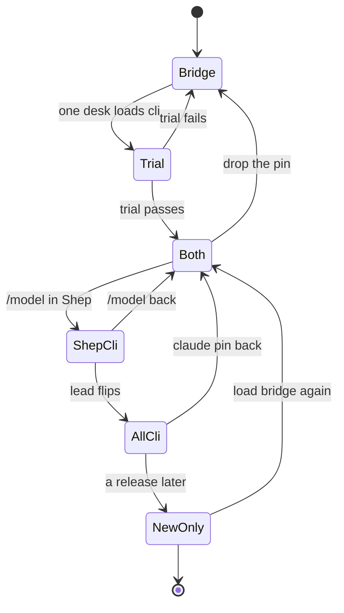

# Mulroy's tools

**Research**, for bercail-07h2. Checked on 2026-11-23 against bercail
[`0f9ab1c`](https://github.com/simoncrypta/bercail/commit/0f9ab1c83ec8d2935b852dc2e6da47ee02fa4268).
Nothing here is built. No package went into `~/.pi` or bercail's deploy, and no
model call or paid call was made.

| Repo | Commit read | Last commit |
| --- | --- | --- |
| [dmmulroy/.dotfiles](https://github.com/dmmulroy/.dotfiles) | [`81c277b`](https://github.com/dmmulroy/.dotfiles/commit/81c277ba516ef303b1752b4e3e7f6efdaa6a9dd0) | 2026-11-23 |
| [dmmulroy/pi-claude-cli](https://github.com/dmmulroy/pi-claude-cli) | [`31e02ea`](https://github.com/dmmulroy/pi-claude-cli/commit/31e02ea41081b99a6e2f1903eec6c53abad82103) | 2026-11-17 |
| [elidickinson/pi-claude-bridge](https://github.com/elidickinson/pi-claude-bridge) | [`5ea9bb8`](https://github.com/elidickinson/pi-claude-bridge/commit/5ea9bb88bd54395c1fe38cc95ec2ce1dbdcf15cc) (0.13.0) | 2026-11-16 |
| [earendil-works/pi-claude-code](https://github.com/earendil-works/pi-claude-code) | [`d5b5e04`](https://github.com/earendil-works/pi-claude-code/commit/d5b5e04c314d3452d357174d16d10dda34daa2d2) | 2026-11-05 |
| [dmmulroy/pi-web-tools](https://github.com/dmmulroy/pi-web-tools) | [`33b921a`](https://github.com/dmmulroy/pi-web-tools/commit/33b921aabe8e1efc45c35d7d06b78e0b4e8b7a7f) | 2026-11-17 |

In short:

- **Switch to pi-claude-cli**, as Simon asked. Do it in stages: a trial desk
  that loads it, then every role loading it beside the bridge, then Shep, then
  all desks, then the bridge's retirement. Three things must change before the
  trial:
  - The fallback turns pi-claude-cli's "Claude billing" stop into a
    retryable limit. The guard against spending usage credits then never
    holds.
  - The fallback picks Fable by comparing whole model ids, provider included.
  - pi-claude-cli can show an update confirm in any Pi that loads it,
    whatever provider the session uses.
- **Adopt one thing from the dotfiles:** set `GIT_EDITOR=true` for agents. A
  `git commit` with no `-m` hangs a desk's bash tool today. Skip the rest.
- **Web tools:** a `webfetch` for the lead and the builder only, once the guard
  sees it. Leave search until Simon picks a backend. Exa's hosted MCP has a
  keyless free tier that Pi 1.6 can reach with no extension. Kagi's API has no
  free tier ($12 per 1,000 searches).

## 1. The dotfiles

Effort: S is under half a day, M is one to two days, and "—" means nothing to
build.

| Item | Verdict | Why | Effort |
| --- | --- | --- | --- |
| `extensions/git-interceptor.ts` | **Adapt** the editor half | It prefixes every bash command that mentions git with `export GIT_EDITOR=true GIT_SEQUENCE_EDITOR=true GIT_MERGE_AUTOEDIT=no`, and blocks `--no-verify`. bercail's guard already blocks `--no-verify` (`bstack/pi/extensions/guard.ts:873`). The editor half fixes a real hang. In Pi's bash tool there is no tty, and `git var GIT_EDITOR` is `nvim` here. There, `git commit --allow-empty` with no `-m` hung until `timeout 10` killed it (exit 124); with `GIT_EDITOR=true` it returned at once. Autopilot's "merge the base on conflicts" can end in that kind of commit. Set the three variables in the role's environment, where `bin/bercail-desk-agent:222` and `bstack_pi_command` already unset the Anthropic ones. Do not rewrite `input.command` as he does, because the guard parses and logs that string | S, with a bats test |
| `extensions/continue-after-compaction.ts` | **Skip** | After every `session_compact` it sends a steer telling the agent to reread the session JSONL and go on. In bercail, `bercail-desk.ts` has no compaction hook (`config/pi/extensions/bercail-desk.ts:426-447`). Shep writes its own summary from live state and only logs the result (`shep/pi/compaction.ts:209-229`). Neither sends a message after a compaction, and neither needs to: Pi 1.6 goes on by itself after a compaction in the middle of a run, and retries after an overflow (Pi `docs/compaction.md`, "Overflow and Length Recovery Ordering"). That leaves a manual `/compact`, after which the person types next anyway. Rereading the JSONL costs tokens on every compaction. No issue on record shows a desk losing its job after one (`bd search compaction`). If that happens, the steer to send is "reread `bd show <id>`", not the transcript | — |
| `extensions/save-md/` | **Skip** | `/save-md name` writes the last reply to `name.md` and refuses to overwrite. Desks already write long output to files and post reports with `bd comment` | — |
| `.agents/.skill-lock.json`, `skills-lock.json` | **Skip** | These are the lockfiles of the `skills` CLI: third-party skills pinned by source, path and folder hash. bercail installs no third-party skills. It ships its own, and copies the two it vendors with a record beside each (`docs/investigations/vendoring.md`). `lib/deps.json` `git:` entries already open an issue when an upstream moves (`.github/scripts/deps-track.sh:track_git`). The statechart lockfile from bercail-c9yo pins its npm packages by sha512 (`lib/statechart/package-lock.json`, `lib/deps.sh:_statechart_tla_ts`) | — |
| `.config/herdr/config.toml`, `plugins.txt`, `.agents/skills/herdr` | **Skip** | These belong to the `herdr` terminal: its `herdr plugin` system and its `HERDR_SOCKET_PATH` API. bercail left that product in 0.8 for the Herdr app and `hc` (`docs/install.md:59,75`, `bercail/RECIPE.md:46`). The skill's rules (check `HERDR_ENV`, learn the CLI from `--help`, `idle` and `done` both mean ready) are already in `hc --skill` | — |
| Layout of `.pi/agent/extensions/` | **Skip** | It is mixed. Some extensions are single files with tests in `tests/`. Those with runtime dependencies are folders with their own `package.json`, `tsconfig` and tests (`herdr-codemode`, `mpl`, `save-md`), in one npm workspace with one lockfile. bercail's extensions import only `node:` modules, Pi's packages and `typebox`, all devDependencies at the repo root, and one `vp test` covers them. A folder per extension pays off only once one has a runtime dependency of its own | — |
| `dot doctor`: broken symlinks | **Skip** | It counts every dangling link three levels under `$HOME`, which mostly reports links that are not bercail's. bercail's own links are the Pi skill links, and `doctor_skill` already checks that each is bercail's and resolves (`lib/doctor.sh:197`) | — |
| `dot doctor`: edits that slipped into the repo | **Skip** | His failure comes from stow: an installer rewrote a symlinked file, so the edit landed in the dotfiles repo. bercail copies instead of linking (`lib/common.sh:copy_file`), so nothing writes back into the clone. The drift bercail can have, a deployed copy that no longer matches its source, is what doctor's `stale` lines check (`lib/doctor.sh:158-195`). For bercail-yzvz: `copy_file` overwrites with `cp`, which keeps the inode a running reader has open [Inferred from the code; not reproduced] | — |
| `extensions/herdr-agent-state.ts` | **Skip** | Herdr's managed Pi integration for the `herdr` terminal, which reports working, blocked and idle over `HERDR_SOCKET_PATH`. In bercail, `hc` reads status from Pi's OSC 7501 reports (`hc --skill`), and `bercail-desk.ts` keeps the desk record. They do not overlap | — |
| `extensions/herdr-codemode/` | **Skip** | It exposes `@herdr/sdk` (not on npm, so vendored there) to Pi codemode as `herdr_*` tools, found through one search tool. It drives the `herdr` terminal's API, not `hc`. Worth remembering if `hc` ever ships an SDK: listing one search tool and deferring the rest keeps the prompt small | — |
| `extensions/cloudflare-deployment-allowlist.ts` | **Skip** | 78 KB that block `wrangler deploy`, `cf` and `alchemy` runs unless the target is in a JSON allowlist, following package scripts up to 12 levels deep. bercail's guard does that job for git and forge commands, from `.bercail/policy.toml`. bercail deploys only its site, from a tag in CI. If desks ever deploy Workers, add a policy entry rather than a second guard | — |

## 2. The Claude provider: switch to pi-claude-cli

### The three providers

| | pi-claude-bridge (today) | pi-claude-cli (dmmulroy) | pi-claude-code (earendil-works) |
| --- | --- | --- | --- |
| Design | The Agent SDK (`@anthropic-ai/claude-agent-sdk` 0.3.321). It keeps Claude Code's session on disk in step with Pi's history (`claude-bridge/sessions/`) | The `claude` on PATH, run as `claude -p --input-format stream-json`. Pi's tools are offered by an MCP server inside the CLI's own control channel. A pool keeps one warm process per Pi session for an hour, and at most four per Pi process | Also `claude -p` over `stream-json`, with an inert MCP tool list. At most two warm processes, for five minutes each |
| Claude Code it runs | Its own bundled binary, 2.1.321 in 0.13.0 [Observed: `claude-agent-sdk-linux-x64/claude --version`]. New models wait for a bridge release | Whatever `claude` is on PATH: 2.1.330 here, managed by Omarchy's mise config. Needs 2.1.265 or newer, 2.1.292 for structured history, and Node 22.18 | `claude` on PATH |
| System prompt | Claude Code's preset, then Pi's whole prompt (`systemPromptPreset`, default `"claude_code"`). Hooks in `~/.claude/settings.json` fire | Pi's prompt alone (`--system-prompt-file`). No CLAUDE.md, memory, settings or hooks (`--setting-sources ""`) | Pi's prompt. Auto-memory and CLAUDE.md are off |
| Wire | Untouched | A loopback relay, `rewrite` by default. It moves Claude Code's session-context reminders back to message 0 so a fresh process hits the prompt cache. Its author measured 96–99% cache reads that way, against 0% without (README, Claude Code 2.1.299). `PI_CLAUDE_CLI_RELAY=off` turns the relay off | A relay that rebuilds every user message from Pi's history and rejects extra requests |
| Model list | pi-ai's Anthropic catalog, plus the bridge's own additions (Mythos) | The account's list from the CLI's `initialize` reply, joined with pi-ai's catalog and refreshed daily. Fable 5.2 is listed [Observed: `pi -e git:…@31e02ea --list-models`, 18 models] | The account's list, from a discovery probe |
| Limits and billing | `rate_limit_event` comes through as `after_provider_response` headers (`anthropic-ratelimit-unified-*`), which bercail's fallback reads. Extra usage is warned about, not stopped | A `pi-claude-cli.rate-limit` diagnostic on the message (status, window, `resetsAt`). A call charged to usage credits ends with a "Claude billing:" error that Pi does not retry | A `claude-code.rate-limit` diagnostic and the same billing stop |
| Compaction | Pi compacts. Summary calls go to an isolated query | Pi compacts; the CLI's own compaction and retries are off. "Prompt is too long" becomes `context_length_exceeded`, so Pi's overflow recovery runs | Pi compacts |
| Install | npm, pinned to `@0.13.0` | git only: `package.json` is private, and `@saccolabs/pi-claude-cli` on npm is the original fork, at 0.11.0 | git only |
| Platforms | Linux, macOS, Windows (via the SDK) | macOS and Linux; "Windows is not supported" | Also Windows (`.cmd` and `.ps1` launchers) |
| Stars, open issues and PRs | 852, 34 and 42 | 82, 1 and 0 | 436, 17 and 27 |
| Weekly downloads | 48,103 (npm, week to 2026-11-23) | — (git) | — (git) |
| Maintainers | elidickinson (573 of about 610 commits) | dmmulroy (40) after agustinsacco (39) | mitsuhiko (16 of 27), from Pi's own team |
| Cadence | 8 releases in 7 weeks (0.9.0 on 2026-09-28 to 0.13.0 on 2026-11-16) | No releases. About 40 commits since the fork on 2026-10-12, the last on 2026-11-17 | 27 commits, the last on 2026-11-05. The README says experimental |

**Terms of service.** All three send Claude Code's own requests on the person's
plan. In May 2026 Anthropic announced that `claude -p`, Agent SDK and
third-party use would draw from a separate "Agent SDK credit"
([support article](https://support.claude.com/en/articles/15036540-use-the-claude-agent-sdk-with-your-claude-plan)),
then put the change on hold, as both READMEs say. If it comes back, it hits all
three alike.

What differs is the wire. The bridge's author calls rewriting requests on the
wire "less clearly within Anthropic's TOS". pi-claude-code's issue
[#53](https://github.com/earendil-works/pi-claude-code/issues/53) reports
requests rejected as third-party use after a relay change. pi-claude-cli
rewrites by default. With `PI_CLAUDE_CLI_RELAY=off`, the request goes out as
Claude Code wrote it, but fresh processes lose the prompt cache: after a
compaction, a restart, a model switch or an edit.

The CLI providers stop at the first call charged to usage credits. The bridge
only warns (`pi-claude-bridge/src/index.ts:1498-1537`). As shown below,
bercail's fallback undoes the CLI's stop.

**Why pi-claude-cli over pi-claude-code.** Both run the CLI. pi-claude-cli
answers the `tools/call` the process is still waiting on, keeps warm processes
for an hour, and imports structured history with signed thinking.
pi-claude-code starts a new process at every tool-use boundary and keeps at
most two, for five minutes. Its open issues include a doubled session file
(#61), dropped replayed thinking (#52), and `claude auth status` run 12 times
at start (#60). Its edges are Windows, which bercail does not run on, and
Pi's team behind it. pi-claude-cli has one active maintainer and no releases,
so bercail pins a commit and owns each move.

### New ids

The provider is `pi-claude-cli`, and the model ids are pi-ai's:
`pi-claude-cli/claude-opus-5-5` and `pi-claude-cli/claude-fable-5-2`, with the
usual `:high` suffix. Its list also has dated snapshots
(`claude-haiku-4-5-20251001`), which `_bstack_pi_pick_model`'s
`-[0-9]{1,2}$` already leaves out.

Both providers load in one Pi without clashing. With `-e
npm:pi-claude-bridge@0.13.0 -e git:github.com/dmmulroy/pi-claude-cli@31e02ea…`,
`pi --list-models` printed 17 `claude-bridge` rows and 18 `pi-claude-cli` rows
[Observed, in a scratch `PI_CODING_AGENT_DIR`]. That proves they register
together, not that a turn or the TUI works with both.

### Install from git

- **The pin.** `BSTACK_PI_CLAUDE="git:github.com/dmmulroy/pi-claude-cli@<40-char
  sha>"` in `lib/bstack.sh`. Pi treats a commit ref as pinned: "A ref that is a
  commit hash already checked out is not fetched" (Pi `docs/packages.md`). In
  the scratch run, Pi cloned it into `tmp/extensions/git-github.com/…`,
  installed its dependencies with npm (`effect`,
  `@effect/platform-node-shared`), and used 62 MB.
- **The tracker.** The `lib/deps.json` entry takes the shape of the vendored
  ones (`lib/deps.json:101-120`): `name: "pi-claude-cli"`, `source:
  "git:dmmulroy/pi-claude-cli"`,
  `known: <sha>`, the `min`, `why` and `notes` fields, and a bare `pinned_in:
  ["lib/bstack.sh"]`. A `path:KEY` form would make `deps-track.sh` read the sha
  as a version (`.github/scripts/deps-track.sh:339-362`). `track_git` then
  opens an issue when a commit moves past `known`. Its text says "move the copy
  as its UPSTREAM.md says", which needs a word for a fetched pin.
- **How `bercail update` moves it.** Pi identifies a git package by its URL
  without the ref (Pi `docs/packages.md`, "Understand scope and identity"), so
  `pi install` of a new ref beside the old one is not a safe move. Replace the
  one declaration, warm it online (`pi -e <spec> --list-models`), check offline
  that the checkout is at the expected sha and lists the expected ids, and only
  then write the new pin into `lead.json` and the templates. On a cold miss
  Pi skips the package, and on a failed refresh it loads the cached copy (Pi
  `docs/packages.md`), so check the actual sha. `bercail update`
  treats a failed deploy step as non-fatal (`lib/config.sh:814`), so a failed
  warm must stop the flip. Today's check, `_bstack_pi_bridge_present`, runs
  `--offline` and never fetches.
- **Claude Code's version.** bercail no longer pins it. It moves whenever mise
  moves `claude`. pi-claude-cli's structured import relies on CLI behavior
  Claude Code does not document (`shouldQuery: false`, assistant lines on
  stdin; its `docs/CONTEXT-POLICY.md`), and falls back to a text import on a
  CLI that refuses it. `PI_CLAUDE_CLI_COMMAND` can point at a version-pinned
  path (open question 2).

### Where bercail names the bridge

`git grep -n claude-bridge` finds 19 lines in `lib/` and `config/`. Add the
places that launch it or check for it, below. Tests have 179 lines in 17
files, and these stay outside the count:

- `docs/plans/v0.18.md`: history.
- `docs/investigations/decision-detector/detector.mjs:74,87`: a frozen
  experiment that loads the bridge from `~/.pi/agent/npm`.

| Where | Today | The switch |
| --- | --- | --- |
| `lib/bstack.sh:18` `BSTACK_PI_BRIDGE` | `npm:pi-claude-bridge@0.13.0`, loaded with `-e` by every role (`:289`, `:311`) | `BSTACK_PI_CLAUDE`, the git pin, loaded beside the bridge until the flip |
| `lib/bstack.sh:123` | The label "Claude plan (Claude Code via pi-claude-bridge)" | Names the new provider |
| `lib/bstack.sh:213-239` | `_bstack_pi_bridge_present`, and `claude` and `fable` map to provider `claude-bridge` | The provider follows the pin. The login check (`claude auth status --json`) stays |
| `lib/bstack.sh:263-264` | Picks `^claude-bridge/claude-opus-…` and `…-fable-…` | The prefix comes from one variable |
| `lib/bstack.sh:427-440` `_bstack_pi_bridge_compaction` | A 40k `reserveTokens` per `claude-bridge` model in `~/.pi/agent/settings.json` | The same for `pi-claude-cli/*`, from the trial on. The "Prompt is too long" margin behind it (bercail-ruv) is in Claude Code, not the bridge [Inferred: not measured]. Keep the old keys until the bridge goes |
| `lib/shep-context.sh:1107-1112,1159-1181` | Shep's compaction override, written for the model in `lead.json`; the 40k floor only for `claude-bridge/*` | Both prefixes, for the candidate's ids as well as the lead's, so a Shep moved with `/model` keeps its override |
| `lib/shep.sh:48-69`, `:79-96`, `:369-385` | Shep and Discuss copy `--model` and every `-e` from `lead.json`. Background Shep takes `pi/models`' `fable=` line first, and every `-e` but `review.ts` | They follow the lead and `pi/models`. Nothing else is needed for the Shep stage (below) |
| `lib/desk.sh:383-403`, `skills/handoff/scripts/handoff-spawn:596`, `handoff-stages.sh:330` | `--model` is checked with `pi --offline --list-models` and the lead's extensions only. The examples name `claude-bridge/…` | The trial needs the candidate to load for one desk (below). Update the examples |
| `bstack/pi/extensions/provider-error.ts:50-61` | "Claude billing: … (rate limit status …)" matches `rate limit` and classifies as `usage_limit` | **Breaks** [Observed: both of pi-claude-cli's billing messages run through `classifyProviderError` return `usage_limit`]. The fallback then pauses and retries, or moves to another model (`fallback.ts:405-528`), so the next call may be charged too. A billing stop must be terminal, ahead of the limit rules, behind safety and refusal. Test it apart from a real plan limit |
| `bstack/pi/extensions/fallback.ts:383-395,443` | Reset time and window come from `anthropic-ratelimit-unified-*` headers, which only the bridge makes up | **Breaks.** pi-claude-cli puts them in the `pi-claude-cli.rate-limit` diagnostic. Without it, a limit waits 5 minutes (`unknownReset`), and the claim fallback at `:443` does not match pi-claude-cli's wording, so it counts as plan-wide. Read the diagnostic |
| `bstack/pi/extensions/fallback.ts:457-466` | Fable stands in for the judge, or for a desk whose model equals the `claude=` line of `pi/models` (`claude=claude-bridge/claude-opus-5-5#high`). The stand-in is that file's `fable=` line, reread on every error | **Breaks** for a mixed fleet. A trial desk on `pi-claude-cli/…` never matches. After the flip a running bridge desk stops matching, and an old judge could pick a Fable from a provider it never loaded. An Opus-only limit should take Fable from the same Claude provider. The judge should take a Fable from a Claude provider it loaded. Running processes keep the old code, so restart them before the flip, or keep the old map until they drain |
| `bstack/pi/extensions/fallback.ts:268,488` | `claudeLogin` runs only for `provider === "claude-bridge"` | Both providers |
| `bin/bercail-desk-agent:221` | A comment, and the unset Anthropic variables | The comment only. pi-claude-cli strips them from its child too |
| `lib/deps.json:6,12-13` | Pi's minimum comes from the bridge's peerDependencies | pi-claude-cli declares `*`. Pi's minimum needs another reason, or stays at 1.5.1 |
| `.agents/skills/verify-bercail/run.sh:57,80,175,197` | A fake `--list-models` and the checks on the builder template and Shep's settings name the bridge | Both providers, then the new one |
| `lib/help.sh:195,198`, `config/bercail/config.toml.example:15`, `bstack/pi/prompts/bstack-setup.md:11`, `skills/handoff/SKILL.md:131,155`, and 17 lines in `docs/` | They name the bridge and its ids | The new ids, the git pin and the trial |
| `~/.config/herdr-core/templates/bstack-*.md` (rendered) | The builder, autopilot and Fable-builder commands carry `-e npm:pi-claude-bridge@0.13.0` and `claude-bridge/…`. The judge's also loads the bridge, for its Fable stand-in | Rerendered by `bercail update`. The judge and the PR reviewer stay on GPT |
| `~/.pi/agent/settings.json` (the person's) | `"packages": ["npm:pi-claude-bridge"]`, `defaultProvider: "claude-bridge"` | The person's. bercail adds nothing there and removes nothing without their yes |

### What breaks for live sessions

- **Running desks** keep their providers, since Pi loads extensions at start
  (or at `/reload`). They do reread `pi/models` on every error, so the flip
  changes their Fable stand-in (above).
- **Restored desks keep their record.** A guarded desk's record replays its
  args exactly (`lib/desk.sh:100-110`, `bin/bercail-desk-agent:181-188`), and
  they name `-e npm:pi-claude-bridge@0.13.0` and `claude-bridge/…`. That keeps
  working while Pi can load the bridge: from its cache in
  `~/.pi/agent/tmp/extensions/`, or by fetching again when online.
- **A session moved between providers** starts a fresh Claude process, which
  imports the whole history. The first turn is uncached and costs plan quota.
  The other provider's thinking goes in as plain text (pi-claude-cli
  `docs/CONTEXT-POLICY.md`).
- **`bercail desk model`** switches a live desk only to a provider that
  desk's Pi has loaded. To go back from a CLI-only process, restart it on a
  profile that loads the bridge.
- **The update confirm.** At a fresh TUI start, in the background,
  pi-claude-cli compares `claude --version` with npm. When npm has a newer
  version that was not declined before, it asks "Update Claude Code?" and runs `claude update` on yes
  (`pi-claude-cli/index.ts:199-252`). It does this whichever provider the
  session uses, so a bridge desk, a GPT judge or Shep sees it once the
  extension loads there, and no variable turns it off. Here `claude` comes
  from Omarchy's mise config, so `claude update` would fight mise. Today
  2.1.330 is npm's `latest`, so nothing is offered. [Unverified] whether it
  blocks an unattended desk. **Check:** in the trial, with a `claude` older
  than npm's `latest`.
- **Memory.** Each parked process holds about 500 MB, per the README. The
  bridge's processes here use 209–282 MB each, with 4 running [Observed:
  `ps`]. The trial measures the difference.
- **The prompt.** Desks lose Claude Code's preset ahead of bercail's
  instructions, and the hooks in `~/.claude/settings.json` stop firing in
  desk turns. Tools still run in Pi, so the guard sees every call unchanged.

### Rollout

Drawn by hand, not model-checked.

- `Bridge -> Trial: one desk loads cli`. First, Simon confirms usage credits
  are off at claude.ai/settings/usage, or approves the spending (open question
  3). Then the build jobs land:
  - The fallback stops on billing, reads the diagnostic, and picks a Fable
    from a Claude provider the process loaded.
  - `GIT_EDITOR` is set.
  - `bercail update` warms the pin.
  - A spawn whose `--model` names `pi-claude-cli/…` adds the pinned `-e` for
    that desk alone, and its `--offline --list-models` check loads it too.

  The pin and the spawn change touch the install path, so they need Simon's
  LGTM. Then Shep hands one real, low-stakes job:
  `handoff-spawn --branch <b> --stage bstack --issue <id> --model
  pi-claude-cli/claude-opus-5-5:high`,
  with `PI_CLAUDE_CLI_RELAY` set as Simon picks (open question 1). Without
  `--branch` the handoff is headless (`handoff-spawn:21-35`). The desk loads
  both providers and its record keeps both, so a restore brings it back the
  same way.
- `Trial -> Bridge: trial fails`. `bercail desk model <desk>
  claude-bridge/claude-opus-5-5:high`, which needs no restart because the
  desk loads both. That changes the model, not the `-e` its record replays. To
  unload the candidate, restart the desk on the bridge-only lead.
- `Trial -> Both: trial passes`. The trial passes when:
  - the job runs from brief to `/validate`, through a threshold compaction
    and a guard ask;
  - no "Claude billing:" error shows up;
  - the update confirm is proven harmless, or fixed upstream;
  - RSS and cache-read numbers are written down.

  Then every role loads the pin beside the bridge, with the model unchanged.
- `Both -> Bridge: drop the pin`. Drop the pin and restart.
  Records that load it still restore while its cached copy is there.
- `Both -> ShepCli: /model in Shep`. Simon picks `pi-claude-cli/…` once in
  Shep's own TUI while it is idle, without `Ctrl+S`, after restarting Shep so
  it loads both, so no default is saved
  (Pi `docs/models.md`). No new `[shep]` setting is needed. Check a Shep
  compaction or rollover on it before going on.
- `ShepCli -> Both: /model back`, in the same TUI. A Shep restart also goes
  back, since its `--model` comes from `lead.json`.
- `ShepCli -> AllCli: lead flips`. `BSTACK_PI_CLAUDE` becomes the provider for
  `claude` and `fable`, and `bercail update` rewrites `pi/models`, `lead.json`
  and the templates. New Claude roles run on the CLI. Restored desks keep
  their record.
- `AllCli -> Both: claude pin back`. Set `[bstack] claude =
  "claude-bridge/claude-opus-5-5#high"` (and `fable`) and run `bercail
  update`: a config change, no release. Live desks go back with `bercail desk
  model`, since they load both.
- `AllCli -> NewOnly: a release later`. The lead stops emitting the bridge's
  `-e`, so bercail no longer loads or requires the bridge (the person's own
  `packages` may still load it). The bridge stays loadable for records that
  select it, whose own `-e` names it. Drop its dependency only once no
  restorable record selects a `claude-bridge/…` model. A record that only loads it does not
  count. Its `deps.json` entry and compaction keys go with it. bercail does
  not `pi remove` the person's package or default; doctor can tell them they
  may.
- `NewOnly -> Both: load bridge again`. The lead emits the bridge's `-e`
  again, then `claude pin back` as above.

## 3. Web tools

**What they add.** Desks have no web tool today; they use `gh api` and `curl`
through bash.

- `webfetch` returns one public URL as Markdown, text, HTML or an inline
  image. It caps the body at 5 MB, follows at most 5 redirects, rejects
  credentials in the URL, and needs no account.
- `websearch` sends a query to an MCP endpoint (Exa by default, or Parallel)
  and returns 8 results, at most 20.

The package is one squashed commit with 19 stars. Its name is not on npm:
`pi-web-tools` there is someone else's (coctostan, 0.1.0).

**Search backends and costs**, read from each pricing page and the MCP docs on
2026-11-23. Simon approves any paid search or key before it is tried.

| Backend | Free | Paid | What it needs |
| --- | --- | --- | --- |
| Exa hosted MCP, `https://mcp.exa.ai/mcp` | Keyless search and fetch "at a free rate limit". An account gets $10 of credits a month and a $10 bonus, with no card | Search from $4 per 1,000 requests, Deep $12 per 1,000 | Nothing for keyless use. A key goes in an `x-api-key` header, which pi-web-tools cannot send: it takes only a URL (`PI_WEB_TOOLS_EXA_ENDPOINT`) |
| Parallel MCP | "Free web search … No account needed", with "variable limits, enough for personal use" (pricing page) | Search from $1 per 1,000 requests. $5 a month free with a card on file, up to $80 at signup | The `search.parallel.ai/mcp` endpoint pi-web-tools targets is now documented as legacy. The free terms of the current endpoint are [Unverified]. **Check:** Parallel's MCP docs before use |
| Kagi Search API | None. The API runs on prepaid credit, separate from the Kagi subscription | Search $12 per 1,000, Extract $4 per 1,000 pages | `KAGI_API_KEY`. An official MCP exists (`kagisearch/kagimcp`, `uvx kagimcp`) |
| `omarchy-kagi` (Simon's) | — | — | Opens Kagi in the signed-in browser. It has no API and is meant for a person, so agents cannot use it |

**Pi-native option.** Pi 1.6 connects to MCP servers itself, over streamable
HTTP (`pi mcp add exa --url https://mcp.exa.ai/mcp`, Pi `docs/mcp.md`). For
search, that makes the extension unnecessary. The same keyless endpoint works
with no third-party code, and a key, if one is ever added, goes in a header,
not a URL. Fetch has no backend to choose, so pi-web-tools' `webfetch` is the
useful part. It is about 2,200 lines with the files it shares, plus four
HTML-to-Markdown dependencies. Vendoring it is M effort. Unlike pi-emphasis,
its dependencies have to be installed.

**Security.**

- *Private hosts.* `assertPublicUrl` (`network.ts:222`) rejects private and
  local names and IPs, then resolves the name and rejects private answers,
  again on every redirect. It fails open twice. A failed lookup lets the
  fetch go ahead. And `fetch` resolves the name a second time, so a
  DNS-rebinding host can answer public to the check and private to the fetch.
  A copy for bercail should connect to the address it checked, and refuse
  when the lookup fails.
- *User agent.* It sends a Chrome user agent by default, and retries a
  Cloudflare challenge as `opencode`. A copy should name itself honestly.
- *Prompt injection.* This is the main new exposure. `curl` already lets a
  desk read any page, or send data out in a URL, so web tools add no new
  power. What changes is that reading untrusted pages becomes routine, and
  nothing marks fetched text as untrusted. Give the tools to the lead and the
  builder only. Keep them from Shep, whose inbox and Decisions carry
  authority. Discuss and background Shep already run with `--no-mcp`, and the
  PR reviewer refuses tools it does not know (`review.ts:53`). Wrap fetched
  text as untrusted data in the tool result.
- *The guard.* `decideTool` allows every tool it does not know
  (`guard.ts:2652-2673`), so `webfetch` and MCP calls pass unseen and
  unlogged today. Its `tool_call` handler already gets the real tool name,
  which Pi gives MCP tools as `mcp__<server>__<tool>`, but passes on only the
  command and path (`guard.ts:3508-3539`). Have it:
  - name the allowed web tools per role, and refuse the rest (`--tools` alone
    does not remove MCP tools, Pi `docs/mcp.md`);
  - check the URL, query and payload for the desk secret;
  - log the host, never the raw query.

  Keep the boundary at which tools a role has, rather than taking rights from
  a session after a fetch. `guard.ts` is a high-stakes path.

## Recommended order

Each is a future beads issue (titles only), with its effort.

1. Agents: set `GIT_EDITOR=true`, `GIT_SEQUENCE_EDITOR=true` and `GIT_MERGE_AUTOEDIT=no` so git never opens an editor in a desk (S)
2. fallback: a "Claude billing" stop is terminal, never a limit to wait out or route around (S)
3. fallback: read pi-claude-cli's rate-limit diagnostic, and pick a Fable from a Claude provider the process loaded (M)
4. pi-claude-cli upstream: offer the Claude Code update only when its provider is in use, or behind a setting (S, upstream)
5. bstack: a pinned pi-claude-cli in `lib/deps.json`, warmed by `bercail update`, loaded by a desk spawned with `--model pi-claude-cli/…` (M)
6. Trial: one desk on `pi-claude-cli/claude-opus-5-5`, with RSS, cache-read and limit notes (S, a day of use)
7. bstack: every role loads pi-claude-cli beside the bridge, and Shep tries it with `/model` (S)
8. bstack: pi-claude-cli becomes the Claude provider (templates, docs, examples, verify-bercail, tests) (M)
9. bstack: new desks stop loading pi-claude-bridge, and doctor says when the person's own package can go (S)
10. Guard: see web and MCP tool calls, allow them per role, check them for the desk secret, and log their hosts (M, high stakes)
11. Desks: a vendored `webfetch` that connects to the address it checked and marks fetched text as untrusted (M)
12. Desks: web search through Pi's own MCP client, on the backend Simon picks (S, after open question 4)

Items 5, 7 and 8 change the install path or `lib/config.sh`, so they need
Simon's LGTM. Item 10 changes `guard.ts`, which is high stakes.

## Open questions

1. **Relay `rewrite` or `off` for the trial?** `rewrite` is the default and
   keeps the cache on fresh processes. `off` sends Claude Code's requests
   untouched, the posture the bridge's author recommends. I'd start with `off`,
   measure the cache loss, then decide.
2. **Pin Claude Code's version?** The bridge pins it today (2.1.321). Under
   pi-claude-cli, mise moves it. A pin keeps a Claude Code update from breaking
   desks. No pin gets new models sooner. I'd leave it unpinned and rely on the
   text-import fallback, since Fable 5.2 needs only 2.1.321.
3. **Usage credits, before the trial.** Are they off at
   claude.ai/settings/usage? Even once the fallback stops on billing, the call
   that tripped the guard is already charged. With credits off, a call that
   would have been charged is refused instead.
4. **Web search backend.** Exa's keyless tier, Parallel's, or none? Every
   query leaves the machine.
5. **The update confirm.** Fix it upstream (item 4), or prove in the trial
   that an ignored confirm leaves a desk working?

## What was checked and what was not

- Read every file named above at the pinned commits, in shallow clones under
  `$TMPDIR`. GitHub numbers come from `gh api repos/…`, and npm downloads from
  `api.npmjs.org` (week to 2026-11-23). Prices come from each pricing page and
  the Exa and Parallel MCP docs, fetched that day.
- Ran the `--list-models` runs above with `PI_CODING_AGENT_DIR` and the `XDG_*`
  dirs in `$TMPDIR`. They made no model call; `claude auth status` wrote only
  to the scratch state dir. Ran the billing classification with Node, and the
  `git commit` hang in a scratch repo.
- The judge (GPT 6.2 Astra) reviewed a first draft, and its findings are
  folded in.
- Not tried: a model turn on pi-claude-cli, a compaction, a rate limit, the
  update confirm, memory under load, or `webfetch` itself. Each belongs to the
  trial or to a later issue.
