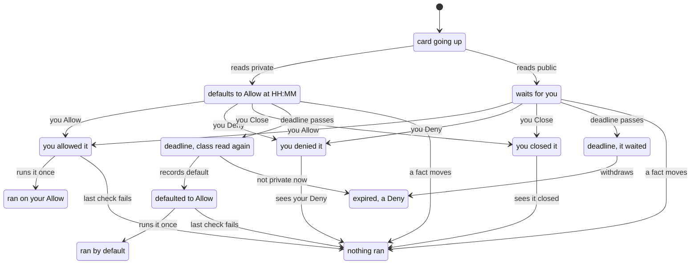

# An unanswered guard card for a private or local action counts as Allow

Written 2026-11-23 for bercail-mdfb, on top of the guard cards of
[shep-free-guard.md](shep-free-guard.md). How it works now is in
[docs/shep.md](../shep.md#guard-asks); this note keeps the reasoning.

Goal: a guard card nobody answers within its hour runs, as if allowed, when
what it runs stays private or local. Anything that publishes, spends, can't be
undone, or that the guard cannot class still waits for Simon and counts as a
Deny at the deadline, as today.

## No card where the repo opts in

Simon, 2026-11-23, in a later comment on the issue: in Lesentiel he does not
want to be asked at all for a trail link, a trail merge or a cleanup. This
folds in bercail-fcjs (a standing merge approval cannot reach the trail-merge
card) and bercail-23ek (a link asks where the policy says `push = branch`).

- A new policy key, `shep_may_run`, lists what Shep runs with no card in that
  repo: any of `"cleanup"`, `"trail link"` and `"trail merge"`. The default is
  `[]`. A non-empty list is looser than the default, so it counts only once
  Simon trusts that exact policy file (`bercail policy trust`), or sets it
  under `[policy."<path>"]` in his own config. He approves the opt-in once.
- In Shep's session, an ask that resolves to one of those operations, pinned as
  today, runs right away with a warning, instead of going to a card, when the
  pinned target's repo lists it and reads private (the same reading as below,
  without `merge_reversible`: the opt-in is the grant), and the call is alone
  in its message. What runs is the argv a card's worker would run (`runOf`), in
  its folder, put in Pi's bash input in place of Shep's words: a program named
  `bercail` or `entire` elsewhere never gets the grant, and the program goes by
  the real path the guard's reads found on `PATH`. A relative or empty `PATH`
  folder, or a relative helper path, goes to a card. Shep's environment must
  hold no git variable the pinning reads dropped. Pi's configured command prefix
  and `BASH_ENV` still run first, as for every Shep command: they are the
  person's own setup. The warning names the policy,
  the reading and what ran; Shep says so in its report.
- "trail merge" covers a trail job's `bercail job merge` only, as Simon named
  it: it checks the job and closes it. A bare `entire trail merge` goes to a
  card. It runs with no `--force`, so entire checks the trail's gates on the
  head it merges: a merge whose gates have not passed fails there.
- A cleanup counts only when its worktree's `origin` is private on its forge,
  as read below; an origin on this machine is not read so, and goes to a card.
- Anything else asks as before, and the timeout-Allow rule below stays for
  repos without the opt-in: a public remote, an unreadable one, a deploy, a
  release, a tag, a force push, a delete, a spend.

## The class

The worker classes the operation it pinned (`guardDefault` in guard.ts) before it
puts the card up, again at the deadline, and once more right before a default
runs. Each read is fresh; nothing is cached, and nothing it cannot read counts
as private.

| Operation | Defaults to Allow when | Else |
|-----------|------------------------|------|
| `bercail cleanup <worktree>` | always: it is local, and the branch stays | |
| a push | the repo's trusted policy says `merge_reversible = true`; it goes to that repo's own `origin`, one URL for fetch and push; Entire's pre-push hook, if on, sends checkpoints nowhere else; `origin` is on this machine or private | waits |
| a trail merge, `bercail job merge` | the repo's trusted policy says `merge_reversible = true`, and the change is in that checkout's own private Entire-native repo | waits |
| `entire trail link 
 --branch <b> [--base <b>]`, as `entire` itself, with no other `ENTIRE_BIN` | the same, for the checkout's `origin` | waits |
| any other command | never | waits |

Any card for a tag, a release, a deploy, a delete or a spend is a command card,
or one the guard refuses to pin, and never defaults.

**Private** is read from the remote, never the command's words:

- `github.com` over ssh or https: `gh repo view github.com/<owner>/<repo> --json visibility`, private only when it is `PRIVATE` (`INTERNAL` counts as public)
- `entire://…/et/<project>/<repo>`: `entire repo view <that URL> --json`, private only when it names that repo, gives its `repoId`, and `private` is `true`
- `entire://…/gh/…`, Entire's mirror of a GitHub repo: public, since GitHub's visibility says nothing of the mirror
- a path on this machine, for a push only: local
- any other host, a read that fails, or an answer in another shape: public

The `why` the worker reads names the repo by its forge's ID and URL ("it
merges app/7 in the private Entire repo et/acme/app (01M…, entire://…)"). The
card keeps it, and the default holds only while a later read gives the same
words: an `origin` moved to another private repo, another cluster, or a repo
replaced under the same name, waits.

Why each row is narrower than the issue's first reading (from the judge's
review):

- **One grant, one repo.** A trail can merge a change in another repo of its
  project (guard.ts `decideTrailMerge`), and a push can name another remote, so
  the checkout's `merge_reversible` speaks only for its own `origin`.
- **`merge_reversible` on every row but cleanup.** The issue's sentence reads
  either way; with it on every row, a push to the remote's real trunk (not only
  `main` or `master`) is covered without reading which branch that is. Lesentiel
  says `merge_reversible = true`, so its links and merges default.
- **Entire-native only for trails.** A trail lives in its project on
  entire.com; for a GitHub-backed project, who sees it is not read.
- **A link names its branch.** Without `--branch`, entire links the checkout's
  current branch, which can move while the card waits.
- **Checkpoints.** Entire's pre-push hook pushes transcripts beside a push, to
  `origin` or to `checkpoint_remote` (lib/doctor.sh). Elsewhere waits.
- **One origin.** A remote can fetch from one repo and push to another (a
  fork); the policy speaks for the checkout's repo, so `origin` must be one URL.
- **The same `entire`.** A link card runs its argv as written; it defaults only
  when that is `entire` itself, the binary the worker reads with.
- **An hour to answer.** A card defaults only when it went up with most of its
  hour left (50 minutes; a later card says it waits), its worker saw it pending
  in the 5 minutes before the deadline, and acts within 5 minutes after (the
  ledger: 10). A card that went up late, or a machine that slept through the
  deadline, gave the person no hour or a stale reading, so it counts as a Deny.
- **The project's audience.** Entire shows a repo's visibility, not its
  project's. For an Entire-native trail the repo's stands for the project's:
  that is Simon's to confirm.

What it does not promise: a git hook, the remote's own automation (a CI run, a
branch an Entire merge deletes once merged), or what the person's Allow would
also have done. It covers the operation and its checkpoints, once per card.

## The card

- The worker writes the class into the card: `guard.defaults` is `{why}`, or
  absent, and the brief ends "It defaults to Allow at 15:42: … because
  <why>" or "It waits for you: nobody answering by 15:42 counts as a Deny"...
  The panel's timer says "defaults to Allow in 42 min" or "waits for you; a
  Deny in 42 min".
- A card that said "waits for you" never defaults, even if the class reads
  private by the deadline.
- The person's Allow works as today, before the deadline only. Their Deny needs
  no live check and stands whenever the card is pending, even past the
  deadline: it grants nothing, and a slow check must not let the default win.

## At the deadline

1. The worker sees the card still pending past its deadline.
2. On a card that said it defaults, it reads the class and the facts again.
   Still private or local and unchanged: `bercail shep question guard-default`
   records the default under the ledger's lock. The ledger refuses it on a card
   that is not pending (the person's pick won the race), or not past its
   deadline, or that did not say it defaults. Any other read: the card is
   withdrawn as expired, a Deny.
3. A recorded default is claimed once (`guard-claim` accepts it), and the
   worker's checks before the run are today's plus the class once more. A class
   that no longer defaults then reports `expired`, and nothing runs.
4. The guard event says `"defaulted": true`. Shep's line reads "ran by default
   at its deadline: nobody answered, and it is private or local. Not the
   person's Allow", and SHEP.md tells Shep to say it that way.

The default's answer source is its own, `guard default at expiry`, not the
two-way doors' `default after timeout`: nothing waits for an OK or a Reverse
on it (it ran), and no code that reads Shep's defaults mistakes it for one.

## The states

From `tests/statechart/guard-card/`, projected by hand from its `chart/` (the
race where the person's pick lands just before the deadline is left out
here; the model has it).

## The model check

`tests/statechart/guard-card/GuardCard.tla`, checked on tla-ts by its
`check.sh`. The rules, in Simon's words:

- A command runs only on your Allow, or by default on a card that said it
  defaults to Allow and still read private or local, with nothing it acts on
  changed, at its deadline and right before it ran.
- It runs once at most.
- Your pick stands: a default never replaces it, and your Deny never runs.
- A card that said "waits for you" never defaults.
- Nothing defaults before the deadline, nor on a card you had no hour to see.
- The event says whether it was your Allow or a default.
- The worker ends, with its event, unless it died.

Each planted bug breaks its rule: a default that trusts the class read when
the card went up, a "waits" card that defaults, a default over the person's
answer, a default before the deadline, a run with no last class check, and a
card that went up late or slept through its deadline.

Left out: what the class is made of (tests/pi_guard_ask.test.ts has a case for
each row), the gap of a few seconds between the last check and the run (the
same one an Allow has today), and a run killed mid-way (`unknown`). A worker
that dies before its claim leaves a card that never defaults and counts as a
Deny; one that dies while it runs leaves `unknown`.

tests/guard_ask.bats has a case for each of the model's steps on the real
worker and ledger: a default that runs, a card that waits, one that no longer
reads private at its deadline or right before the run, an unreadable
visibility, the person's Deny first, a worker that dies, and a card that
went up late or slept through its deadline. tests/shep_question_cli.test.ts
has the ledger's side (the default refused before the deadline, on a card that
waits, on a changed reading, after the person's Deny, or on a card that went up
late; a Deny past the deadline with no live check), and tests/shep_mod.bats the
panel's (its timer, and Deny offered on a stale card).
