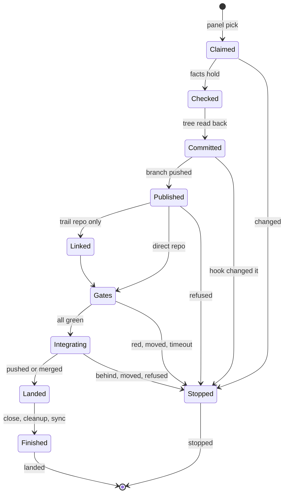
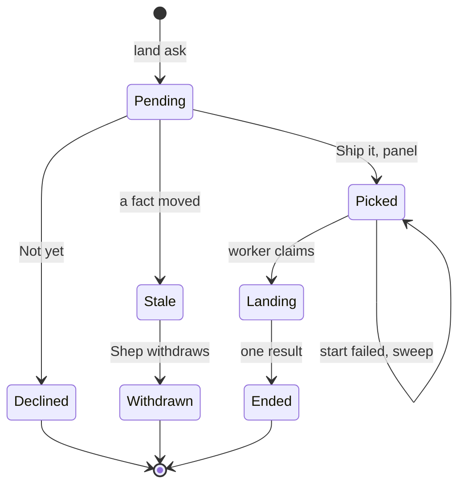

# One pick lands a job

Written 2026-11-21 against `9a71989` for bercail-fq7y. Plan only: nothing here
is built yet. The judge (GPT) reviewed a first draft; its review moved v1 to
direct integration on a fixed base, bound each step to one named effect, and
cut the inbox drops that could lose a real signal. Simon approved the plan and
its seven decisions on the panel (Q260), with one change: trail repos land as
step 8, right after v1 (section 10).

Goal: when a desk's change is ready, Simon picks once on one card, and a
model-free worker does the rest: commit, publish, CI, integrate, close the job,
retire the desk, sync main. Shep asks the card and reports the result, and
spends no turn in between. Shep's thread also gets lighter: a burst of picks
arrives as one message, the question call returns less, "waiting on you" is
read from the ledger, and the door check stops reading words.

State paths below are under `${XDG_STATE_HOME:-~/.local/state}/bercail`.

## Today

What 2026-11-21 shows, from `shep/questions.json`, `shep/delivered/` and
Shep's session file:

- **78 cards in a day.** 27 asked for a commit, 22 for a merge, 3 for a push and
  26 were planning picks. Each landed job took two or three cards: an LGTM or
  commit card, then a merge card asked after Shep's own commit (Q236 → Q237,
  Q244 → Q245, Q246 → Q249, Q248 → Q250), plus a second card when a pick went
  stale (Q224 → Q231, Q233 → Q234). bercail-0w3q is that staleness.
- **Each pick costs a model call and waits for one.** 76 picks reached the
  inbox within a second of the click. Each entered Shep's session as its own
  message, and Shep's model answered each one separately: Q231, Q230, Q229 and
  Q228, picked within 12 seconds of each other, became four messages with an
  assistant reply after each. The wait from pick to Shep's session had a median
  of 5 minutes, and the slowest tenth waited 30 minutes or more, up to 56
  (Q232). The inbox sends each drain as its own `followUp`
  (`shep/pi/inbox.ts:506-522`), and Pi delivers a follow-up only once Shep's
  current run has no tool calls left. That run is usually another job's chain
  of steps, so Simon's answer arrives in the middle of other work.
- **Landing is a chain of turns.** After a pick, Shep commits (`bercail land`),
  pushes, links, starts a watcher, asks the merge card, merges, closes the
  trail, kills the watcher, fast-forwards main and cleans up. Each step is its
  own model turn in Shep's one thread. The watchers report back as events.
- **Shep rebases by hand when the trunk moves.** Its session on 2026-11-20 and
  2026-11-21 shows it rebasing and cherry-picking desk commits onto scratch
  worktrees, comparing `git patch-id --stable` before and after, and sending
  a lesentiel desk to rebase twice because main moved (#52). Each is a model
  turn with its own rule for what may change.
- **Each call is heavy.** `shep_question` returns the whole question and its
  check, policy text included (`shep/pi/question-commands.ts:239`), about 6 KB a
  call. `bercail shep questions --json` prints the full ledger: 500 KB for 257
  questions, 3 of them pending. The guard's worker reads that snapshot on each
  poll (`bstack/pi/guard-ask.ts:228`).
- **Cards and chat disagree.** Shep listed decisions in chat with no card behind
  them (#47 and #48, mistake `decision-listed-without-card`). The board's
  "Waiting on the person" section (`lib/shep-context.sh:433`) lists desks and
  todos but not one pending card, so Shep writes that list from memory.
- **The door check reads words.** `door()` (`shep/pi/questions.ts:515`) makes a
  card one-way when its prompt, choices or brief contain a word such as
  publish, trail or clean. It refused `reversible` on the planning card for this
  plan three times, once for each of those words in a brief that only described
  the design.

Built already, and reused here:

- **A model-free worker and a panel-only card**, from bercail-q707
  (`docs/plans/shep-free-guard.md`). The guard's worker pins facts, puts up a
  card, claims an Allow once under the ledger's lock, classifies the operation
  again, and runs an argument vector it derives itself, in a cleaned
  environment (`bstack/pi/guard-ask.ts:102-156`).
- **`bercail land`** (`lib/land.sh`) commits the described tree and waits on
  CI in a background terminal. Shep still does everything around it.

bercail-5g8f, in progress on desk t2q8 (branch `trail-lifecycle`), adds
`bercail job merge trail:<n>`, which merges a trail's one open change and closes
the trail, as a guard-card operation. v1 below does not touch trails, so it
does not depend on 5g8f. Step 8 lands trails with `job merge` and does not
rebuild it, so step 8 waits for 5g8f on master.

## Design

### 1. Scope of v1

v1 lands one profile: **integration `direct` with a trusted `push = "main"`, on
the `gh` backend, with a trusted `required_ci` naming the workflows that must
pass.** `required_ci` is a new policy key: a list of workflow files, such as
`[".github/workflows/ci.yml"]`, whose push runs gate a landing. A repo opts in
by setting it. Policy trust covers it, as it covers `push`. bercail would be
the first.

Trail repos such as lesentiel come right after v1, in step 8 (section 10).
Every other repo keeps today's flow: a GitHub PR repo, a repo on `gt` or with
no policy, and a repo whose policy asks about the trunk push. `bercail land`
and its cards stay for those, and so does bercail-0w3q's fix (see
"Decisions").

The base is fixed. The change Simon picks is the change that lands, byte for
byte. If the trunk moves while the card waits or while CI runs, the chain stops
at `behind`, and the desk rebases its staged change for a new card. Two jobs
can wait on CI at the same time. If both are based on the same trunk commit,
the first lands and the second stops.

### 2. One land card per job

When a desk finishes and its description checks out, Shep runs one command:

```bash
bercail land ask <worktree>
```

It checks the description (`bercail describe check`), checks that the repo has
the v1 profile, pins the facts below, and creates a card of a new kind, `land`,
through the ledger's `land-create`. It prints one line: the token, the choices,
and whether the change needs an LGTM and why. Shep tells Simon in a line, and
its turn is over. `shep_question` does not take kind `land`.

`land ask` refuses, with the reason and the fix, when:

- the repo is not the v1 profile: use today's flow
- the worktree is the repo's main checkout, or its branch is the trunk or is
  not the branch in the job's handoff record: land a desk's own branch
- the description is missing, or its tree is not the staged tree: the desk
  runs /validate
- HEAD is not the trunk's current commit on the remote: the desk rebases its
  staged change onto the trunk and runs /validate again. So the tree Simon
  reviews is the tree that lands
- a workflow in `required_ci` is not among the repo's workflows on GitHub
- a land card for this worktree, branch or job is pending or running

**Pinned when it asks:**

| Fact | Read from |
|------|-----------|
| the worktree's registered real path, its branch as a full ref, HEAD | `git worktree list`, git |
| the staged tree, and nothing unstaged or untracked | `git write-tree`, `git status` |
| the description's tree and the hash of its commit text | `.bercail/description.md` |
| the trunk, the remote's one push URL (as in `docs/shep.md#guard-asks`), the GitHub repo it names, and the trunk's commit there | `git_backend_trunk`, `git ls-remote` |
| the policy as read, with its trust, and a hash of it | `bercail policy show --json` |
| the required CI gate: each `required_ci` workflow's database ID | `gh workflow list --repo <repo> --json id,path` |
| the installed `bercail`, by its real path | `BERCAIL_SELF` |
| review: `required` with its reason, or `none` | `describe check --json` |
| the reviewer, when review is required: the person's global `user.name` | `git config --global` |
| the job's beads issue, and the desk, its space and session | the handoff record, `desk-sessions` |

**What the card shows:** the space, the description's title, the size and
stakes, and each effect the pick allows, written out with its target:

> Commit tree `1b5f46c` on `one-pick-landing-plan` (parent `9a71989`). Push it
> to `git@github.com:simoncrypta/bercail.git` as `one-pick-landing-plan`. Wait
> for CI (`ci`, `lint`) on that commit. Push the same commit to `master` there.
> Close bercail-fq7y. Clean up the desk and its worktree. Fast-forward the main
> checkout to it.

The choices are **Ship it** and **Not yet**. When review is required, the first
reads **LGTM, ship it**. The brief names the `high_stakes` paths and the
reviewer the commit will name. The `Reviewed-by` trailer is a record of who
picked, as it is today, not a verified identity: any program running as Simon
can change his git config. There is no recommendation and no default.

**Rules:**

- **Panel only.** The ledger takes a pick only from `panel picker`, like a guard
  card. Discuss can talk but cannot pick, since an agent can type into a
  Discuss terminal (`docs/shep.md#a-push-your-answer-approves`).
- **One-way.** A land card publishes, so it never takes `reversible`.
- **No expiry.** Simon may take hours over a review in tuicr. Each pinned fact
  is checked again at the pick and before each effect.
- **Fresh or stale.** `checkQuestion` for kind `land` compares every pinned
  fact. It has no one-commit allowance, since the chain makes its own commit.
  On a stale card the panel offers no pick, and Shep asks again once the desk
  is ready.

### 3. The chain, run by a worker

A pick on the panel records the answer. Right after that, the ledger's `answer`
starts the worker:

```bash
hc run --bg --name land-<Q>-<rev> --outlive-parent --no-notify --rm -- \
  env BERCAIL_ROLE=shep XDG_STATE_HOME=... bercail land run <Q>@<rev>
```

It uses the same environment prefix as `bercail land`'s waiter
(`lib/land.sh:44`), with the pinned `bercail` path rather than the one on
`PATH`. Before `hc run`, the ledger records a start reservation under its lock:
the terminal's name and the time. Until a claim, the card reads "picked;
waiting for its worker". `bercail shep question expire`, which runs every 30
seconds while Shep is up, looks at every positive pick with no claim. When its
reserved terminal is gone (`hc get` says so; an `hc` that cannot answer counts
as not known, and the sweep waits), the sweep reserves again and starts a new
worker. That covers a crash between the pick and `hc run`, an `hc run` that
failed, a worker that died before its claim, and a reboot. The claim is still
the only way in, so a second worker never runs a spent pick. Nothing runs
before the pick, so a card that waits hours costs no process.

`bercail land run` is bash beside `lib/land.sh`, with no Pi and no model. Its
steps:

1. **Claim** under the ledger's lock (`land-claim`). The claim needs the token
   and revision, kind `land`, `panel picker`, the positive choice (**Ship it**
   or **LGTM, ship it**), an unspent answer, and no other running chain for the
   same worktree, branch or job. A claim that fails runs nothing: a declined
   card never runs, even if a worker was started by hand.
2. **Check** every pinned fact again, and `describe check`. A difference stops
   the chain at `changed`.
3. **Each effect**, in order, checks its own facts again right before it runs,
   and stops the chain at `changed` or `refused` when they do not hold:

| Effect | Runs | Holds only if |
|--------|------|---------------|
| commit | `git -C <dir> commit -F <description text>` with `Reviewed-by` when the card asked for an LGTM | the index is the pinned tree. Afterwards the commit's tree, single parent and message are the pinned ones, or the chain stops at `unknown`: a hook changed it |
| branch push | `git -C <dir> push --no-follow-tags --recurse-submodules=no <URL> <sha>^{commit}:refs/heads/<branch>` | the branch is not the trunk and is the pinned one. The guard's own push resolution and pinning, as its worker does it (`guard-ask.ts:221-235`, `guard.ts:2832-2869`), gives the same git dir, the same URL with no rewrite, and the same refspec. The policy and its trust are unchanged, and `decideLive` as role `shep` says `allow` |
| CI | `gh run list --repo <repo> --commit <sha> --branch <branch> --event push --json workflowDatabaseId,headBranch,headSha,attempt,status,conclusion`, every 30 seconds for up to two hours | for each required workflow ID, the latest attempt of its run on that branch and commit is completed with conclusion `success`. A missing required run, or skipped, neutral, red or still running, is not green. A list that may be cut short (as many runs as the limit) is not green either |
| trunk push | `git ... push ... <URL> <sha>^{commit}:refs/heads/<trunk>`, with no force | the trunk on the remote is still the pinned commit, and CI is still green on a second read. The same push resolution gives the same git dir, URL and refspec. The policy still says trusted `push = "main"`, `integrate = "direct"` and the same `required_ci`, and `decideLive` says `allow` |
| close | `bd close <issue>` in the pinned repo, with a comment naming the commit | the issue is the pinned one and still open |
| cleanup | `bercail cleanup <real path>` | the path is still a registered worktree on the pinned branch at the landed commit, with the pinned desk, space and session. The guard's resolution of this command gives the cleanup operation with exactly those facts, and `decideLive` asks about it. That one operation is what the card named, so its ask is the expected answer here, and no other ask is |
| sync | `git -C <main> merge --ff-only <sha>` | the main checkout is on the trunk and clean, and its HEAD is an ancestor of the landed commit |

   `decideLive` is a veto, not a permission. Each effect names the one answer
   it expects. Any other answer, or a lookup it cannot read, stops the chain.
   No `ask` runs except the cleanup the card named. Every command is a fixed
   argument vector built from the pinned facts, never text Shep wrote, run in
   the guard's cleaned environment (`cleanEnv` in `guard.ts`) with stdin
   closed, in its own process group, each with a time limit. The repo's git
   hooks and credential helpers run, as they do for `bercail land` and every
   desk's commit today, so they are trusted code. The commit is read back to
   catch a hook that changed it, but that cannot undo what a hook did.
   `--no-verify` and force stay refused.
4. **Integrate** under a per-repo lock (`land/<repo-hash>.lock`). The lock keeps
   two workers from pushing the trunk at once. It does not stop a person or
   another tool from pushing, and the trunk push is not forced, so a trunk that
   moved meanwhile makes it fail with `behind`.
5. **Record one result** under the ledger's lock: the outcome, the last effect
   that ran, the commit, any warnings, and the log's path. Then write the event
   and mark the result `told`, as a default's event is today
   (`shep/pi/discuss.ts:247-266`). `question expire` repairs only a result that
   is not `told`. It writes the event when neither `inbox/` nor `delivered/`
   has it, then marks it `told`. So a worker that dies between the record and
   the event loses nothing, and an event already delivered and later pruned is
   never sent again.

Each effect's output goes to `land/<Q>-<rev>.log`, mode 0600. The worker writes
each effect to the ledger as it starts (`land-step`), so the card reads
"landing: waiting for CI (2 of 3 runs passed)" until the chain ends.



The chart covers both profiles. For a direct repo, Gates is the `required_ci`
workflows, integrating is the trunk push, and close is `bd close`. For a
trail repo (section 10), the branch is linked to its trail
first, Gates is the trail's blocking gates, and integrating is `bercail job
merge`, which also closes the trail, so close only reads it back. In both, a head or base that moved stops
the chain before it integrates.

**What stops the chain, and what it reports:**

| Outcome | When | Already done |
|---------|------|--------------|
| `changed` | a pinned fact moved after the pick | nothing, or the effects before it |
| `refused` | `decideLive` gave an answer other than the effect's expected one, or a lookup failed | the effects before it |
| `ci-failed` | a required workflow is red, skipped or neutral; on a trail, a blocking gate failed | commit and branch push (and the link) |
| `ci-timeout` | no complete result in two hours; on a trail, a blocking gate still pending, named in the event | commit and branch push (and the link) |
| `behind` | the trunk moved before or during the trunk push; on a trail, the change conflicts with its base or fails its up-to-date gate | commit and branch push (and the link) |
| `push-failed` | a push failed for another reason | the effects before it, as the log shows |
| `unknown` | a hook changed the commit, a step was killed or ran out of time, or the worker died after its claim | something may have happened: the log and the ledger's last step say how far it got. Nothing is retried |
| `landed` | the trunk push succeeded, or the trail's change merged at the pinned commit | all of it. A close, cleanup or sync that did not hold is a warning on `landed`, and that part is left as it was |

A stopped chain never retries itself or replays an effect. Shep reads the
event and decides, for instance by sending the desk its failed run.

**A worker that dies.** `question expire` checks a claimed card with no
result. If `hc get land-<Q>-<rev>` says the terminal is gone, it records
`unknown` and tells it as above. If hc cannot answer, it records nothing and
checks again next time: no answer is not the same as gone.

### 4. The card's life



A stale card is withdrawn, and Shep asks a new one once the desk is ready
again. **Not yet** writes a decision event, so Shep knows; Simon may say why in
Discuss, and closing Discuss sends its event as today. The result takes the
card off the panel and stays in the ledger.

### 5. What Shep gets

Only the outcome: one event, written from the ledger's record and from fields
alone, as the land and guard events are today:

```json
{"source":"bercail","schema":"bercail.land/v2","kind":"land","sink":"shep",
 "event_id":"land:Q260@1","question":"Q260@1","repo":"bercail","issue":"bercail-fq7y",
 "branch":"one-pick-landing-plan","commit":"<sha>","trunk":"master",
 "outcome":"landed","step":"sync","warnings":[],"runs":[...],
 "log":"<state>/land/Q260-1.log"}
```

`eventLine` writes Shep's line from these fields: "bercail-fq7y: Decisions:
one pick lands a job landed on master as `<sha>` in bercail. Tell the person
in one line." A **Ship it** pick writes no decision event. The worker acts on
it, and the land event is what Shep reports.

Shep's turns for one job go from about ten (ask, commit, push, link, watcher,
merge card, merge, close, cleanup, sync, report) to two: ask the card, and
report the outcome.

### 6. A burst of picks in one turn

Simon's report: "the answer gets mixed with a bunch of other threads in Shep."
The record agrees: each pick enters a busy thread as its own message and costs
its own model call. The land worker removes most picks from Shep's thread. For
the picks that are left, the inbox stops sending while Shep is busy:

- While Shep's run is going, the inbox still claims ready files as today, but
  calls `sendMessage` only once, at `agent_settled`, with everything ready.
  Desk events go first and decisions after, as `eventMessage` already splits
  them. When Shep is idle, it sends as today, after the existing 200 ms
  (`inbox.ts:534`).
- Nothing is dropped and the receipts do not change: one event id gives one
  line, and claims, persistence checks, replay and pruning work as they do now.

So four picks in twelve seconds while Shep works become one message and one
model call, delivered when the run ends, which is when Pi would have delivered
the first of them anyway.

The issue also asks for one event per already-handled pick. The ledger already
gives that: an answer writes one decision event, whose file name follows from
its id, so a retry is the same event and the inbox keeps one (`inbox.ts:506`).
A land card's pick writes none (section 5). The late duplicates seen on
2026-11-21 came from the CI watchers and background Sheps around a landing.
The land worker replaces those for a v1 repo, so v1 adds no drop rule. Late
duplicates from the watchers that remain are under Later.

### 7. A lighter question call and listing

- **`shep_question` returns** `{token, status, deadline, door, check: {status,
  reasons, warnings}}`, with each reason and warning cut to 300 characters. The
  full question and check stay in the tool result's `details`, which the TUI
  shows and the model does not see. `bercail shep question check <token>` keeps
  printing the policy for a person or Shep that asks for it.
- **`bercail shep questions --json`** prints what waits on the person: pending
  cards and defaults not yet OK'd or reversed, under `pending`. Land cards
  still running are under their own `landing` key. `--all` prints the full
  snapshot as today. `lib/shep.sh:462` routes both,
  and the help text says so.
- **`bercail shep question get <token>`** prints one revision. The guard's
  worker polls with it, not with the internal `question json`.

### 8. "Waiting on you" from the ledger

- **The board** (`bercail shep board`) adds a `Decisions:` block under
  "Waiting on the person", from the same `pending` list as `questions --json`:
  one line per pending card (its space and prompt, and "two-way door: defaults
  in N min" where it has a deadline) and per default not yet OK'd. A reversal
  waits on Shep, not the person, so it is not listed. Once section 2 exists, a
  separate `Landing:` line lists each running chain with its step.
- **Shep's reply** ends with that block, written by the question extension as a
  TUI-only entry (`pi.appendEntry` with a renderer, which Pi does not send to
  the model) at `agent_settled`, whenever the block's text changed since the
  last one. The model never writes it.
- **SHEP.md:** never list pending decisions in your own words. A decision with
  no card is not one. Ask it with `shep_question` or `bercail land ask` first.

### 9. The door from the card, not its words

The door comes from what the card can do: its kind, its action, and whether it
carries a push. No word in the prompt, choices or brief changes it.

| Door | When |
|------|------|
| one-way | kind `review` (its answer is an LGTM) |
| one-way | kind `guard` or `land` |
| one-way | a card with `push` |
| one-way | an action other than `commit`, `merge` or `land`, or any action on a planning card |
| two-way or one-way | action `merge` or `land`: two-way only where the trusted policy says `merge_reversible = true` |
| two-way | action `commit` |
| two-way | a planning card with no action |

The word rows (`ONE_WAY`, `MERGE` and `COMMIT` at `shep/pi/questions.ts:488`)
go. This gives up some defense in depth. Today "Delete the old branch?" is
one-way. After this change it is a two-way planning card that can default, and
the guard lets Shep run `git branch -D` or `bd close` with no ask. Pushes,
cleanup and trail merges still go to a guard card, and a default can never
approve a push. So the new rule is that **a default authorizes only its card's
own action**: a local commit on an action `commit` card, or a merge on an
action `merge` or `land` card where the trusted policy says `merge_reversible`.
A planning card's default decides a plan, an order or a scope, and authorizes
no write. The default's inbox line (`inbox.ts:77-81`), the expire path
(`questions.ts:816-836`) and SHEP.md say so. It is a rule in Shep's prompt,
not a boundary the code enforces.

### 10. Trail repos, right after v1

Step 8 lands a trail repo, such as lesentiel, from one land card too. The
profile is backend `entire`, with a trusted policy whose `push` lets a branch
push through (`branch` or `main`) and `integrate = "pr"`, where the trail is
the PR. Lesentiel's policy file says `push = "branch"` but is not trusted
today, so each of its pushes asks. It needs `bercail policy trust` once,
which is Simon's to run. `required_ci` is not used: the trail's blocking gates
are the gate.

**What `land ask` pins on top of section 2:**

- the project and trail (Entire ID and number), and its change as
  `<repo>/<n>` with branch and base when it is already linked
- the trail's base, which must be the trunk, and the trunk's full SHA on the
  remote
- the set of blocking gates the change carries (`gate_key`, `gate_type` and
  `gate_definition_id`). It must include at least one CI gate, a plugin or
  checks gate such as lesentiel's `rwx`. A trail with none is refused, for the
  reason under the merge effect below

**Two shapes of candidate.** `land ask` accepts one of these and refuses
anything else:

- **A plain commit**, as in v1: HEAD is the pinned trunk SHA, and the staged
  tree becomes one commit on it.
- **Main merged in**, today's #44 case. The branch already holds commits that
  were reviewed and pushed, and the trunk has moved past their base. The desk
  runs `git merge --no-commit origin/<trunk>`, resolves what conflicts, and
  stages the result without rewriting the branch. `land ask` pins HEAD, equal
  to the branch on the remote, and exactly one `MERGE_HEAD`, equal to the
  pinned trunk SHA. It also pins the full staged tree and the description.
  The part Simon reviews is every staged difference from git's own merge,
  `git merge-tree --write-tree HEAD MERGE_HEAD`: the hand resolution, and
  anything else the desk changed while merging. For #44 that was 17 lines in
  two files. When `merge-tree` exits 1 for conflicts, its tree still holds the
  conflict markers, and the diff is taken against that tree. Any other exit
  refuses. The card shows that diff, its size and stakes, and the commits
  already on the branch. The pick and the commit each check HEAD, `MERGE_HEAD`,
  the tree and the trunk SHA again. The commit must read back as a merge with
  exactly HEAD then `MERGE_HEAD` as parents, the pinned tree and the
  description's message, before anything is pushed. It descends from the
  pushed branch, so its push is not forced.

**A card behind each commit on the branch.** These are the commits in
`<pinned trunk>..HEAD`. Each must be one of two things:

- One commit whose tree and single parent are exactly the tree and HEAD that a
  card approved: a review or land card for the same repo, trail and branch,
  answered on the panel with its positive choice (an LGTM or Ship it).
- A merge that an earlier land card made. Its result records the merge's SHA,
  both parents and the tree.

For #44, `b322181` is Q252's approved tree on its parent `507c07d`. Any other
commit is refused, with the commit named. That includes a merge approved on
an older action card such as Q261, which kept no `MERGE_HEAD`: it takes a new
review, or today's path.

This is the one place step 8 differs from v1's fixed base. Merging the trunk
in needs no force push and keeps every reviewed commit as it was, and the card
asks only about what a person wrote. A rebase would rewrite the reviewed
commits, which v1 refuses.

**Effects, after the commit and the branch push of section 3:**

| Effect | Runs | Holds only if |
|--------|------|---------------|
| link | `entire trail link <trail> --project <project> --branch <branch> --base <trunk> --idempotency-key land:<Q>@<rev>`, only when the branch is not linked yet | the trail is the pinned one and open. Afterwards, `entire trail show` lists the change on that branch and base. The worker records its `<repo>/<n>` with `land-step`. An existing link must already have that branch and base |
| gates | `entire trail show <repo>/<n> --project <project> --json`, every 30 seconds for up to two hours | each read is of the pinned trail, branch and base. The change's `mergeability.head_sha` is the full pushed SHA, `conflict_status` is `clean`, and `mergeable` is true. The trunk on the remote (`git ls-remote`) is still the pinned SHA. The blocking gates are the pinned set, each either `passed` and evaluated at that SHA, or `skipped` with state `disabled`. Nothing else counts: a gate with no evaluation, one evaluated at another SHA, or a set that changed. A failed gate gives `ci-failed`. A conflict or a moved trunk gives `behind`. Another head or another gate set gives `changed`. Still not ready after two hours gives `ci-timeout`, naming the gates |
| merge | `bercail job merge trail:<n> --change <repo>/<n>` (5g8f), which merges and then closes the trail when no other change is open | a read just before shows everything the gates row checks. The guard asks about a trail merge for Shep, and this card named this one, so that ask is the expected answer here. Afterwards the change reads merged at the pinned SHA, or the chain records `unknown` with both heads |
| cleanup, sync | as in section 3. Sync fast-forwards the main checkout to the trunk on the remote, only when that contains the pinned commit | as in section 3 |

**The merge takes no expected head.** `entire trail merge` (0.13.4) merges
whatever head the change has, and `job merge` may close the trail in the same
command. So the worker can detect a wrong merge but cannot prevent it. Two
things narrow the gap. The read just before the merge is seconds old. And a
commit pushed in those seconds has no CI result yet, so the trail's blocking
CI gate, which `land ask` requires, leaves it unmergeable, and Entire refuses
the merge. This is the gap Simon accepted for the guard card's trail merge
(`docs/shep.md#guard-asks`). Once Entire takes an expected head, the merge
passes it. Asking Entire for that is a todo in the report. The judge would stop
before the merge until then. Simon's Q260 asked for the merge, and the guard
card ships the same gap, so step 8 keeps it.

The issue is not closed separately: `job merge` closes the trail. When the
trail still has another open change, it stays open, and `landed` carries a
warning that names that change.

**Stacked trails.** A change whose base is another trail's branch is not
landed on its own. `land ask` refuses it and names the trail it sits on. The
base trail lands first, from its own card. For a native trail such as
lesentiel's, merging the base can move the open trails based on its branch
onto the trunk. That happens only when the server deletes the branch, and only
for the trails it can move (`entire agent-help trail merge`). A GitHub-backed
trail is left to GitHub. Shep reads the stacked change's base in `entire trail
show`. Only when it is the trunk does Shep ask the change's own card, after the
desk merges main in where needed. Its branch-only commits are then checked as
above, against the new base. Each change takes one card.

## Risks

- **More stops than today.** On a fixed base, a busy trunk stops landings that
  Shep would have rebased by hand. Each stop costs a desk rebase and a new
  card. The stop is the honest outcome, since what Shep's rebase landed was
  never reviewed. If the stops turn out to be common, a rule for a moved trunk
  can follow (see Later).
- **The worker pushes and cleans up outside Pi.** The guard sees no tool call.
  What holds instead: the pinned facts, the claim, one expected guard answer per
  effect, the fixed argument vectors, the read-back commit, and `land-create`
  as the only way to make a land card, behind a description check. Step 5 puts
  `lib/land.sh` and `shep/pi/questions.ts` under `high_stakes`.
- **The seconds before each effect.** Between an effect's last check and its
  run, a person or another tool can push the trunk or change the remote's
  config. The non-forced push catches a moved trunk. A config rewrite in those
  seconds is the same gap the guard card has today.
- **A trail merge takes no expected head** (section 10). A commit pushed to the
  branch in the seconds before the merge could be merged, if the trail's CI
  gate somehow passed on it in time. The chain would then report `unknown`
  with both heads, after the fact. The guard card has the same gap today.
- **A merge-in card trusts git's own merge.** The reviewed diff is the staged
  tree against `git merge-tree`'s result. What git merged cleanly from the
  trunk is not shown, as with any merge of main today. The trail's gates run on
  the merge commit before it lands.
- **The CI gate is what the policy names.** A workflow left out of
  `required_ci` can be red and the change still lands. A workflow that runs
  only on PRs cannot be in it, since v1 reads push runs.
- **Two hours of CI per job, in parallel.** Each worker is one hc terminal that
  sleeps between polls.
- **The environment.** Like the guard's worker, the land worker runs in the
  Herdr server's environment plus a prefix. It needs the server's SSH agent or
  credential helper for pushes, and `gh` logged in.

## Decisions

Simon approved all seven on the panel (Q260, "Approve, and add Lesentiel's
trails as a step right after v1"). The first two read as amended by that
pick.

1. **v1 is direct integration only**, on a fixed base, as in section 1. Trail
   repos, lesentiel among them, follow right after as step 8 (section 10).
   GitHub PR repos, repos on `gt` and repos with no policy keep today's flow.
2. **bercail-0w3q is still needed until step 8 lands**, and after that only
   for the repos that keep today's cards. Until step 8, lesentiel lands
   through the commit and merge cards. The cases named for it were all there:
   Q213, Q224 and Q233, and today Q261 on #44, which went stale after Shep
   committed its approved merge. Its fix is built now as its own job, beside
   steps 1 to 5.
3. **Panel-only LGTM.** A review-required change takes its LGTM only from a
   panel pick on the land card. Today a Discuss pick can be an LGTM.
4. **No default on a land card**, even where `merge_reversible = true`.
5. **A default authorizes only its card's own action** (section 9): a local
   commit, or a merge where `merge_reversible` says so. Shep's prompt enforces
   it, not the code.
6. **`shep/pi/questions.ts` becomes high stakes** along with `lib/land.sh`. It
   already holds the door, the push approval and the guard card's claim, so
   every change to it would then wait for your review.
7. **`required_ci`**, a new policy key, as the only source of the CI gate. The
   other way, inferring it from the trunk's past runs, cannot tell a required
   check from an optional one.

## Steps

Each step lands on its own, ends green, and has tests that fail on master.
Steps 1 to 5 do not depend on each other. Step 6 needs 5, and step 7 needs 3
and 6. Step 8 comes right after v1 (steps 5 to 7). It also needs 5g8f's
`bercail job merge` on master, and lesentiel's policy trusted.

1. **A lighter question call** (section 7). `shep/pi/question-commands.ts`,
   `shep/pi/question-cli.ts`, `lib/shep.sh`, `lib/help.sh`,
   `bstack/pi/guard-ask.ts`, `docs/shep.md`. Tests:
   - `shep_question`'s text has the token, door and check status and none of
     the policy. It stays under 1 KB with a long brief and long warnings, and
     `details` still has the full question and check
   - `questions --json` with pending, answered, withdrawn, superseded,
     defaulted and reversed cards lists only the pending cards and the
     defaults not yet OK'd; `--all` lists everything
   - `question get` prints the exact revision and refuses an unknown one
   - in a guard-ask bats test with a real ledger, the worker's logged argv
     shows `question get <token>` on each poll, and one Allow runs the operation
     once

   No `high_stakes` path.
2. **The door from the card** (section 9). `shep/pi/questions.ts`,
   `shep/pi/inbox.ts` (the default's line), `docs/shep.md#reversible-questions`,
   `shep/SHEP.md`. Tests:
   - one per table row
   - this plan's planning card, whose brief says publish, trail and clean, is
     two-way
   - a review card, a guard card and a card with `push` stay one-way whatever
     their words say
   - an action `deploy` card is one-way, and an action `commit` card whose
     brief says push is two-way
   - the default's inbox line says it authorizes only the card's own action:
     on a planning card, no write

   No `high_stakes` path today. After step 5, `questions.ts` is one.
3. **"Waiting on you" from the ledger** (section 8). `lib/shep-context.sh`,
   `shep/pi/question-commands.ts`, `shep/SHEP.md`, `docs/shep.md`. Tests:
   - the board's block lists the pending cards, stale and unavailable ones
     included, and the defaults not yet OK'd. It lists no reversal, and says
     `- nothing` once the last card is answered
   - the settled entry is written when the block's text changes (a new card, a
     countdown, a status), and not when it stays the same
   - in a live Pi proof, the entry is in the session file and not in the next
     model request

   No `high_stakes` path.
4. **A burst of picks in one turn** (section 6). `shep/pi/inbox.ts`,
   `docs/shep.md#desk-events`. Vitest cases with a fake clock and a fake Pi that reports busy:
   - two distinct events 1 second apart while busy arrive as one message with
     both ids, after `agent_settled`, and both get receipts. On master they are
     two messages
   - while idle, an event is sent after 200 ms as today
   - a crash between claim and send replays as today, and a conflicting claim
     is held
   - a Reverse, a Discuss close and a guard outcome that arrive together all
     reach Shep

   No `high_stakes` path.
5. **The land card's plumbing, inert.** In `shep/pi/questions.ts`: kind `land`,
   `land-create`, `land-claim`, `land-step` and `land-result`, and its check in
   `shep/pi/question-target.ts`. The `required_ci` key in `lib/policy.sh`, with
   `docs/config.md`. In `.bercail/policy.toml`, `lib/land.sh` and
   `shep/pi/questions.ts` join `high_stakes` (if Simon agrees to item 6), before
   any land code lands. Nothing creates a land card yet, so there is
   nothing for Simon to pick. In `bstack/pi/extensions/guard.ts`: refuse
   `bercail land run` and the ledger's `land-create`, `land-claim`, `land-step`
   and `land-result` for every agent, Shep included. Tests:
   - each pinned fact that changes makes a card stale, and one commit of the
     tree does too
   - a claim needs kind `land`, `panel picker`, the positive choice, the right
     revision and an unspent answer. It refuses a declined card, a Discuss
     pick, a second claim, and a second running chain for the same worktree,
     branch or job
   - a start reservation is recorded once per attempt under the lock, and a
     claim after it still needs everything above
   - `land-result` records once, and a second result is refused. `told` is set
     once
   - the guard refuses each raw route as `shep`, as a desk and as `shep-bg`
   - `required_ci` must be a list of workflow paths. Untrusted, it does not
     count

   **High stakes:** `bstack/pi/extensions/guard.ts`, `lib/policy.sh` and
   `.bercail/policy.toml`.
6. **The land card and its worker, for direct repos** (sections 2 to 5).
   `lib/land.sh` (`land ask`, `land run`), the `answer` path and the `expire`
   sweep in `shep/pi/question-cli.ts`, the panel in
   `bercail/mods/bercail-shep/main.js` (choices, progress), and the land event
   in `shep/pi/inbox.ts`. Bats tests with real git repos and a local bare
   remote, stand-in `gh`, `hc` and `bd` at the process boundary, a fixed clock,
   and a barrier, not sleeps, where two workers race. Each test checks the
   ledger's result and the remote's refs:
   - `land ask` refuses each case in section 2, and pins each fact. In the
     main checkout, with a staged and described change and HEAD on the remote
     trunk, it refuses, and nothing is pushed even when `land run` is started
     by hand on a forged card
   - `landed`: one commit with the pinned tree, parent and message on the
     branch and the trunk, the issue closed, the worktree gone, main
     fast-forwarded, one event, and no decision event for the pick
   - `changed` for each fact moved after the pick: the tree, the index, HEAD,
     the branch, the description, the policy, the remote URL, the desk
   - a hook that changes the commit gives `unknown`, with nothing pushed
   - `ci-failed` when a required workflow is red while an optional one is
     green, and when a green attempt is followed by a red rerun. `ci-timeout`
     when a required one never appears, when it is green only on another branch
     at the same commit, and when the run list is as long as its limit. The
     trunk is unchanged in each
   - the trunk moves after CI: `behind`, and the trunk is the other commit
   - two chains on one trunk commit: one `landed`, one `behind`
   - `decideLive` answering `ask` for the trunk push gives `refused`, with the
     trunk unchanged
   - two workers on one pick run the chain once
   - a declined card with a worker started by hand runs nothing
   - cleanup that does not hold gives `landed` with a warning, and the worktree
     is kept
   - the sweep starts a worker for a pick with no reservation (a crash before
     `hc run`), for a failed `hc run`, and for a worker that died before its
     claim. It records `unknown` when the claimed worker is gone, and nothing
     when `hc` cannot answer
   - a crash after the result and before the event, and one after the event's
     rename into the inbox, each give one event. After the receipt is pruned,
     the sweep sends nothing
   - the event's line is written from fields only, and a malformed event is
     dropped

   **High stakes:** `lib/land.sh` and `shep/pi/questions.ts`, after step 5.
7. **Shep's flow.** `shep/SHEP.md` Shipping: for a v1 repo, `bercail land ask`
   replaces the description check, `land`, the branch push, the push card and
   the trunk push. For every other repo the section stays as it is. Also
   `docs/shep.md#landing-a-change`, `lib/help.sh` and `docs/cli.md`. The
   existing help tests cover the text. No `high_stakes` path.
8. **Trail repos** (section 10). `lib/land.sh` (the trail profile, the link,
   gates and merge effects), `shep/pi/question-target.ts` (the trail facts, the
   merge-in candidate and its reviewed diff, and the card behind each branch
   commit), the panel in `bercail/mods/bercail-shep/main.js` (the hand
   resolution's diff and the commits already on the branch), `shep/SHEP.md`
   Shipping for trail repos, and `docs/shep.md#trails-as-jobs`. Bats tests in
   the style of step 6, with a stand-in `entire` that keeps a trail's changes,
   heads and gates in a file:
   - `landed`, plain: one commit, the branch pushed and linked to the trunk
     with the land's idempotency key, gates read at that commit, `job merge`
     run once with the pinned `<repo>/<n>`, the trail closed, the worktree
     gone, main fast-forwarded
   - `landed`, main merged in (#44): a merge commit with exactly HEAD and
     `MERGE_HEAD` as parents and the staged tree. The card's reviewed diff is
     only the hand resolution. The earlier reviewed commit is unchanged, and
     the push is not forced
   - `land ask` refuses: a branch commit with no card behind it; one whose
     card was declined, answered in Discuss, or for another repo, trail or
     branch; an old action-card merge with no `MERGE_HEAD`; a `MERGE_HEAD`
     that is not the trunk on the remote, or two of them; a `merge-tree` that
     exits above 1; a link with another branch or base; a trail with no
     blocking CI gate; and a stacked change, naming the trail it sits on
   - a conflicted `merge-tree` (exit 1) gives a reviewed diff against its
     tree with the markers, and the card shows it
   - `MERGE_HEAD`, HEAD or the trunk moved between the ask and the pick, or
     between the pick and the commit: `changed`, and nothing is committed
   - `ci-failed` for a failed blocking gate; `behind` for a conflict or for the
     trunk moving during the gates; `changed` for another head or another gate
     set; `ci-timeout` for a gate with no evaluation or one evaluated at
     another SHA, naming it. In each, `job merge` never ran
   - the head moves after the last gate read and before the merge: the read
     just before the merge sees it, the chain stops at `changed`, and `job
     merge` never ran
   - a stand-in `job merge` that merges another head: `unknown`, with both
     heads in the event
   - the base trail lands but its stacked change is not moved onto the trunk:
     `land ask` on the stacked change still refuses
   - another open change on the trail: `landed`, with the trail kept open and
     a warning naming that change
   - the trunk-push effect of v1 never runs for a trail repo, and the link,
     gates and merge effects never run for a direct repo

   **High stakes:** `lib/land.sh`, and `shep/pi/questions.ts`, whose land
   result also keeps a merge's SHA, parents and tree.
   `bstack/pi/extensions/guard.ts` is not touched: 5g8f already
   classifies `bercail job merge` for Shep.

**Proof on the real thing**, in a throwaway HOME with a real Pi Shep, the way
the guard-ask live proof does it (`tests/pi_guard_ask_live.ts`), with a local
bare remote and a stand-in `gh` that reports CI:

1. A desk stages a low-stakes change, and Shep runs `land ask` once.
2. Answer **Ship it** as the panel does. The change lands on the trunk, the
   issue closes, and the worktree is gone. Shep's session gets one land event,
   with no decision event and no model turn between the pick and the event.
3. A high-stakes change: the card reads **LGTM, ship it**, and the commit
   carries `Reviewed-by`.
4. The tree changed after the pick, then a red CI: neither reaches the trunk.
5. Two jobs on the same trunk commit: one lands and one stops at `behind`.
6. For step 8, the same run with a stand-in `entire`: a plain trail change,
   and a change with main merged in, each from one pick.

The live test answers through the CLI tagged `panel picker`, as the guard-ask
proof does. It proves the wiring, not the panel's keys. A first real landing on
bercail, and the first on lesentiel, each need Simon's OK.

## Later

Each of these is its own issue once v1 and step 8 have run for a while:

- **PR repos:** bind the PR's repo, head, base and draft state, and read the
  PR's required checks instead of branch push runs.
- **An expected head for the trail merge:** once Entire takes one, step 8's
  merge passes the pinned SHA, and the gap in section 10 closes.
- **A moved trunk:** a rule for when a rebased change may still land on the
  same pick. `git patch-id` is not that rule: it ignores whitespace inside
  strings. A rebased branch also cannot be pushed without force. So a rule
  would push the rebased commit to a new ref for CI.
- **Dispatch on a pick:** a planning choice that pins a `bercail shep task
  dispatch` request, run by a worker on the pick. Most of today's planning
  picks were "start this now". Worth building if, once landing and step 4 are
  in, those picks still wait on Shep.
- **The guard card's pick event:** drop it only once its guard outcome is
  recorded, so a worker that died still reaches Shep.
- **Late duplicates from the remaining watchers:** count them once v1 is in.
  If they still cost turns, fix the producer's event ids so one generation of a
  desk's state gives one id, rather than dropping by status at the inbox.
