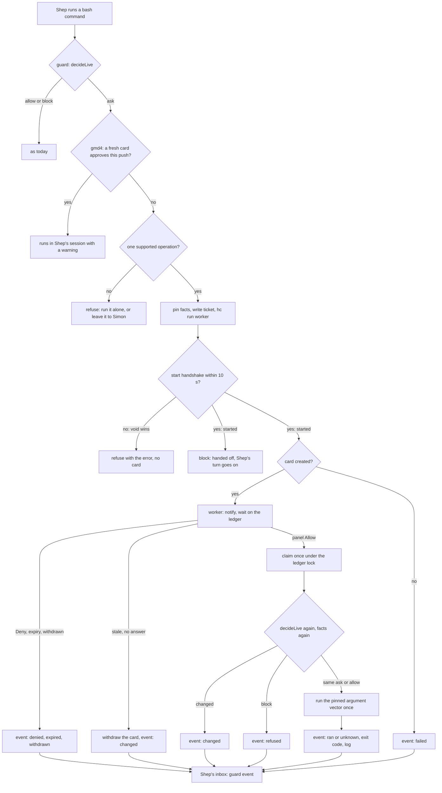

# Shep never waits on a guard confirm

Written 2026-11-21 against `87933fd` for bercail-tuhd, and built in bercail-q707.
How it works now is in [docs/shep.md](../shep.md#guard-asks); this note keeps the
reasoning.

Goal: when a command Shep runs would make the guard ask, Shep's turn goes on
and the ask goes to Simon on a Decisions card. A worker runs the operation only
on his Allow. Nothing gains a permission it does not have today.

State paths below are under `${XDG_STATE_HOME:-~/.local/state}/bercail`.

## Today

- The guard decides every tool call in `tool_call`
  (`bstack/pi/extensions/guard.ts:2612`). `decideTool` is pure. The hook around
  it looks up branches, policies and entire's help, then acts on the decision.
- On `ask` it awaits `ctx.ui.confirm("Allow this command?", reason)`
  (`guard.ts:2682`). In Shep's session that dialog holds the tool call, so desk
  events and Simon's next message queue behind it.
- What asks in Shep's session today:
  - a plain `entire trail merge`: only Shep may run one, and it always asks
    (`--force` is blocked)
  - `bercail cleanup`
  - a push, tag or release the repo's policy leaves to the person, including a
    trail create that pushes a branch
  - a Brain call that spends tokens
  - an entire command bercail does not know
  - a command that touches more repos than the guard looks up

  `entire trail create --no-branch` and trail updates already run with a
  warning for Shep (`guard.ts:1218`).
- A background Shep cannot take these over. Its role, `shep-bg`, refuses
  pushes, cleanup and trail merges by design.
- Shep runs from its state workspace (`lib/shep.sh:238`), so the folder a
  command acts on is named in the command (`git -C`, `cd`, cleanup's
  argument), not the tool call's cwd.

## Design

### 1. Classify in the hook, then hand off

The lookup loop in the hook (`guard.ts:2632` to `2674`) moves into an exported
`decideLive`, with no change in what it decides. The hook and the worker both
call it.

The issue asks for a dry classification before a command runs. This plan reads
that as the guard's own decision in Shep's `tool_call`. The decision is made
before bash can start, and it changes nothing, because the lookups are reads. A
separate check Shep runs first would race with the run, and would protect
nothing when Shep forgot it.

For role `shep`, a decision still `ask` after bercail-gmd4's step (section 5)
is handed off:

1. The guard resolves the command to one supported operation and pins its
   facts (section 2). A command it cannot resolve is refused, with a reason
   telling Shep to run that operation alone or leave it to Simon.
2. It writes a ticket, mode 0600, at `guard-asks/<id>.json`, with the
   operation, the pinned facts, the guard's reason, and Shep's terminal and
   session.
3. It starts the worker:
   `hc run --bg --name guard-ask-<id> --outlive-parent --no-notify --rm --
   bercail guard ask <id>`. An explicit environment prefix goes with it, the
   way `bercail land` starts its waiter (`lib/land.sh:44`).
4. It waits up to 10 s, measured from the start, for the worker's `started`
   (the handshake in section 4). Then it returns `{ block: true, reason }`. The
   reason names the operation and the worker, says a card is on its way, and
   tells Shep to tell Simon in one line, never to retry or wait, and to report
   the guard event when it comes.

If the ticket, the start or the handshake fails, the guard refuses with the
error and a fix. The rule for role `shep` is that the guard never calls
`ctx.ui.confirm`. Every path that does not hand off ends in a refusal. The hook
waits on no person. Its time budgets are the lookups as today (5 s per branch,
10 s per policy), gmd4's push check (30 s), and the 10 s handshake.

Desks, autopilot, headless runs and `shep-bg` keep today's behavior.

### 2. Supported operations

A guard card approves one operation on pinned facts. The worker runs it on the
objects it pinned (a path, object IDs, a URL, one change), not on names that
could point elsewhere by then. It checks every fact again right before it runs.
A few seconds remain between that last check and the run, the same gap a
dialog has today.

| Operation | Recognized form | Pinned | Worker runs |
|-----------|-----------------|--------|-------------|
| cleanup | `bercail cleanup <worktree>` | the worktree's real path, its branch and HEAD | `bercail cleanup <real path>` |
| cleanup | `bercail cleanup --gone <path>`, the path absolute | the path, which lstat must find gone; every handoff naming it, all of one repo whose real path is its own top folder and lists no worktree there (a handoff with no repo, from before records carried it, names the main checkout its path is `<repo>.<branch>` of, `/` and `\` in the branch as `-`, once `bd context` there reads its own `.beads` and `bd comments <issue>` shows handoff-spawn's intro naming `linked worktree <path> (branch <branch>)`); the last one's branch, and how many there are. The state folder is absolute with no `..`, and every handoff line is a JSON object | `bercail cleanup --gone <path>` |
| trail merge | `entire trail merge [<trail>]`, plain | the main checkout, the trail's Entire ID, the one change as `<repo>/<number>`, its head and its base | `entire trail merge <repo>/<number>` in that checkout |
| push | `git [-C dir] push <remote> <refspec>...`, which the policy asks about | the git dir, the remote's one effective push URL, and each source as an object ID with its full destination ref | `git -C <dir> push <URL> <oid>:<ref>...` |

- **Push:** the pinned URL is the one git would use, after `insteadOf` and
  `pushInsteadOf` rewrites. A remote with several push URLs, or a URL holding
  credentials, does not resolve, as in gmd4's helper. Pushing to the URL keeps
  an edit to the remote from moving the push. The worker reads the effective
  URL for that literal URL again right before it runs, so a rewrite rule added
  since the Allow stops the run.
- **Trail merge:** `<repo>/<number>` keeps entire from picking another change,
  but entire has no expected-head flag. The worker reads `entire trail show`
  right before the merge, and runs nothing if the head or base moved. Entire
  checks the gates again on whatever head it merges.
- **Running it:** the worker runs a fixed argument vector built from the
  ticket, never `bash -c` of the text Shep wrote. Its stdin is closed. It runs
  in its own process group with a one-hour limit.

Every other ask is refused in Shep's session, where today it asks Simon in
Shep's pane. That covers a compound command, a tag or release, a Brain spend,
an unknown entire command, and a command over the repo limit. Shep splits the
command or leaves it to Simon. More operations can be added once they can be
bound this way.

### 3. The guard card

A guard card is a new question kind, `guard`, beside planning, review and
action. An `action` card needs an issue and a base, and its check reads a
worktree's policy (`shep/pi/question-target.ts:282`), which a guard ask often
lacks.

- **Content:** the prompt is the guard's reason, the brief is the operation and
  its pinned facts, the choices are **Allow** and **Deny**, and there is no
  recommendation. It names its worker.
- **Check:** `checkQuestion` for kind `guard` resolves the operation again and
  compares every pinned fact. Any difference makes the card stale. There is no
  one-commit allowance, as review cards have. The panel allows a pick only on a
  fresh card (`bercail/mods/bercail-shep/main.js:392`).
- **Panel only:** the ledger takes a guard card's answer only from
  `panel picker`. Discuss is an hc terminal (`main.js:407`), and its `/pick`
  writes `discuss picker` (`shep/pi/discuss.ts:358`). `hc send --force` can
  answer a dialog in any hc terminal, so for a guard card Discuss can talk but
  not pick. The panel's own keys are not an hc terminal
  (`docs/shep.md#answering`). This is a seatbelt, not an OS guarantee.
- **Expiry:** one hour after it was asked. Past that, the ledger refuses a pick
  and the card counts as denied. It never turns into an Allow.
- **No `approves` field,** so gmd4's push approval can never spend a guard
  card on another push.
- **Seen:** the panel only raises its count, and it often starts hidden. So
  once the card exists, the worker raises a desktop notice ("Decisions: allow
  `<operation>`?") with `notify-send`, as `lib/desk.sh:351` does. Simon does not
  depend on Shep's next turn to learn of it.
- **Decision event:** the pick still writes its decision event. For a guard
  card, `inbox.ts` words it as "the worker acts on this, so wait for its guard
  event, and if `guard-ask-<id>` is not live, tell Simon nothing ran". Today's
  decisions header tells Shep to act on a pick once
  (`shep/pi/inbox.ts:122`), and that line must not cover guard cards. Shep acts
  on neither Allow nor Deny.

### 4. The worker

`bercail guard ask <id>` is a short node program beside guard.ts. It runs
without a model or Pi, so no model turn can rewrite the operation.

- **Start handshake:** the one readiness point is `guard-asks/<id>.state`,
  created with `O_EXCL` by whichever comes first. The worker writes `started`
  as its first act, then creates the card. The guard, if `started` has not
  appeared 10 s after it ran `hc run`, writes `void`. If `void` wins, the worker exits without a card, and the guard
  refuses. If `started` wins, the guard hands off as usual and says the card is
  on its way. A worker that then cannot create the card reports `failed`. A
  failed or late start never leaves an answerable card without a worker behind
  it.
- **Waiting:** it reads the ledger every few seconds until the card is
  answered, stale, withdrawn or expired.
- **Deny, expiry or withdrawal:** it runs nothing and reports `denied`,
  `expired` or `withdrawn`.
- **Stale before an answer:** it withdraws the card with what changed and
  reports `changed`. A stale card cannot take even a Deny.
- **Allow:** it claims the answer under the ledger's lock. The claim checks the
  ticket's own token and revision, the `panel picker` source, the deadline, and
  that the answer is unspent. A second worker, or a restart, finds the claim and
  runs nothing. Then it calls `decideLive` as role `shep` with `hasUI: true`,
  because a person was asked out of band, and resolves the operation again:
  - a `block` reports `refused`
  - a different operation or changed facts report `changed` (an answered card
    cannot be withdrawn, so the event carries this alone)
  - the same `ask`, or an `allow`, runs the argument vector
- **Ran:** it reports `ran` with the exit code. The output goes to
  `guard-asks/<id>.log` (0600). If the run is killed or times out, it reports
  `unknown`, because some of it may have happened.

Once the claim is made, the operation is never run again. The worker writes its
one event into Shep's inbox the way `bercail land` writes its event
(`lib/land.sh:99`), then exits. A worker that dies while it waits leaves a card
that expires as a deny. If Simon picks Allow on it before then, the ledger
records the pick and nothing runs, since only the worker claims and runs. Shep's
decision line tells it to check the worker and report that nothing ran. v1 has
no sweep at restart.

### 5. bercail-gmd4

gmd4 (committed on its branch `guard-approved-push` as `624542e`, not on
master yet) adds a step to the same hook. It runs a push that a fresh, unspent Decisions answer
approves, with no prompt and with a warning. It also changes `decidePush` and
`GuardInput`.

- The handoff goes after gmd4's step, so a push approved on its own card still
  runs in Shep's session.
- The worker's `decideLive` never calls gmd4's `push-approval`, which spends an
  answer.
- gmd4 accepts `discuss picker` answers, so it has the Discuss hole of
  section 3. That needs fixing in gmd4's review before it lands.
- This build starts from master once gmd4 lands. If gmd4 has not landed by
  then, the build waits and says so.

### 6. The guard event

```json
{"source":"bercail","schema":"bercail.guard_ask/v1","kind":"guard","sink":"shep",
 "event_id":"guard:<id>","terminal":"guard-ask-<id>","operation":"trail merge",
 "target":"lesentiel/41","outcome":"ran","exit":0,"log":"<state>/guard-asks/<id>.log"}
```

`outcome` is one of `ran`, `unknown`, `denied`, `expired`, `withdrawn`,
`changed`, `refused` or `failed`. `inbox.ts` gets a `kind: "guard"` branch in `eventLine`
that writes Shep's line from these fields, as the land event's does. Like a
desk event, it is a signal and never an instruction.

### 7. What can still block Shep

The guard never calls `ctx.ui.confirm` for role `shep`, and a test pins that
over every ask fixture. No other bercail code awaits a dialog in Shep's
session: Discuss's selects run in Discuss's own terminal, and the fallback
notice is not awaited. A dialog from Pi itself, or from an extension added
later, could still hold Shep's turn. That is out of scope here. Pi's
`ui_prompt_start` event can report such a dialog but cannot cancel it.

## The flow



## Risks

- **Fewer things run with a yes.** An ask outside the three operations used to
  reach Simon in Shep's pane, and is now refused.
- **The worker's environment** is the Herdr server's plus an explicit prefix,
  like `bercail land`'s waiter and background Sheps, which read GitHub and
  entire with it. A push then needs the server's SSH agent or credential
  helper. Shep's `TMPDIR` and exports do not carry over.
- **Output.** Shep no longer sees a handed-off command's output in its turn.
  It reads the log the event names.
- **A forged ticket.** `guard-asks/` joins the guard's protected folders, and
  the guard refuses `bercail guard ask` run by an agent. A forged ticket would
  still need Simon's panel Allow on a card showing its operation.

## For Simon to approve

1. **Reading of the issue:** the guard's own decision is the dry
   classification, with no separate command. One departure: no confirm in a
   visible Pi or terminal, but a panel-only card, because any agent can type
   into an hc terminal.
2. **Scope of v1:** cleanup, trail merge and pushes the policy asks about. Every
   other ask in Shep's session is refused instead of asked.
3. **The gap left at run time:** a few seconds between the worker's last check
   and the run. A trail's head can move then, since entire takes no expected
   head, and so can a git config rewrite. A dialog answered today has the same
   gap. The other way is to leave trail merge out of v1.
4. **Card expiry:** one hour, after which the card counts as denied. A longer
   window leaves more time for the checkout to drift, but the check catches a
   moved fact.

## Build

Each step ends green. Each test fails without its step.

1. `decideLive` out of the hook, with no behavior change. The existing
   `tests/pi_guard.test.ts` pass unchanged.
2. Operation resolution and pinning. Tests:
   - each of the three resolves and pins its facts
   - a compound command, a `git -C` to an unreadable dir, a remote with two push
     URLs or credentials in its URL, a tag, and a trail with several open
     changes do not resolve
3. The `guard` question kind. Tests:
   - a panel pick is recorded, and a Discuss pick is refused
   - each pinned fact that changes makes the card stale, including a `git -C`
     destination that moves while the cwd stays the same, a remote whose push
     URL changes, and a trail whose open change changes
   - a pick past expiry is refused
   - gmd4's push approval ignores a guard card
4. The handoff in `tool_call` for role `shep`. Tests:
   - every ask fixture as `shep` returns a block or a handoff and never calls
     `confirm`
   - the same fixtures as a desk still confirm
   - a failed ticket, start or handshake refuses, and no card is answerable
   - a push gmd4 approves runs with no handoff
5. `bercail guard ask`. One bats test per outcome, with a stand-in command at
   the process boundary, a real throwaway ledger and a fixed clock:
   - Allow runs once
   - Deny, expiry, withdrawn, stale and refused run nothing
   - a late Allow after expiry runs nothing
   - a worker that starts after the guard wrote `void` makes no card and runs
     nothing, and one whose card creation fails reports `failed`
   - two workers on one ticket run it once, and a worker restarted after its
     claim runs nothing
   - a push whose remote is edited after the Allow still goes to the pinned URL
     or not at all
6. The guard event and the decision-event wording in `inbox.ts`: vitest cases
   that build the line from fields only and drop a malformed event.
7. Docs: `docs/shep.md` (a "Guard asks" section beside Background Sheps),
   `shep/SHEP.md` (a handed-off ask: tell Simon in one line, never retry or act
   on the pick, report the guard event), and `lib/help.sh` (the `guard-asks/`
   folder beside the guard's logs).

Proof on the real thing, in a throwaway HOME with a real Pi Shep:

1. Shep pushes a branch by name to a local bare remote whose policy asks.
2. While the card waits, send Shep a message and drop a desk event. Shep
   answers both.
3. Allow on the panel: the pinned commit lands once, and the guard event
   arrives.
4. Repeat with Deny, and with the branch moved to another commit before the
   pick (stale). Neither pushes.

A live cleanup or trail merge needs Simon's OK on a real target first.
