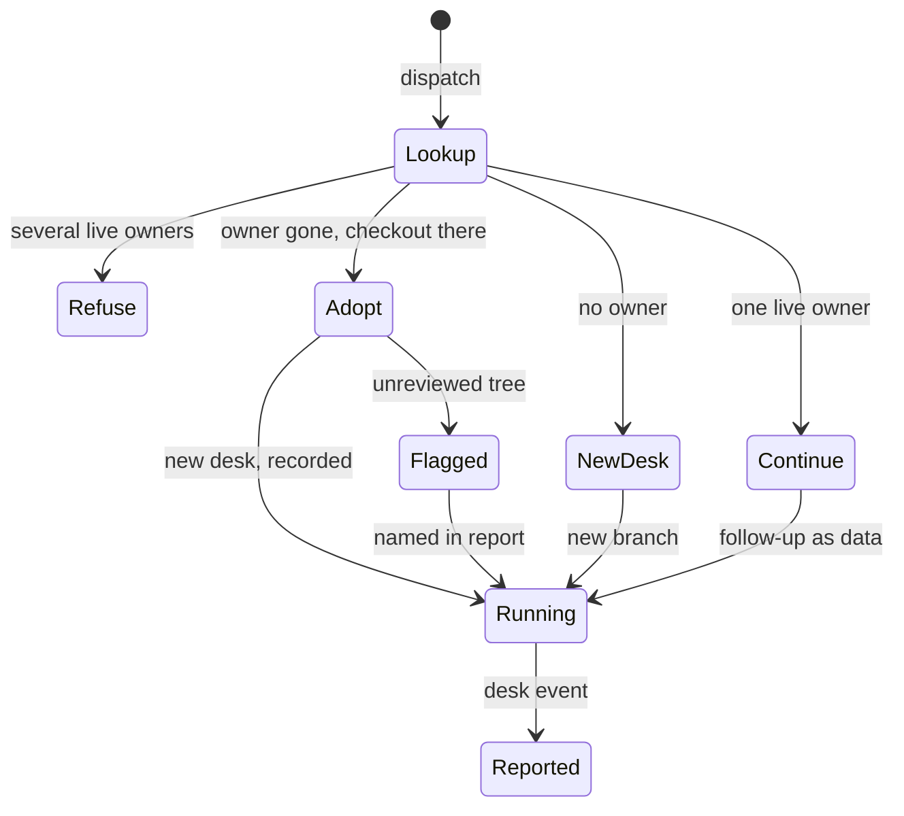
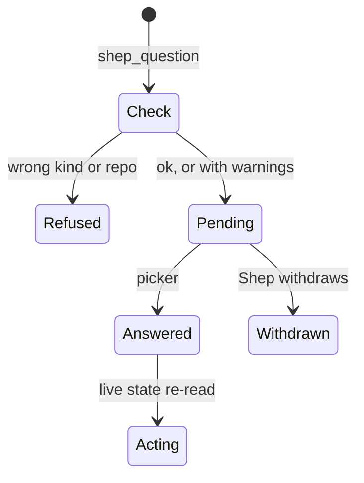
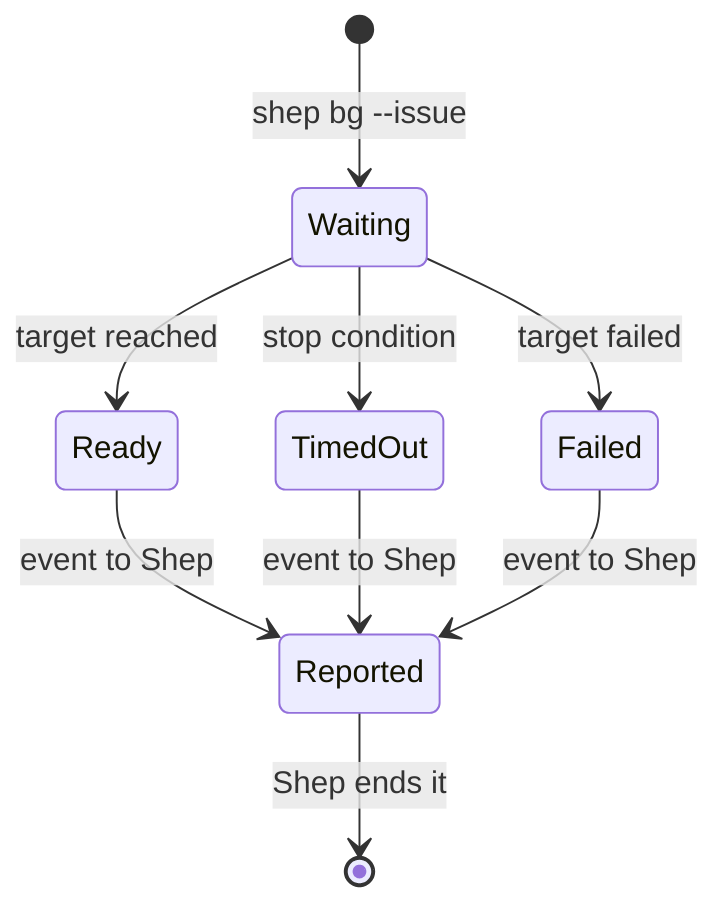
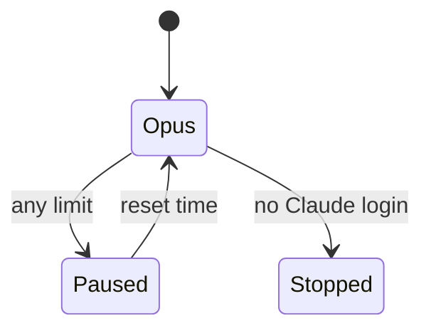
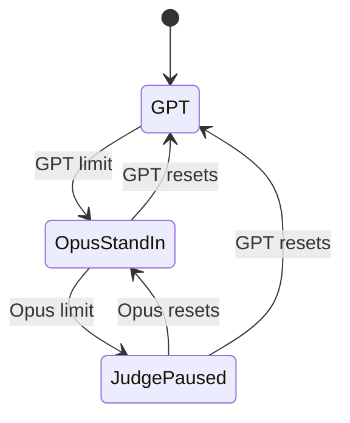
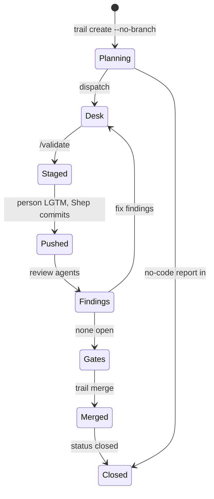
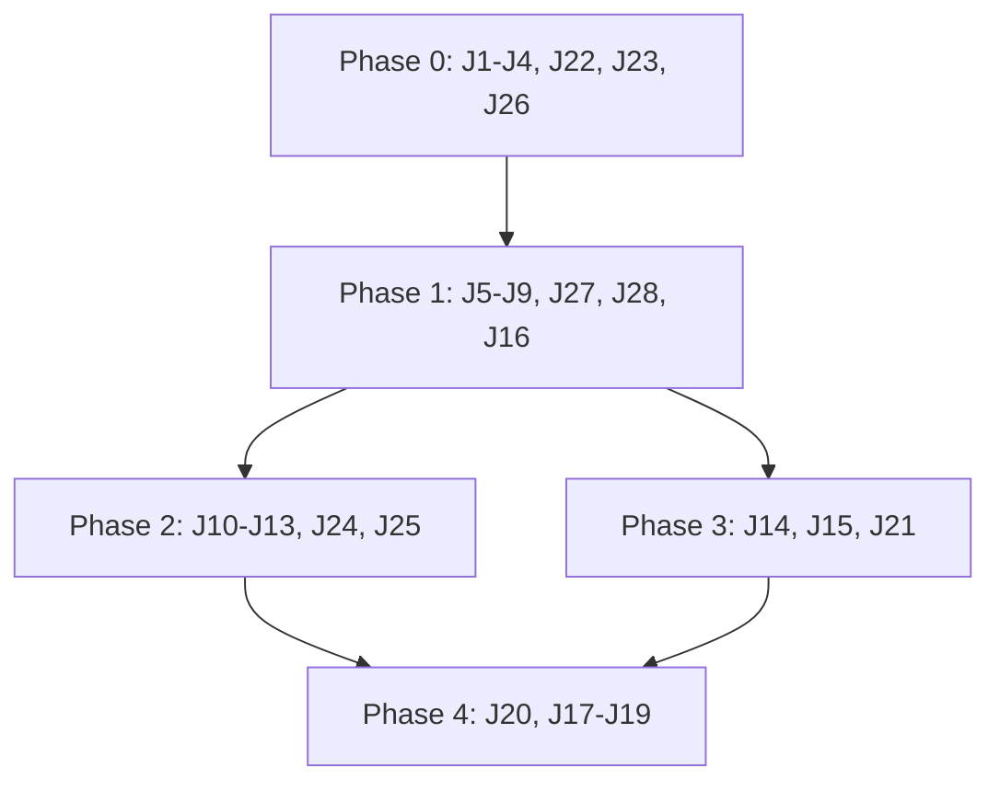

# Bercail v0.18 plan

Written 2026-11-18 against `0b987ae` (v0.17.2) for bercail-5wm8. This is a plan:
nothing in it is built. Each job at the end becomes a beads issue and a desk.

v0.18 is the next major release. It is smaller, warns where it now refuses,
gives Shep better behavior, uses Claude for the work, runs Entire repos on
Trails, and treats repeated mistakes by their cause. The major version number
waits until Herdr core and the Herdr app reach theirs.

## How this was measured

- Size: `git ls-files | xargs wc -l` per area.
- Usage:
  - Pi sessions since 2026-10-18: 537 desk session files in
    `~/.pi/agent/sessions`, plus Shep's own under `~/.local/state/bercail/shep`
  - logs: `handoffs.jsonl`, `guard-approvals.jsonl`, `fallback-dead.jsonl`
  - Shep's `questions.json`
  - the beads metadata of bercail, leftlane_app and lesentiel
  - the mistakes ledger (`mistakes.jsonl`, 82 entries)
- Guard refusals: tool results in those sessions whose text is one of the
  guard's messages. The guard logs only what it lets through, so this is the
  only record of what it refused.
- Suite time: each `tests/*.bats` file run on its own with `--timing`, 12
  files at a time, plus `vp test --reporter=json`. Both ran at once on a
  16-core machine, so the times are contended upper bounds.
- Not checked: Simon's shell history, other machines, and anything that would
  need a paid API.

## The short version

1. Delete eight things that are unused or dead:
   - scoped authorization: 10.5k lines, 0 real uses
   - the task-receipt ledger: 0 of 14 requests ever completed
   - the notify webhooks: no sinks since Nov 14
   - desk secrets: configured nowhere
   - Grok: dead since Nov 13
   - the `review` skill: 1 use
   - the council: 0 uses
   - the migration from the old `agentic-dev` name
2. Fix two parsing faults in the guard. It treats a read of its own files as a
   write when the command has any redirect, even `2>/dev/null`. It forgets the
   working directory after a `cd` chained with `&&`, or after any word ending
   in `)`, and then fails closed. Every false refusal I traced came from one of
   the two.
3. Judges may write in `/tmp` and new files under the worktree's `.bercail/`.
   A judge is told to write its report to a file, and was refused 118 times
   for doing it. Commits by desks and headless agents warn in every repo,
   and only push and publish ask.
4. Questions bind to a repo and issue, and the desk becomes optional. A gone
   desk adds a warning to the card instead of refusing it.
5. Claude Opus only for Shep, lead and build, with no fallback model. On any
   limit the role pauses until Opus resets. The judge is GPT, and Opus stands
   in for it when GPT is limited.
6. In an Entire repo every job is a trail, including research, admin and
   waits. Brain holds the memories, and beads is not used.
7. Group the 82 recorded mistakes by root cause. The two largest groups are
   bespoke verification (14) and test isolation (12). The ledger's
   twice-then-guardrail rule should count groups, not keys: 28 of 47 keys were
   used once.

Value and effort are rated H, M or L in every proposal table. Section 6 ranks
its groups by how often they happen.

Simon answered the plan's eight open questions on 2026-11-19, and then the
five follow-up points they raised. All thirteen answers are folded into the
sections and jobs, and listed under [Decided](#decided).

## 1. Simplify

### What is there

| Area | Lines | Notes |
|------|------:|-------|
| `lib/` | 12,424 | `review.sh` 1,697, `notify.sh` 1,002, `shep-task.ts` 928, `shep-context.sh` 866 |
| `bercail/` mods | 7,907 | four Herdr mods |
| `shep/` | 4,535 | questions 1,662, scoped 1,349 |
| `bstack/` | 4,038 | `guard.ts` 2,497 |
| `skills/` | 8,254 | |
| `tests/` | 41,407 | 7k of it is statechart `graph.json` |
| `docs/` | 3,128 | `docs/shep.md` alone is 10,444 words |

Tests: 827 bats tests in 60 files, and 784 Vitest tests in 21 files. All
passed.

- Bats per-test times sum to 523 s. The slowest files are `review_pr` (121 s),
  `bstack` (52 s), `shep_context` (46 s), `desk_upgrade` (31 s),
  `handoff_spawn` (29 s) and `describe` (26 s).
- Vitest took 55 s, and its slowest file sets that time:
  `shep_scoped_statechart` (2 tests) takes 54 s and `shep_scoped_execution`
  takes 26 s. Without the scoped files, the slowest is `shep_question_cli` at
  14 s.

### Usage evidence

| Feature | Evidence of use | Verdict |
|---------|-----------------|---------|
| Scoped authorization (`scoped_job` tool, scoped question kinds, picker, TLA+ model) | 0 of 101 questions are `scoped-authorization` or `candidate-review` (51 planning, 31 review, 19 action). Its tool schema broke every new claude-bridge desk (bercail-cszc, P0). | Remove |
| Task requests and receipts (`shep task status/receipt/block`, the request ledger in beads metadata) | 8 issues across 2 repos hold 14 requests: 6 awaiting-session, 6 queued, 2 unknown, 0 completed. Receipts are always rejected (bercail-1htn). This job's own second request, Simon's change of spec, is one of the queued six. A follow-up reaches a desk only while it is idle, so it waited behind the work it was meant to change. Simon's change of spec reached this desk only through its judge. | Remove the ledger, keep dispatch |
| Notify webhooks (`notify add/test/repo/check/status`, sinks) | `notify.d` has been empty since Simon moved it aside on Nov 14. The follower still feeds Shep's inbox and is needed. | Remove the sinks, keep the follower |
| Desk secrets and the op shim | No `[desk_secrets]` in `config.toml`. No repo uses them. | Remove, but keep the empty-`op read` rule |
| Grok / xAI | 39 dead-provider records (402, no credits) from Nov 13 to 17. The build role still defaults to Grok (`lib/bstack.sh:36`). | Remove (section 4) |
| `council` skill | 0 loads in a month, and no council sibling was ever started. Judges: 138 starts. Builders: 73. | Remove (decided): the GPT judge is the second opinion |
| `review` skill (tuicr comments to GitHub) | 1 load. 435 lines, plus 186 lines of tests. | Remove (decided) |
| `desk-restore` skill | 1 load (`bercail desk restore` itself has 10 runs) | Fold into `docs/` |
| `review-pr` | 17 review runs, the last on Nov 13. 1,928 lines of code, 2,796 of tests, 23% of bats time. | Keep, but slim its tests |
| Old-name migration (`agentic-dev` to `bercail`) | 9 of the 18 tests in `tests/old_names.bats`. Leftover `agentic-dev.*` shell files remain in `~/.config/bercail/shell`. `bin/agentic-dev` stays in the repo only because a v0.14.0 `bercail update` stops without it. | Remove (decided) |
| `reconfigure`, `dry-run` | 1 run each | Merge `reconfigure` into `update` |
| Statechart replay suites | `scoped-job` (5,429 lines) goes with scoped. `shep-task` (the TLA+ model for task delivery) goes with the receipts. `shep-inbox` stays (7 s). | Remove two of three |

Most used, by commands whose first word is `bercail`: `describe stamp`
(201), `shep question` (59), `describe` (49), `describe check` (36). Shep's
own commands: `bd comment` 406, `shep brief` 361, `bd comments` 269, `hc get`
232, `describe check` 162, `shep questions` 144, `shep mistake` 124, `shep bg`
93. None of these is a removal candidate.

### Low-value tests

- 90 bats assertions grep a prose phrase in a deployed doc or prompt (29 in
  `bstack.bats`), for example `grep -q 'never commits, pushes, or opens a PR'
  validate.md`. Rewording the doc fails the test, and it proves nothing about
  behavior. Replace them with one check that each deployed file matches its
  source. Keep a grep only where the deploy step rewrites the text.
- `review_pr.bats` holds 43 tests that take 121 s. Keep one end-to-end test per
  backend and the safety tests (`review_pr_safety`). Move the rest to the
  functions they test.
- The scoped and task statechart replays take 54 s across 4 tests, for code
  that is being removed.

### Proposals

| # | Proposal | Value / effort | Removes | What it costs to lose |
|---|----------|:--------------:|---------|-----------------------|
| S1 | `tests/run.sh` runs in parallel without GNU parallel, with `xargs -P` per file. Without GNU parallel it runs one test at a time: about 9 minutes here, against 140 s for 12 files at a time. | H / L | nothing | nothing |
| S2 | Remove Grok | H / L | the xAI family, its picks, status lines, a seat in `bstack.bats`, and the xAI provider in the live fallback proof | nothing, since it is dead |
| S3 | Remove scoped authorization | H / M | 1,609 lines of code, 3,507 of tests and 5,429 of statechart; 278 Vitest tests; Vitest wall time drops from 55 s to about 15 s here | A desk can no longer hold an exact-OID commit or fast-forward grant from a picker. Shep commits and pushes through the policy and the guard's ask, as it does today. The Shep state-folder protection in `scoped-job.ts` moves to the guard first (J2). |
| S4 | Remove the task-receipt ledger, keep `shep task dispatch` (a new desk, or a follow-up into the original session) | H / M | most of `shep-task.ts`'s cleanup and receipt code, `shep_task_statechart`, the TLA+ model | The board cannot say a request is done from runtime proof. It shows what Simon reads now: the desk's state, its last report and `describe check`. |
| S5 | Remove the notify sinks, keep the follower as Shep's event feed | M / L | about 700 of `notify.sh`'s 1,002 lines and most of `notify.bats` (38 tests) | Webhook pushes to a phone or OpenClaw. Adding them back later is one sink type. |
| S6 | Remove desk secrets | M / L | 370 lines, plus three guard rules (`secretFile`, `printsToken`, `vaultShown`) | A per-repo 1Password service account for desks. Lesentiel's vault reads went through the person's own `op`. |
| S7 | Replace the 90 prose greps with source-equals-deployed checks | M / M | about 90 assertions | nothing, as long as the deploy rewrites are still checked |
| S8 | Slim `review_pr.bats` | M / M | about 25 tests, about 80 s | some regression coverage of review-pr's internals |
| S9 | Shorten `SHEP.md` (3,347 words) and `docs/shep.md` (10,444 words) | M / M | about half of each | nothing, provided the behavior specs in section 3 hold the rest |
| S10 | Remove the `review` skill and the old-name migration | M / L | `skills/review` (435 lines), `publish_github.bats` and `wait_comments.bats`; `bin/agentic-dev`, the `agentic-dev` moves in `lib/config.sh`, and the 9 tests of `old_names.bats` that cover them. Its other 9 tests cover old config keys and stay, except the two for sinks, which go with S5. | Posting tuicr comments to a GitHub PR by script. An install at v0.14.0 or older can no longer update in place: it reinstalls. |
| S11 | Remove the council | M / L | the `council` skill, its agent brief and its prompt (92 lines), the per-provider council seats in `lib/bstack.sh`, the guard's `council` role, and its mentions in the docs, the tests and verify-bercail | A review by one reviewer per provider on request (`/council`). The GPT judge on every /validate is the second opinion. |

## 2. Warn, don't block

### What went wrong

From today's bugs and the ledger:

- **Cards refused for live or gone desks** (bercail-shhh). The helper refused:
  - live desks with no open-session claim
  - background Shep terminals
  - a desk whose cwd differed
  - a space held by another job's terminal (t178)
  - any job question with no desk

  A decision about a job whose desk is gone could not reach the Decisions
  panel at all.
- **Task receipts always rejected** (bercail-1htn). The claude-bridge
  `toolResult` has no `structuredContent.exit_code`, so every request stays
  queued.
- **Background wait workers with no shell** (bercail-qni9). A `--kind wait`
  worker cannot wait on an Entire trail gate. Nothing can run the approved
  `entire trail merge` afterwards.
- **Adoption needing a recorded checkout** (bercail-deyr, shipped in v0.17.2).
  A PR whose desk died could get no new work until `adoptReason` existed. It
  still needs Simon's yes and a recorded branch worktree.
- **The `scoped_job` schema** (bercail-cszc, P0). A top-level `anyOf` broke
  every new desk on claude-bridge.
- **The background brief never reached the worker** (bercail-z7ev).

Guard refusals measured in the sessions since Oct 18:

| Refusal | Times | What was attempted |
|---------|------:|--------------------|
| "This role is read-only" | 131 | 118 `write` calls, almost all a judge writing `judge.md`, `answer.md` or `verdict.md`, which its brief asks it to do. Also 2 edits and 11 bash. |
| "This file decides what bercail's guard lets through" | 28 | Reads (`cat`, `jq`, `sed -n` on `config.toml` or `policy-trust.json`), scratch configs written under `mktemp -d`, and project edits after a `cd`. None of the 28 commands wrote one of the guard's own files (I read the first 140 characters of each). |
| Trail approve or merge | 3 | correct |
| `--no-verify`, force-push, `core.hooksPath` | 5 | correct |
| Unknown branch on push | 2 | the branch could be read |
| Unclosed `$(` | 1 | a heredoc |

The guard also refused five read-only commands of mine while I wrote this
plan: a `curl` loop into `/tmp`, `sed -n` on `config.toml`, `jq -r` on
`todo.json`, and two loops over Shep's sessions. All five reproduce offline
with `decideBash` from `guard.ts`, and they come from two faults.

**Reads count as writes.** `writesProtected` (`guard.ts:1304`) runs whenever
the command has any redirect (`2>/dev/null` and `2>&1` count) or starts with a
writer. The writer list includes `sed` and `perl`. The check then looks at
every word of the command, in two ways: does a target resolve to a protected
path, and does any word contain the last two parts of one, such as
`bercail/config.toml` (`guard.ts:1320-1321`)? So
`jq -c keys policy-trust.json 2>&1`, `cat config.toml 2>/dev/null` and
`sed -n 1,5p config.toml` are all refused. `grep -n bstack config.toml`
passes.

**The cwd is dropped.** After `A && cd X && B;`, the cwd is unknown once the
chain ends (`guard.ts:2124-2130`). Any word that ends in `)` also counts as
closing a subshell, even inside a quoted regex such as `'(^|&& )(bd [a-z]+)'`
(`guard.ts:2111-2117`). With the cwd unknown, every relative write target
fails closed (`scoped-job.ts:143`). That includes a `sed` script argument and
`> out.txt`, so `mkdir -p /tmp/w && cd /tmp/w && echo a; cat y > out.txt` is
refused.

The scratch-repo commit prompts in the ledger (`guard-scratch-commit-prompt`,
7 times) no longer happen. The four command shapes recorded in the ledger now
pass as scratch commits.

### Inventory

- **Keep**: the rule stays a refusal, because the action is destructive,
  irreversible, outward-facing, a secret, spending, or the person's own
  authority.
- **Ask**: a confirm when there is a UI, and a refusal when headless.
- **Warn**: the command runs, and the agent sees a line it must repeat in its
  report.

| Where | Rule | Next | Why |
|-------|------|------|-----|
| guard | force-push, `+` refspec, `--mirror`, deleting main | Keep | irreversible |
| guard | `--no-verify`, `core.hooksPath`, risky `git config` keys | Keep | bypasses the hooks or the guard; rare false hits |
| guard | PR merge; trail approve, merge or dismiss; `--force` past gates | Keep (Shep's plain `trail merge`: Ask) | the person's call |
| guard | push to main by autopilot; tag or release (unless `agent_may_release`) | Keep / Ask | publishing |
| guard | headless push or release | Keep | no one to ask |
| guard | a commit, where the policy says `commit = "ask"` | Warn, in every repo. No commit asks any more: only push and publish do. A desk's warning says desks stage, and Shep or the person lands. Only read-only roles and background Shep still refuse. A headless commit warns too: with no ask left, nothing needs a person. Today it already passes where the policy says `allow` (`guard.ts:1547`) and refuses where it says `ask`. The policy's `commit` key goes, and an old one is ignored with a warning, as any unknown key is. The scratch-repo detection (`guard.ts:1543-1548`, `lib/policy.sh:109`) goes too: it exists to let scratch commits through. | local and reversible (decided, for desks and headless agents) |
| guard | `push --all` in an Entire repo | Keep | leaks shadow branches with unredacted snapshots |
| guard | `bercail shep question answer`, `policy trust`, synthetic input | Keep | the person's authority |
| guard | Entire setup, login, destroy; Brain setup | Keep | the person's config |
| guard | Brain spend (`distill`, `recall --expand`, …) | Ask | spends Simon's tokens; today it refuses even with a UI |
| guard | `brain remember` from a desk | Keep | reaches every desk; Shep records it after a yes |
| guard | an empty `op read` piped onward | Keep | two real incidents, one touching faillock |
| guard | Basecamp writes, auth, todo targets from a desk | Keep | outward-facing, the person's lists |
| guard | writes by read-only roles (judge, discuss) | Allow under `/tmp` and `$TMPDIR`, and new files under the worktree's `.bercail/`. Keep everywhere else: for `description.md`, `validate.json`, tracked files, edits and git | 118 false refusals. Anywhere else would let a reviewer write `~/.bashrc`, and `description.md` and `validate.json` are the evidence `describe check` trusts |
| guard | protected files (`policy-trust.json`, `questions.json`, `questions.lock`, `config.toml`, `todo.json`, Shep's state folder) | Keep for writes. A stderr redirect or `sed -n` is not a write, and only a write's target is checked, both for full paths and for last-two-part names | 28 false refusals |
| guard | unknown cwd | after `A && cd X`, check a relative path against both X and the old cwd; a quoted `)` does not close a subshell; when the cwd stays unknown, Keep a write whose name matches a protected file, else Warn | the other cause of false refusals |
| guard | unclosed `$(` or backtick | Keep when the text holds any Keep or Ask trigger (git, gh, entire, push, `shep question answer`, `policy trust`, `op read`, basecamp, a protected file name); else Warn | it cannot parse, but most of these are heredocs |
| guard | unknown branch on push; "too many repos" | Ask | the person can tell |
| guard | `basecamp` flags before the action | Warn | a parse aid, not a safety rule |
| guard | headless unknown `entire` command | Warn for subcommands `entire agent-help` lists as read-only; else Keep | read-only lookups |
| guard | scoped-job rules (`scopedWrite`, scoped reads) | Remove with S3 | |
| guard | desk-secret rules | Remove with S6 | |
| question target | invalid kind; issue not in this repo | Keep | wrong job |
| question target | desk required; desk gone; cwd mismatch; desk of another job; no session claim | Warn on the card | a card asks; only the picker grants, and the action re-reads live state when it runs |
| task dispatch | a live owner on the target; ambiguous live owners | Keep, and list the owners | stops two desks on one branch |
| task dispatch | owner gone, checkout still there | Warn and adopt: a new visible desk with a new session, recorded on the issue | reversible and visible; today it needs Simon's yes |
| task dispatch | dispatch lock held; creation outcome UNKNOWN; `requestId` required | Warn with the lock's age and the `hc ls` facts; mint the id | |
| task receipts | "missing runtime-observed validation" and the rest | Remove with S4 | 0 completed |
| `shep bg` | `--kind wait\|admin` required; wait has no shell | one kind: bash under the guard as `shep-bg` (no commit, push or edit of tracked files), with a trail-gate wait | bercail-qni9 |
| `describe` | no description | Keep | nothing to print |
| `describe` | stale description | Keep where the repo pushes straight to main; Warn elsewhere | published text |
| review by stakes | `high_stakes` needs the person's LGTM | Keep, but it never holds other work | Simon's policy |
| Shep's "Never block" rule | no `sleep` or polling | allow waits of 10 s or less, and add `dispatch --wait-ready` | 116 `sleep`s, mostly 2–3 s before an `hc get` |

### Proposals

| # | Proposal | Value / effort | Job |
|---|----------|:--------------:|-----|
| W1 | The guard reads its protected files correctly and keeps the cwd. The Shep state-folder protection moves from `scoped-job.ts` into the guard. | H / M | J2 |
| W2 | Read-only roles write in `/tmp`, `$TMPDIR` and new files under `.bercail/` | H / L | J3 |
| W3 | Questions bind to a repo and issue, with desk warnings on the card | H / M | J10 |
| W4 | Background Shep: one kind, a shell under the guard, a trail-gate wait | H / M | J11 |
| W5 | Dispatch adopts a gone owner by itself | M / M | J12 |
| W6 | Guard warnings and refusals, logged | M / M | J13 |
| W7 | Commits warn in every repo. Only read-only roles and background Shep refuse. The `commit` policy key and the scratch-repo detection go. | H / L | J13 |

A warning goes in the tool result as a line starting `bercail guard warning:`.
It is appended to a `guard-warnings.jsonl` next to `guard-approvals.jsonl`, and
refusals go to the same file. Today refusals are not logged at all. A warning
seen often becomes evidence for a fix, the way a mistake does now.

### Dispatch

Transitions:

- Lookup -> Continue: one live desk owns the target. The message is queued in
  its original session, as it is today.
- Lookup -> Refuse: two or more live desks claim the target. The refusal lists
  them, and the person picks.
- Lookup -> Adopt: the recorded desk is gone and its checkout still exists. A
  new visible desk starts there with a new session, and the adoption and its
  reason go on the issue. The person is told but not asked. Today this needs
  their yes.
- Adopt -> Flagged -> Running: the checkout holds a staged tree the person
  has not reviewed. The new desk says so in its first report and does not
  restage over it unless asked.
- Lookup -> NewDesk: no owner. A first desk starts on the given branch.
- Running -> Reported: the desk finishes or blocks, and Shep reports from
  `shep brief`. With the request ledger and its receipts gone, nothing is left
  stuck in queued.

### Question cards

A question card is pending, then answered or withdrawn. Today a target check
runs before the card exists and can refuse it. In v0.18 the check still runs,
but a desk problem (gone, a cwd mismatch, another job's terminal, no session
claim) becomes a line on the card. Only a wrong kind or an issue from another
repo still refuses. When Shep acts on an answer, it reads the live desk,
branch and staged tree again, so an answer to a stale card cannot act on the
wrong thing.

Transitions:

- Check -> Refused: an invalid kind, or an issue that is not in the named repo.
- Check -> Pending: every other case. Desk problems show as warnings on the
  card.
- Pending -> Answered: the person picks on the Decisions panel or in Discuss.
- Pending -> Withdrawn: the question no longer applies.
- Answered -> Acting: Shep re-reads the desk, branch and tree, then acts under
  the guard. If the state has moved, it tells the person instead of acting.

### Background Shep

Transitions:

- [*] -> Waiting: Shep starts the worker from the issue that says what to wait
  for, what comes after, and when to stop. The worker has bash under the guard
  as `shep-bg`. It can read, run checks and wait, but it cannot commit, push or
  edit tracked files.
- Waiting -> Ready: the CI run passed, or `entire trail show <n>` reports the
  gates passing on the expected head.
- Waiting -> TimedOut: the issue's stop condition, such as a time limit or a
  head that moved.
- Waiting -> Failed: CI failed, or a gate failed.
- Ready, TimedOut or Failed -> Reported: the worker comments its result on the
  issue, and a desk event reaches Shep's inbox.
- Reported -> [*]: Shep reports to the person. A follow-up action, such as
  `entire trail merge`, runs in Shep's own session after the person's yes or a
  standing rule, where the guard can ask.

## 3. Shep's behavior

### What agentbehavior.dev says

[Agent behavior](https://www.agentbehavior.dev/) is a format for writing down
the conduct you expect from an agent across many interactions. A spec is a
`.agents/behaviors/<name>/BEHAVIOR.md` file: frontmatter (`name`,
`description`) followed by free Markdown.

- It suggests six dimensions: Intent, Evidence, Decision, Execution,
  Recovery, Failure modes.
- It is written for the people and agents who review traces and design evals,
  not as runtime prompt.
- A behavior earns a spec when it is frequent, high-impact, agent-defining,
  ambiguous by default, spread across context, or useful for debugging.
- AGENTS.md tells the agent how to act. BEHAVIOR.md defines what counts as
  good.

### What is wrong with Shep now

- `SHEP.md` mixes two kinds of text. It has runtime steps ("run `bercail shep
  brief`") and contract prose ("It always reports `authority: false`:
  freshness is not permission", "OPEN is distinct from RECENT/history; neither
  a future-delivery queue nor completed Pi processes is a global veto"). The
  contract prose is for reviewers, but Shep pays for it in every turn.
- The failures cluster where the first path fails and there is no Recovery:
  - A card refused for a gone desk ended as a decision asked only in chat.
  - A rejected receipt left its request queued forever.
  - A bg worker that could not wait on a trail stopped at once.
- Shep works around missing tools. It ran 116 `sleep`s, mostly 2–3 s before an
  `hc get` on a starting desk. It also pressed `hc keys <desk> Enter` 52 times
  to submit text it had sent.

### Proposals

| # | Proposal | Principle | Value / effort |
|---|----------|-----------|:--------------:|
| B1 | Add `.agents/behaviors/` with five Shep specs, one for each behavior below, and link each spec to its ledger groups (section 6). | Behavior specs; Recovery; Failure modes; "useful for debugging" | H / L |
| B2 | Rewrite `SHEP.md` as runtime steps only, about 1,500 words. The contract prose moves to the specs and to `docs/shep.md`. Every step that can be refused says what Shep does next: tell the person, file the gap, and never try a workaround the guard would not see. | "AGENTS.md: how to act. BEHAVIOR.md: what counts as good." Recovery | H / M |
| B3 | The mistakes ledger names the behavior a mistake breaks, or the process it counts against. A group seen twice gets an eval case (the trace excerpt plus the expected conduct) before any new refusal. A refusal is added only when the action is in section 2's Keep set. | Specs inform evals; evals test the behavior | H / L |
| B4 | Remove the workarounds with tools: `shep task dispatch --wait-ready` returns when the desk's Pi is up; `hc send` submits, or bercail wraps it so it does; `shep_question` works with no desk (W3); `shep bg` waits on a trail gate (W4). | Recovery: give the first path a way through | H / M |

The five behaviors for B1:

- **ask before outward-facing actions**: G5 in section 6
- **decisions go on cards**: G4 and G5
- **verify before claiming**: ordinary claims, such as "the tests ran" or
  "the file exists". It adds no receipt process. G2's entries count against
  the ceremony, not against this behavior.
- **cost-sensitive work**: G8, the case the site itself uses as its example
- **act on the current state, and report each event once**: G6

Cleanup (G3) gets no spec. It counts against the ceremony, and a tool replaces
it (J24).

## 4. Models and fallback

### Now

- Roles: lead = Claude, judge = Claude, **build = Grok** (`lib/bstack.sh:35-36`).
  Shep and Discuss take the lead's model. Simon's `[bstack]` sets only
  `statechart = true`, so all of these are defaults.
- The fallback is the same for every role: claude, then gpt, then grok
  (`lib/bstack.sh:167`, `fallback.ts:360`). When Claude is limited, Shep and the
  lead move to GPT, which Simon found unusable for those roles (gpt-6.2 astra
  and sol).
- Builders start on xAI, which has been dead since Nov 13. The fallback found
  it dead 39 times between Nov 13 and 17 (402, no credits) and fell through to
  the next family.
- Pi's own `~/.pi/agent/settings.json` has `defaultModel: grok-4.6` with
  provider `xai`. Any Pi started without `--model` lands on the dead provider.
  This is Simon's config, so I did not change it. Simon decided that J1
  changes it.

### Proposals

| # | Proposal | Value / effort |
|---|----------|:--------------:|
| M1 | Claude Opus for Shep, lead, build, Discuss and bg. Remove xAI. An old config that names `grok` is ignored with a warning, not refused (`lib/bstack.sh:168-171` refuses it today). | H / L |
| M2 | No fallback model for the Opus roles. On any limit, an Opus-only window or a plan window, the role pauses and resumes on Opus at the reset time. The runtime fallback list (`[bstack] fallback`) goes. One exception: the judge's stand-in (M3). A role's model is still picked once at start, from the plans that are connected: GPT then Claude for the judge, Claude for every other role. | H / M |
| M3 | The judge is GPT. It reviews, and the lead, on Opus, makes the call, since the issue asks for Claude Opus for decisions. When GPT is limited, Opus stands in as judge, so /validate keeps finishing. | M / L |
| M4 | Pi's own default becomes Claude Opus on Simon's machine: `defaultProvider` and `defaultModel`, and only those two keys | M / L |
| M5 | A small decision model for Shep's decision-question check, as an offline experiment that runs before Phase 3 | M / M |

| Role | Model | On a limit |
|------|-------|------------|
| Shep, lead, build, Discuss, bg | `claude-opus-5-5` | pause until Opus resets; no other model |
| judge | GPT (`gpt-6.2-sol`) | Opus stands in until GPT resets. If Opus is limited too, the judge pauses. |
| analytics, explanations on request | GPT | none |
| xAI | removed | |

What the GPT judge changes:

- /validate's judge step, and every design question a playbook sends to the
  judge, now goes to GPT. The judge gives a second opinion from another
  provider, and the lead decides. That last part comes from the issue, which
  asks for Claude Opus for decisions, not from decision 2. The roles table in
  bstack's instructions and the playbooks say so.
- The judge runs on Simon's ChatGPT plan at every /validate: 138 judge starts
  in the last month. That plan hit its limit once already
  (`model-spend-uncapped`, Nov 14). When it does, Opus stands in.
- The council goes. The GPT judge is the second opinion.

Pi's default (M4) is stored as two keys. J1 sets `defaultProvider` to
`claude-bridge` and `defaultModel` to `claude-opus-5-5` in
`~/.pi/agent/settings.json`, and touches no other key. It is a one-time change
on Simon's machine, not something the installer does to other users' Pi
settings.

The Opus roles (Shep, lead, build, Discuss, bg):

Transitions:

- Opus -> Paused: any limit, whether an Opus-only window (`seven_day_opus`) or
  a plan window (`five_hour`, `seven_day`). The desk shows the reset time, and
  Shep gets a blocked desk event. Nothing moves to another model.
- Paused -> Opus: at the reset time, the same request continues. A limit that
  names no reset is tried again every 5 minutes, as today.
- Opus -> Stopped: `claude auth status` shows no plan login. The desk stops,
  with the login fix in its message.

The judge:

Transitions:

- GPT -> OpusStandIn: the ChatGPT plan is limited. The judge switches to Opus
  and keeps the same review, so /validate finishes. Its report says which
  model judged.
- OpusStandIn -> GPT: GPT's limit lifts. The next review runs on GPT again.
- OpusStandIn -> JudgePaused: Opus is limited too. Decision 1 still applies
  to Opus, so no third model is tried.
- JudgePaused -> OpusStandIn, or -> GPT: whichever resets first.

With no ChatGPT login at all, the judge role resolves to Opus from the start.
A role whose plan is not connected already takes the next family that has a
model (`lib/bstack.sh:40-46` and `78-93`). J1 keeps that start-time pick, as
GPT then Claude for the judge.

### A small decision model?

The [Hightouch study](https://hightouch.com/blog/llm-judges-identity-resolution)
used fast "decision models" that return a 0–1 confidence to judge identity
resolution. Its numbers, as accuracy and cost per 1,000 records:

| Setup | Easier test | Harder test |
|-------|-------------|-------------|
| Opus alone | 99.0%, $3.86 | 95.1% |
| Jev alone (60% cutoff) | 95.7%, $0.05 | 89.1% |
| Luna alone | 97.3% | 88.8% |
| Jev, then Opus on 30–90% confidence | 98.8%, $0.88 | 95.3%, $2.94 |

Luna was more accurate alone on the easier test, but it was overconfident when
wrong, so it gained less from the hybrid. Jev's mistakes sat near 50%
confidence: it is well calibrated. Three lessons carry over:

1. Choose the small model for its calibration, not its raw accuracy.
2. Escalate the uncertain middle to the large model.
3. Measure on hard cases.

Where bercail makes a yes/no call many times and the answer can be checked
cheaply:

| Decision | Today | What a small model would decide | How to measure |
|----------|-------|----------------------------------|----------------|
| Does this Shep message ask the person to decide? | Opus, and it misses (`asked-in-chat-without-card`, `decision-asked-only-in-chat`) | "this reply holds a decision question", with a confidence; above the threshold, Shep is told to make a card first | Label about 300 of Shep's past messages from its 8 sessions; precision, recall, then calibration by bucket |
| Is this desk event new work or a repeat? | Opus reads it (`duplicate-finish-delivery` ×2) | the same report as the last delivered event | Replay the `delivered/` inbox; false merges must be 0 |
| Which ledger group fits this mistake? | Opus reads the list of keys | the nearest group (section 6), or "new" | Leave-one-out on the 82 entries |

It should not decide:

- the guard, which must be deterministic and explain itself
- model routing for coding, where Simon wants Opus
- anything that grants authority

Recommendation: run the first row as an offline experiment, with Claude Haiku
5.5 through the bridge as the small model. Haiku is on Simon's plan, so it
needs no new vendor and no paid API. It is worth building only if it is
calibrated well enough that escalating 30% of cases or fewer matches Opus's
accuracy alone on the same set. If it passes, it ships as a Pi "codemod"
router: an extension that sends the classification to a second model. I found
no public description of Clef, so the plan does not depend on it.

## 5. Entire-native workflow

### What Entire gives

- [Trails](https://docs.entire.com/guides/trails/overview) replace the PR.
  - A trail has a title, a body (intent and acceptance criteria), a type, a
    priority, assignees, and a status of `open` or `closed`.
  - Its phases follow the linked work. A trail with no branch is in the
    Planning phase, so it can carry a job before any code.
  - Changes are branches in one or more repos.
  - Review agents post findings and evals on every push, and gates set the
    merge requirements.
- [Brain](https://docs.entire.com/guides/brain/overview) is the repo's shared
  memory: sessions, checkpoints, memories, docs and Graph's code index. Its
  commands are `brief`, `recall` and `remember --path`. It syncs to Entire
  once `connect` has run.
- [Graph](https://docs.entire.com/guides/graph/overview) is a code map for
  agents.
- [Search](https://docs.entire.com/guides/search/overview) covers commits,
  sessions and code across repos. The skills README suggests making
  `entire search` the first research step.
- [Skills](https://github.com/entireio/skills): `search`, `explain`,
  `what-happened`, `review`, `session-handoff`, `address-findings` and others.

### Lesentiel today

- It uses both: 108 beads issues (91 closed) and 32 trails.
- 67 issues got a desk, and 41 never had one. There are only 32 trails, so
  about 35 desk jobs were research, exploration, admin or cleanup with no
  branch.
- 28 of the 32 trails are `open` with phase `complete`. The code merged and
  nobody closed the trail.
- Brain is live: 119 facts (8 authored), with hosted sync connected.
- The CLI cannot write trail `metadata`, since `entire trail update` has no flag
  for it. So bercail's machine-local job record (desk address, session, pid)
  cannot live on the trail. It should not live there anyway.

### Decision: beads is not needed in an Entire repo

Simon decided that in an Entire repo everything is a trail, including
research, admin and waits, and that Lesentiel stops using beads.

| Need | Beads repo (unchanged) | Entire repo (v0.18) |
|------|------------------------|---------------------|
| The job and its spec | beads issue | trail: title, body with acceptance criteria, type, priority. Shep creates it with `entire trail create --no-branch` |
| A code change | branch, worktree, desk | the same, linked with `entire trail link` once pushed |
| Desk report (for the person) | `bd comment` | `entire trail comment`. Feedback on the code goes in `entire trail finding`, never in a comment |
| Review feedback | tuicr, then a PR review | tuicr, then trail findings and evals |
| Memory | Shep's standing rules | Brain (`remember --path`, after the person's yes), as today. Standing rules stay Shep's |
| Board | `bd list` per repo | `entire trail list --project et/<project> --json`, filtered on phase so complete trails are not shown as open, joined with the local job record |
| Review queue | staged desks, PRs | staged desks, plus trail changes in review with their open findings and gate state |
| Questions | Decisions panel, bound to repo and issue | the same, bound to repo and trail number; the card links the trail's URL |
| Job record (desk, session, pid) | `bercail_task` in beads metadata | `~/.local/state/bercail/jobs/<repo-key>/<trail>.json`, the same fields |
| Research (`how`, `why`) | git log, gh | `entire search`, `entire brain recall` and `entire graph` first |
| Non-code job (admin, research, a wait) | beads issue, no branch | trail with `--no-branch`, type `task`, closed by Shep once its report is in. A background Shep's wait is such a trail. |
| Close | `bd close` | `entire trail update --status closed` after merge, or after the report for a trail with no branch |

What is lost without beads:

- **Offline work.** Trail commands need the network and the keyring. `bd`
  does not.
- **Dependencies.** A trail has `stack` for code that depends on other code,
  but nothing like `bd dep` or `bd ready` for "do A before B" between plans.
- **Speed.** `bd list` answers locally in milliseconds. `trail list` is a
  network call.
- **Throwaway issues.** Every trail shows on entire.com.

The board's per-repo deadline (10 s today) and its UNKNOWN state cover a slow
or unreachable Entire, the same way they cover a slow `bd`.

| # | Proposal | Value / effort |
|---|----------|:--------------:|
| E1 | Close the 28 complete Lesentiel trails and move its open beads issues to trails. Once Lesentiel runs on trails, archive `.beads` to the private archive, and remove it from the repo as its own trail. | H / L |
| E2 | Trails as jobs: `target: trail:<n>`, the local job record, the board and brief reading trails, reports as trail comments, Shep closing trails | H / H |
| E3 | `how` and `why` start from Entire's research commands in Entire repos | M / L |
| E4 | The review queue and questions on trails | M / M |

### A job in an Entire repo

Transitions:

- [*] -> Planning: Shep creates the trail, with a body holding the ask and its
  acceptance criteria, and no branch.
- Planning -> Desk: `shep task dispatch` with `target: trail:<n>` starts a
  visible desk on a new branch. The job record is written locally.
- Desk -> Staged: the desk validates and stages its work. Its report goes on
  the trail as a comment.
- Staged -> Pushed: after the person's LGTM, where the stakes require one,
  Shep commits, pushes, and runs `entire trail link <n> --branch <b>`.
- Pushed -> Findings: review agents post findings and evals.
- Findings -> Desk: the desk addresses the findings (Entire's
  `address-findings` skill) in its original session.
- Findings -> Gates: no findings are open. A background Shep waits on the
  gates.
- Gates -> Merged: the gates pass, and the background worker sends a desk
  event. Shep asks the person, or follows a standing rule, then runs
  `entire trail merge`.
- Merged -> Closed: Shep closes the trail, and the board drops it.
- Planning -> Closed: a no-code job (research, admin) ends once its report is
  on the trail.

## 6. Mistakes

### The ledger

The ledger holds 82 entries from Nov 13 to 18 under 47 keys: 39 from bercail,
39 from lesentiel, and 4 from leftlane_app. 19 keys were seen twice or more,
and 28 only once.

Many single-use keys name the same cause in other words. For example,
`native-response-shape-assumption`, `recovery-representation-assumption`,
`verify-log-word-match` and `validation-command-not-found` are all a checker
that assumed a shape it never confirmed. So the "seen twice, add a guardrail"
rule fires late, or never.

Grouped by root cause, with every entry in exactly one group:

| Rank | Group (root cause) | Entries | Keys | Dates |
|-----:|--------------------|--------:|-----:|-------|
| 1 | G2 Bespoke verification: per-job checker scripts that parse text or assume a response shape, and reports that claim what a checker did not confirm | 14 | 8 | Nov 14–17 |
| 2 | G7 Test isolation: tests and scratch files that reach real state, or that test discovery picks up | 12 | 5 | Nov 13–17 |
| 3 | G3 Cleanup ceremony: retiring worktrees and spaces through multi-step custody protocols run by desks | 10 | 7 | Nov 17–18 |
| 4 | G4 Exact-binding authority: approvals, cards and executors bound to exact OIDs, sessions or desks that the planned action itself changes | 9 | 6 | Nov 16–18 |
| 5 | G5 Landing by hand: Shep shipping from memory of a long SHEP.md, and skipping CI, the description check, the card, or the person's yes | 9 | 8 | Nov 13–18 |
| 6 | G1 Guard misreads: the guard prompts or refuses on a harmless command | 8 | 2 | Nov 14–16 |
| 7 | G6 Stale or repeated events: acting on a notice without reading the current owner or base, or an event delivered twice | 8 | 5 | Nov 13–17 |
| 8 | G8 Spend: model use with no cap across a desk and its siblings | 6 | 1 | Nov 14–15 |
| 9 | G9 Secrets and trust: an empty secret used, a stale credential, an untrusted tool launcher | 4 | 3 | Nov 14–17 |
| 10 | G10 Thin brief: a job that leaves out the main workflow or its local setup | 2 | 2 | Nov 16 |

The keys in each group:

- **G2**: `unverified-review-artifact` 3, `verify-canary-false-alarm` 3,
  `native-response-shape-assumption` 2, `recovery-representation-assumption`
  2, `verify-log-word-match`, `validation-command-not-found`,
  `verification-preflight-not-fail-fast`, `test-matches-checkout-path`.
- **G7**: `tests-touch-real-state` 4, `test-discovery-includes-scratch` 4,
  `pipefail-grep-q` 2, `test-scratch-socket-path`,
  `test-fixture-shared-mutation`.
- **G3**: `cleanup-visible-scope` 2, `cleanup-stop-child-wakes-parent` 2,
  `admin-action-needs-coding-desk` 2, `cleanup-unattainable-queue-proof`,
  `cleanup-drops-required-trust`, `removed-without-archiving-evidence`,
  `archive-helper-bytecode`.
- **G4**: `approval-invalidated-by-planned-commit` 2,
  `interactive-write-in-background` 2, `review-card-desk-session-unbound` 2,
  `graphite-autopilot-publication-boundary`, `executor-assignment-not-durable`,
  `closed-task-unpublished-followup`.
- **G5**: `merged-on-red-ci` 2, `deleted-without-asking`, `desk-pushed-main`,
  `unchecked-commit`, `quoted-commit-subject`, `decision-asked-only-in-chat`,
  `asked-in-chat-without-card`, `trail-created-twice`.
- **G1**: `guard-scratch-commit-prompt` 7, `git-help-prompts-as-write`.
- **G6**: `stale-base-rebase` 3, `duplicate-finish-delivery` 2,
  `stale-notice-drives-duplicate-work`, `duplicate-job-worktree`,
  `refresh-hits-pending-merge`.
- **G8**: `model-spend-uncapped` 6.
- **G9**: `secret-pipe-no-pipefail` 2, `stale-credential-after-move`,
  `verify-launcher-trust`.
- **G10**: `setup-misses-primary-backend`, `job-omits-local-setup`.

G3 and G4 are mistakes in following bercail's own process, with its custody
steps and exact bindings, rather than mistakes in product work. With G2, they
make up 33 of the 82 entries, and 21 of those 33 come from Lesentiel. Part of
the ledger records mistakes the strict process itself created.

Simon decided that the groups hold, and that G2 and G3 count against the
ceremony that produced them, not against the desks. So their fixes below
remove process. The one check they add is that an evidence file named in
`validate.json` exists (J22).

### Which guardrails worked

A guardrail worked when the key has no entry after the guardrail closed. The
window is short (one to four days), so "worked" means "no repeat yet".

| Guardrail | For | Result |
|-----------|-----|--------|
| bercail-7ih, guard scratch commits (closed Nov 14 00:39) | G1 | Did not hold: 3 more entries on Nov 15 |
| bercail-a4e, scratch commit after `cd $d` (closed Nov 15 04:35) | G1 | Worked: no entries since, and the ledger's four command shapes pass offline |
| bercail-u1f, CLI help is not a write (closed Nov 16 20:10) | G1 | No repeat yet (one entry, before the fix) |
| bercail-ndu, empty `op read` (closed Nov 15 02:18) | G9 | Worked |
| bercail-a0n, aggregate model budgets (closed Nov 15 01:30) | G8 | Worked so far. But Pi records $0 for the subscription bridge, so the budget is still an estimate. |
| `describe check` fails a quoted subject | G5 | No repeat yet (one entry, Nov 14) |
| lesentiel-edc, test discovery guard (closed Nov 17 08:53) | G7 | Worked |
| bercail-237.12, inbox reports a finish twice (closed Nov 15) | G6 | Did not hold: `duplicate-finish-delivery` twice on Nov 17. bercail-237.14 is open. |
| v0.17 task dispatch (bercail-diip): continue the original session | G6, G4 | Mixed. No duplicate desks since. But it created bercail-1htn and bercail-qni9. Its idle-only delivery held this job's change of spec until the desk would have finished the old one. |
| verify-bercail's `handoffs.jsonl` canary | G7 | Works, but makes G2's three false alarms: other desks spawning during a run |

Still missing, all open: bercail-auev (CI before master), bercail-hj7
(validate on the current base), bercail-fss (real-state canary), bercail-12a
(pipefail lint), bercail-xku2 (evidence receipts), bercail-b5tw and
bercail-n9rj (cleanup), bercail-5dj7 (admin questions without a dummy desk),
bercail-1pwf (multi-step approvals), bercail-shhh (cards for desks with no
claim) and bercail-237.14 (inbox).

Some of these guardrail specs are as large as features. bercail-b5tw and
bercail-xku2 each ask for a new receipt layer. A guardrail should be the
smallest check that catches the cause, or the removal of the cause.

### What to do, by group

| Group | Improvement | Kind | Value / effort | Job |
|-------|-------------|------|:--------------:|-----|
| G2 Bespoke verification | Jobs stop using bespoke evidence manifests, digests and private checker scripts. Proof is the repo's tests and its verify skill, recorded in `validate.json`, and SHEP.md's job step says so. `describe check` fails when `validate.json` names an evidence file that does not exist. That is the small part of bercail-xku2, and its receipt layer is not built. The canary ignores added lines whose path is outside the run's temp root, which removes its false alarms. | remove the cause, check, test | H / L | J15, J22 |
| G7 Test isolation | Lint `printf … \| grep -q` under `pipefail` (bercail-12a). Fail a bats run whose `PATH` or `BASH_ENV` reaches the real mise shims (bercail-fss). Desks keep scratch under `/tmp` or `.bercail/`, which W2 now allows judges too, with no `.test.` in the name. | lint, test | H / L | J23 |
| G3 Cleanup ceremony | One `bercail cleanup <worktree>` command. It copies the ignored `.bercail/` evidence to the archive, removes the worktree, and closes its space. It keeps the branch. It refuses when the worktree holds work nobody reviewed, or commits that are on neither main nor the remote. Because it deletes, the guard asks the person first. It reports what the sidebar shows: open and recent. This replaces the custody protocols, so bercail-b5tw and bercail-n9rj can close as moot. | tool change, remove the cause | H / M | J24 |
| G4 Exact-binding authority | Remove scoped authorization and the receipts (S3, S4). Bind questions to repo and issue (W3). An approval to land names the staged tree, not HEAD. A commit keeps the tree, which is exactly what invalidated Q58 and Q63. | remove the cause | H / M | J5, J6, J10 |
| G5 Landing by hand | One `bercail land <worktree>` command, for Shep only (desks cannot run it). It runs `describe check`, commits with the described text, starts a background wait for the branch's CI, and ends. When CI passes, the event comes back to Shep, which pushes to main (bercail-auev) or opens the PR or trail the policy names, with plain git, gh or entire under its guard. So the push keeps the policy's rules and its ask, as the trail merge does in the background-Shep chart. Its commit needs no ask, like any commit now (W7). Deleting a remote branch stays a Keep for the person. Cards without a desk (W3). | tool change, test | H / M | J25 |
| G1 Guard misreads | Already mostly fixed. No commit asks any more (W7), so the scratch-commit prompts, 7 of the 8 entries, cannot come back. W1 covers the rest, and W6 logs every refusal and warning so the next misread shows up without anyone recording it. | check | H / M | J2, J13 |
| G6 Stale or repeated events | The follower drops an event whose desk, session and report hash were already delivered (bercail-237.14). A desk starts from the current base (bercail-hj7), and `describe check` warns when the base has moved. | tool change, check | M / L | J26 |
| G8 Spend | Opus does all the work, on the subscription (M1). The judge is the only GPT role that runs on every job, at one review per /validate. GPT benchmarks run only on an explicit ask, under the cost-sensitive spec. | remove the cause, SHEP.md rule | M / L | J1, J14 |
| G9 Secrets and trust | Keep the empty-secret rule. The other two entries are one-offs; record them in the specs. | SHEP.md rule | L / L | J14 |
| G10 Thin brief | SHEP.md's "A job" step names the main user workflow, and the local setup the desk may do (install, generate). | SHEP.md rule | L / L | J15 |
| The ledger itself | `bercail shep mistake` takes a group as well as a key, lists by group, and counts the twice-rule by group. Each group records what it counts against: the process, a tool, or conduct. G2 and G3 are process. Backfill the 82 entries with this mapping. | tool change | H / L | J21 |

## Jobs

Sizes: S is under about 150 changed lines, M is up to 600, and L is more (most
L jobs are mostly deletions). Jobs in the same phase are independent unless
one names another.

| # | Job | Scope | Done when | Size |
|---|-----|-------|-----------|------|
| **Phase 0: quick wins** | | | | |
| J1 | Opus-only roles, a GPT judge, remove Grok | `lib/bstack.sh` families and role defaults (build = Opus, judge = GPT); the runtime fallback list goes (`[bstack] fallback`, a `lib/config.sh` key); the start-time pick stays, as GPT then Claude for the judge and Claude for every other role; `fallback.ts` pauses and resumes the Opus roles, and moves the judge from GPT to Opus and back; the roles table and playbooks say the judge reviews and the lead decides; status; docs; tests; an old `grok` or `fallback` in config is ignored with a warning; Pi's `defaultProvider` is set to `claude-bridge` and its `defaultModel` to `claude-opus-5-5`, once, on Simon's machine, with no other key touched | `bstack status` lists no xAI; build = Opus and judge = GPT; a test shows an Opus-only limit and a plan limit each pause a lead, resume on Opus, and never switch model; a test shows a GPT limit moves the judge to Opus, and an Opus limit after that pauses it; on Simon's machine a `pi` started with no `--model` runs Opus, and the rest of `settings.json` is unchanged | M |
| J2 | Guard: reads are not writes, and the cwd is kept | the protected-file check looks only at write targets (`>`, `>>`, `sed -i`, `cp` and friends), for both full paths and last-two-part names; stderr redirects are not writes; a quoted `)` does not close a subshell; after `A && cd X`, a path is checked against both directories; the Shep state-folder protection moves from `scoped-job.ts` into the guard | the five refusals from this plan pass; a write to `config.toml`, `questions.json` or Shep's state folder still refuses, including after a lost cwd; a test per case | M |
| J3 | Read-only roles write in `/tmp`, `$TMPDIR` and new files under `.bercail/` | judge and discuss; `description.md`, `validate.json`, tracked files, edits and git still refuse; writes anywhere else refuse | a judge writes `.bercail/judge.md` and `/tmp/x`; a judge writing `.bercail/validate.json` or `~/.bashrc`, or editing `lib/x.sh`, refuses | S |
| J4 | Parallel unit runs without GNU parallel | `tests/run.sh` falls back to `xargs -P` per file | the full unit run here finishes in under 3 minutes with the same results | S |
| J22 | Evidence and canary checks | `describe check` checks that `validate.json`'s evidence files exist; verify's canary ignores other desks' spawns | a missing evidence file fails the check; a concurrent spawn no longer fails verify | S |
| J23 | Test-isolation lint | `printf \| grep -q` under pipefail; the `PATH` or `BASH_ENV` escape check | each lint catches its fixture; the current tree passes | S |
| J26 | Inbox dedupe and the current base | the follower dedupes by desk, session and report hash; a new desk branches from the fetched base (bercail-hj7); `describe check` warns when the base moved | a repeated finish is dropped (bercail-237.14's case); a desk started after the base moved sits on the new base; a moved base warns | S |
| **Phase 1: remove, and the offline experiment** | | | | |
| J5 | Remove scoped authorization (after J2) | `scoped-job.ts`, `shep/pi/scoped-*`, the scoped question kinds and picker, their tests and statechart, the guard's scoped rules, the docs | no `scoped` in the source; the protected-file tests from J2 still pass; Vitest under 30 s here; the remaining question tests pass | L (deletion) |
| J6 | Remove the task-receipt ledger, and deliver follow-ups to busy desks | keep `dispatch` (a new desk, or a follow-up into the original session); drop `status`, `receipt`, `block`, the cleanup universes, the request ledger and the `shep-task` statechart; the board and brief show desk state, report and `describe check`; one new behavior: a follow-up to a busy desk is shown to it at its next turn, not only once it is idle | bercail-1htn closes as moot; a follow-up still reaches the original session; a follow-up to a busy desk arrives before the desk finishes (the case this job hit); the dispatch tests pass | L |
| J7 | Notify: keep the follower, drop the sinks | `notify.sh` keeps `run` and the inbox writer; the sink commands, config, `doctor_notify` and docs go | a finished desk still reaches Shep's inbox; `bercail notify add` is gone | M |
| J8 | Remove desk secrets | `desk-secret.sh`, the op shim, its guard rules, the config docs; keep the empty `op read` rule | `desk_secret.bats` is gone; the empty-secret test still passes | S |
| J9 | Test diet | prose greps become source-equals-deployed checks; `review_pr.bats` slimmed | about 120 fewer assertions; the review-pr safety tests are unchanged; each changed test fails without its code | M |
| J28 | Remove the council (after J1) | the `council` skill, `bstack-council.md` and the `/council` prompt; the per-provider council seats in `lib/bstack.sh`; the guard's `council` role; its mentions in bstack's instructions and skill, the docs, the tests and verify-bercail | an update removes the installed skill, prompt and seat templates; no `council` in the source; verify-bercail passes without its council checks | M |
| J27 | Remove the `review` skill and the old-name migration | `skills/review`, its two test files, and its mentions in the help, `docs/cli.md` and the bstack skill; `bin/agentic-dev`, the `agentic-dev` moves in `lib/config.sh`, and their 9 tests | an update removes the installed `review` skill; no `agentic-dev` in the source; the install docs say an install at v0.14.0 or older reinstalls | S |
| J16 | Decision-question detector, offline | a label set from Shep's sessions; Haiku 5.5 through the bridge; an accuracy and calibration report | a report with precision, recall, calibration buckets and the escalation rate, in before Phase 3 starts; Simon decides whether Phase 3 gains a router job | M (no product code) |
| **Phase 2: warn, don't block** | | | | |
| J10 | Questions bind to a repo and issue | the desk is optional; desk problems become card warnings; an answer re-reads live state when acted on; an approval to land names the staged tree, not HEAD | a card for a job whose desk is gone reaches the panel with a warning (bercail-shhh's cases 1–4 as tests); an approval still holds after the same tree is committed | M |
| J11 | Background Shep: one kind, a shell, a trail-gate wait | `shep bg` without `--kind`; bash under the guard as `shep-bg`; `shep_wait` takes `trail:<n>` with an expected head; the follow-up goes back to Shep as an event; the brief reaches the worker (bercail-z7ev, if it has not landed) | bercail-qni9's case runs against a fake `entire`: it waits, then sends the event, and never merges | M |
| J12 | Dispatch adopts a gone owner by itself | owner gone and checkout present: a new visible desk, recorded on the issue, and the person told; an unreviewed staged tree is named in the first report and never restaged unasked; live or ambiguous owners still refuse with the list; `--wait-ready`; text sent to a desk is submitted, by `hc send` or a bercail wrapper | bercail-deyr's flow with no yes step; the refusal cases are unchanged | M |
| J13 | Guard warnings and refusals, logged; commits warn | `bercail guard warning:` lines; `guard-warnings.jsonl` with refusals too; section 2's Ask and Warn rows; commits warn in every repo, and only read-only roles and background Shep refuse; the `commit` policy key (`lib/policy.sh`) and the scratch-repo detection go | each Warn row has a test; a desk commit and a headless commit in a repo that asked before each run with a warning, a judge's commit and a background Shep's commit refuse, and a push there still asks; `bercail doctor` counts the last week's warnings and refusals | M |
| J24 | `bercail cleanup <worktree>` | archive `.bercail/`, remove the worktree, close the space, keep the branch; refuse on unreviewed work or on commits that are on neither main nor the remote; the guard asks before it runs | the cases in the G3 entries as tests (a narrow subset among many open spaces, an unreviewed tree, unpushed commits, an archive copy) | M |
| J25 | `bercail land <worktree>` | Shep only; `describe check`, commit, a background CI wait, and an event; the push, PR or trail runs afterwards in Shep's session under its guard | bercail-auev's two cases as tests: on red CI no event says ready; a green branch reaches Shep as ready; a desk running `land` is refused | M |
| **Phase 3: Shep** | | | | |
| J14 | Shep behavior specs | `.agents/behaviors/` with B1's five specs, linked to section 6's groups | the specs pass the format's structural rules; each group maps to a spec, or is marked as a product bug | S |
| J15 | `SHEP.md` and `docs/shep.md` rewrite | `SHEP.md` as runtime steps only (about 1,500 words), with a next step for each refusal; waits of 10 s or less are allowed; its job step says proof is the repo's tests and verify skill, with no bespoke manifests; the contract prose goes to the specs; `docs/shep.md` halved | the judge finds no rule lost (a diff of rules, old against new); Shep's live proof passes | M |
| J21 | Ledger groups | `bercail shep mistake --group`; list by group; the twice-rule counts groups; backfill the 82 entries | `mistake list` prints section 6's groups and counts | S |
| **Phase 4: Entire-native** | | | | |
| J20 | Lesentiel moves to trails | first, as J17 lands and before its board is trusted: close the 28 complete trails, and move the 17 open and blocked beads issues to trails. Then, once Lesentiel runs on trails: copy the `.beads` data (108 issues, 91 of them closed) to the private archive; remove `.beads` from the repo, with the lines that name it in `AGENTS.md`, `.gitignore` and `vite.config.ts`, in a change that lands as its own trail | Simon agrees on the list of issues to move first; `bd list --status open` and `--status blocked` are empty; the archive copy is read back and holds all 108 issues before anything is removed; the removal trail is merged, after Simon's LGTM since `AGENTS.md` and `.gitignore` are high stakes there; no `.beads` in the repo | S (ops) |
| J17 | Trails as jobs in Entire repos | `target: trail:<n>`; every command that takes an issue id takes a trail there: dispatch, bg, brief, questions, todo and mistake; non-code jobs and waits are no-branch trails; the local job record; the board and brief read trails, filtered on phase; reports as trail comments; Shep closes trails | create, dispatch, report and close against a fake `entire` in tests, then one real Lesentiel trail with Simon watching | L |
| J18 | The review queue and questions on trails | the queue lists trail changes with findings and gates; cards link trail URLs | the board shows a Lesentiel trail in review with its open findings | M |
| J19 | Entire research first | `how` and `why` use `entire search`, `brain recall` and `graph` in Entire repos | in Lesentiel, `why` cites a checkpoint | S |

### Order

Transitions:

- Phase 0 -> Phase 1: the quick wins land first because they stop daily
  friction and are independent. J2 lands before J5, because J5 deletes the
  file J2 moves the protection out of.
- Phase 1 -> Phases 2 and 3: removing scoped authorization and the receipts
  first means the warn-not-block work changes less code.
- J16 runs during Phase 1, as Simon decided, so its report is in before
  Phase 3 starts.
- Phases 2 and 3 run in parallel.
- Phases 2 and 3 -> Phase 4: Entire jobs reuse the new question binding (J10),
  the background trail wait (J11), `bercail land` (J25) and Shep's rewritten
  steps (J15). J20's first step runs as J17 lands: it closes the complete
  trails and moves the open issues, so the board loses no job. The archive
  and the removal of `.beads` come after.

High stakes under this repo's policy, by the paths each job touches. This is
a lower bound, since a desk may touch more:

| Job | Paths |
|-----|-------|
| J1 | `lib/config.sh` |
| J27 | `lib/config.sh`, and `lib/common.sh` and `lib/uninstall.sh` (the list of managed skills) |
| J28 | `guard.ts`, and `lib/common.sh` and `lib/uninstall.sh` (the list of managed skills) |
| J2, J3, J5, J8, J11 | `guard.ts` |
| J13 | `guard.ts` and `lib/policy.sh` |
| J6, J7 | `bin/bercail` and `lib/common.sh` (`BERCAIL_LIBS`, `doctor_notify`) |
| J24, J25 | `bin/bercail` (a new top-level command), and `guard.ts` for their rules |
| J17 | likely `bin/bercail` and `lib/config.sh` |
| J4, J22, J23 | none |

## Risks

- **Warnings get ignored.** A warn rule protects only if the agent repeats the
  warning and someone reads it. Logging warnings (J13) and the
  verify-before-claiming spec (J14) push back on that. The Keep set is
  unchanged.
- **Removing scoped authorization removes the strictest landing path.** The
  ledger's approval mistakes (G4) came from bindings to HEAD, which the planned
  commit itself moved. Nothing in the ledger shows the scoped path would have
  helped. If Simon wants exact grants later, they come back as a new design,
  bound to the tree.
- **With no fallback model, any Claude limit stops Shep, the leads and the
  builders.** An Opus-only weekly window (`seven_day_opus`) could pause them
  for days. That is the trade Simon chose. The pause must be visible: a desk
  event, and the reset time.
- **The GPT judge depends on the ChatGPT plan.** When that plan is limited,
  Opus stands in, so /validate keeps finishing. For that time the review
  comes from the same model as the work, and it draws on the same Claude plan.
- **A desk can now commit in a repo that used to ask.** The commit stays
  local and a push still asks. But Review shows uncommitted changes only, so a
  desk that commits hides its work from the review. The warning says so, and
  desks are still told to stage.
- **Entire is a hosted dependency.** With no network, an Entire repo has no job
  list. The board shows UNKNOWN rather than an empty list.
- **Trails with no branch add noise on entire.com.** In Lesentiel's history,
  about 35 desk jobs had no branch. Simon accepted that: everything is a
  trail there.
- **J6 drops a recent design** (v0.17, "Shep workflow repair"). Its real
  lesson stays in dispatch: continue the original session, and never start a
  second one.

## Decided

Simon's picks on the Decisions panel, 2026-11-19:

1. **Fallback:** no second model. Opus only, and on any limit a role pauses
   until Opus resets (M2, J1).
2. **Judge:** the judge becomes GPT (M3, J1).
3. **Commits:** desk commits warn in every repo. Only push and publish ask
   (W7, J13).
4. **Entire repos:** everything is a trail, including research, admin and
   waits. No beads in Lesentiel (section 5, J17, J20).
5. **Removals:** the `review` skill and the `agentic-dev` old-name migration
   both go (S10, J27).
6. **J16:** the offline detector experiment runs before Phase 3.
7. **Pi's default:** J1 sets it to Claude Opus in
   `~/.pi/agent/settings.json`, replacing `xai/grok-4.6`.
8. **Mistakes:** the groups hold. G2 and G3 count against the ceremony, not
   the desks (section 6).

Simon's follow-up picks, the same day:

9. **Pi's two keys:** J1 sets `defaultProvider` to the Claude bridge and
   `defaultModel` to Claude Opus, and only those two keys (M4, J1).
10. **Headless commits:** a headless agent's local commit only warns too,
    like a desk's. Push and publish still ask everywhere (W7, J13).
11. **The council:** removed entirely. The GPT judge is the second opinion
    (S11, J28).
12. **Lesentiel's `.beads`:** once Lesentiel is on trails, its data goes to
    the private archive and `.beads` leaves the repo, as its own trail (J20).
13. **The judge's stand-in:** when GPT is limited, Opus stands in as judge,
    so /validate keeps finishing. Decision 1 still applies to Opus itself
    (M3, J1).

## Rerunning the numbers

- Guard refusals: tool results with `isError` in the Pi session files, matched
  on the messages in `bstack/pi/extensions/guard.ts:77-142`.
- Question kinds: `jq '[.questions[].kind] | group_by(.) | map({(.[0]): length})
  | add' ~/.local/state/bercail/shep/questions.json`.
- Task requests: `bd list --all --json --limit 0 | jq '[.[] |
  .metadata.bercail_task.requests[]?.status]'` in each repo.
- Dead providers: `~/.local/state/bercail/fallback-dead.jsonl`.
- Mistakes: `bercail shep mistake list`, and `mistakes.jsonl` with the group
  mapping above.
- Suite: `node_modules/.bin/bats --timing --formatter tap <file>` per file, and
  `vp test --reporter=json`.
- The false refusals: `decideBash` from `guard.ts`, with `protectedPath:
  scopedProtectedPath` and the real `protectedFiles`, on
  `mkdir -p /tmp/w && cd /tmp/w && echo a; cat y > out.txt` and on
  `jq -c keys ~/.local/state/bercail/policy-trust.json 2>&1`.
