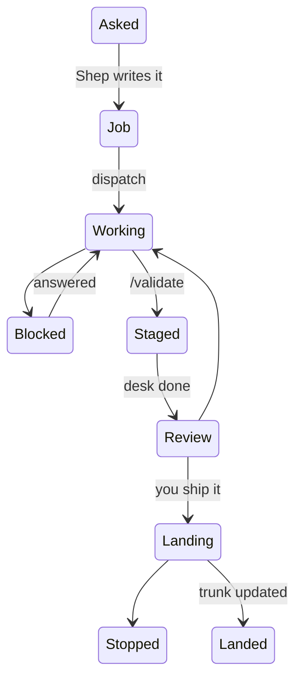

# How a job flows

You ask Shep for something. Shep writes it down as a job, gives it to a desk, and
tells you when the desk has something for you. The desk's agent works in its own
worktree and stages its change without committing it. You read the change in
tuicr and give your LGTM when the change needs one, and the change lands. You
spend your attention on reading changes and answering cards.

## A job, end to end

1. **Ask.** You tell Shep what you want, in its terminal, in your own words.
2. **Job.** Shep writes the ask as a [beads](https://beads.gascity.com/) issue in
   the repo it belongs to, or as a [trail](shep.md#trails-as-jobs) in a repo hosted
   on Entire: what done looks like and how to prove it. The issue is the spec. The
   desk reads it, and its work is judged against it.
3. **Desk.** `bercail shep task dispatch` makes a worktree and a Herdr space for the
   job, and starts a desk there: bstack's Pi lead, with the issue as its first
   prompt. You see the desk in the sidebar, with its status: working, blocked,
   done.
4. **Staged change.** The desk finishes with `/validate`. It runs the tests and the
   repo's verify skill, cleans the diff, stages everything with `git add`, writes
   the change's description, and has the judge check both. It does not commit.
5. **Review.** By default, when the desk is done and its checkout has
   uncommitted changes, tuicr opens in a Review tab of its space the next time
   you look at that space. Your comments go back to the desk, pasted into it or
   sent by Shep as a follow-up, and it stages again.
6. **Land.** When you ask to ship, Shep commits and lands the change the way the
   repo's [git policy](config.md#git-policy-per-repo) says: straight to main, a
   PR, or a trail merge on Entire. A change to a high-stakes path waits for your
   LGTM first. In a GitHub repo whose trusted policy pushes straight to main and
   names the CI that must pass, one pick on a [land card](shep.md#one-land-card)
   commits the change, waits for that CI, pushes it to the trunk, and then tries
   to retire the worktree and close the issue.

The chart follows one job in such a repo:

Drawn by hand, not model-checked. Each arrow:

- `Asked -> Job: Shep writes it`: Shep's first step for any job (`shep/SHEP.md:47`).
- `Job -> Working: dispatch`: a first desk through `handoff-spawn` (`lib/shep-task.ts:718`).
- `Working -> Blocked`: the guard asks before a command the policy does not allow (`bstack/pi/extensions/guard.ts:5065`), or Pi reports itself blocked.
- `Blocked -> Working: answered`: you answer at the desk, or Shep answers from outside it with `bercail desk answer` (`lib/desk.sh:493`).
- `Working -> Staged: /validate`: its step 5 stages everything and commits nothing (`bstack/pi/prompts/validate.md:14`).
- `Staged -> Review: desk done`: the desk mod opens Review when a desk finishes with uncommitted changes (`bercail/mods/bercail-desk/main.js:662`).
- `Review -> Working`: you send comments back; dispatch queues them into the same desk's session (`lib/shep-task.ts:609`).
- `Review -> Landing: you ship it`: your pick on the land card starts its chain (`lib/land.sh:480`).
- `Landing -> Stopped`: CI fails, or the trunk moved, and the chain stops at `ci-failed` or `behind` (`lib/land.sh:556`, `lib/land.sh:573`). Nothing is retried. The job stays open, and Shep asks a new card once the desk has fixed it or caught up.
- `Landing -> Landed: trunk updated`: once CI passed, the commit goes to the trunk with no force push, and the chain reads it back there (`lib/land.sh:581`). The cleanup, sync and close that follow can each fail with a warning, which leaves that part, and the job, open.

## While it runs

Shep itself never waits more than 10 seconds on purpose, so it stays free to talk
to you while desks work.

- **Cards.** A question Shep needs you to answer becomes a card in the
  [Decisions panel](shep.md#the-decisions-panel): where it comes from, what Shep
  asks, its brief, the choices and, when there is one, the choice Shep
  recommends and why. Shep can mark a question cheap to undo, such as a plan or
  a local commit. If nobody picks by its deadline (30 minutes by default,
  `[shep] decision_timeout`) and nothing it asks about has changed, it takes the
  recommendation, and you can OK or reverse that default later. An LGTM never
  defaults. A command of Shep's that the guard would ask
  you about goes on a [guard card](shep.md#guard-asks) with Allow and Deny,
  so Shep's session goes on meanwhile. A guard card nobody answers within the
  hour counts as an Allow only when what it runs stays local or private, such as
  a cleanup; anything else counts as a Deny. Guard and land cards carry no
  recommendation, take your pick on the panel only, and a guard card's default
  cannot be reversed.
- **Background Sheps.** A wait for CI, a deploy or a desk goes to a
  [background Shep](shep.md#background-sheps): a worker on its own job that waits,
  reports on the issue, and stops. Shep tells you in one line and goes back to you.
- **Routines.** A [routine](routines.md) is a query you schedule in `config.toml`.
  The built-ins find worktrees and desks to retire, new versions of what bercail
  depends on, a ready issue to offer you, mistakes that keep coming back, and
  standing rules that may no longer apply. Only what is new or changed reaches Shep,
  and Shep decides what each finding becomes. The Routines panel shows each
  routine and its last findings.
- **Desk events.** A desk that finishes or blocks sends Shep one
  [event](shep.md#desk-events). Shep reads the issue's brief and reports to you.

## What your agents care about

These shape every desk's work. You write the policy once per repo, and the desks
follow all four without being told.

- **The desk.** One job, one worktree, one Herdr space, one agent that stays
  beside the tabs. The issue is its spec, and it re-reads it before it stops.
  It stages its work and leaves it for you.
- **The guard.** A Pi extension that Shep, the coding desks and their siblings load. It checks each command
  before it runs: what may be pushed, which files no agent writes, which commands
  ask you first. It is a seatbelt, not a sandbox: it does not see inside a script
  file or `python -c`. See [git policy](config.md#git-policy-per-repo).
- **The policy.** `.bercail/policy.toml`, committed in the repo: how its agents
  push, integrate and release, which paths are high-stakes, how large a change
  may be. A value that lets agents do more counts only once you trust the file
  (`bercail policy trust`).
- **`/validate`.** How a desk finishes: the tests, the verify skill, `unslop`,
  `git add`, the description, then the judge. See [bstack](bstack.md#how-a-desk-finishes-validate).

## What you care about

- **Cards.** Answer them in the Decisions panel, by click or by key. Only your
  pick there, or in a card's Discuss session, counts as your answer; a "yes" in
  chat does not. A default counts as Shep's until you OK it, where the card
  offers OK.
- **Reviews and LGTMs.** Read each change in tuicr. A change to a `high_stakes`
  path waits for your LGTM before it lands, and Shep warns before a new desk when
  more lines wait on you than the repo's `review_budget`
  ([review by stakes](config.md#review-by-stakes-and-size)).
- **Todos.** What only you can do (create a login, plug in a device) goes on your
  [to-do lists](shep.md#todos-for-the-person) in Basecamp, not into Shep's chat.
- **Standing rules.** Tell Shep a rule once ("merge finished desk work straight to
  master") and it records it with `bercail shep remember`. It is in every session
  after, until you ask Shep to forget it. The rules routine flags rules that may
  no longer apply, and you pick which to forget
  ([standing rules](shep.md#standing-rules)).
