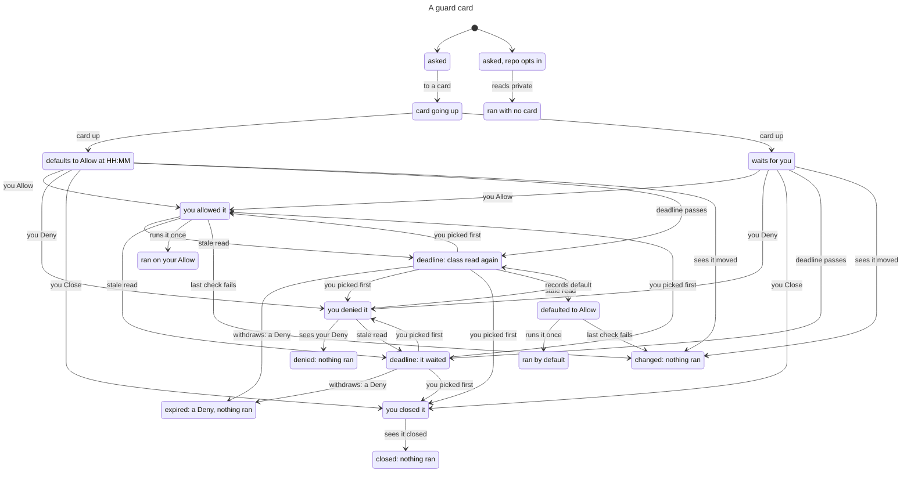

Arrows:
- start -> asked
- start -> asked, repo opts in
- asked -> card going up: to a card
- asked, repo opts in -> ran with no card: reads private
- card going up -> defaults to Allow at HH:MM: card up
- card going up -> waits for you: card up
- defaults to Allow at HH:MM -> you allowed it: you Allow
- defaults to Allow at HH:MM -> you denied it: you Deny
- defaults to Allow at HH:MM -> you closed it: you Close
- waits for you -> you allowed it: you Allow
- waits for you -> you denied it: you Deny
- waits for you -> you closed it: you Close
- you denied it -> denied: nothing ran: sees your Deny
- you closed it -> closed: nothing ran: sees it closed
- defaults to Allow at HH:MM -> deadline: class read again: deadline passes
- waits for you -> deadline: it waited: deadline passes
- defaults to Allow at HH:MM -> changed: nothing ran: sees it moved
- waits for you -> changed: nothing ran: sees it moved
- you allowed it -> deadline: class read again: stale read
- you allowed it -> deadline: it waited: stale read
- you denied it -> deadline: class read again: stale read
- you denied it -> deadline: it waited: stale read
- deadline: class read again -> expired: a Deny, nothing ran: withdraws: a Deny
- deadline: it waited -> expired: a Deny, nothing ran: withdraws: a Deny
- deadline: class read again -> you allowed it: you picked first
- deadline: it waited -> you allowed it: you picked first
- deadline: class read again -> you denied it: you picked first
- deadline: it waited -> you denied it: you picked first
- deadline: class read again -> you closed it: you picked first
- deadline: class read again -> defaulted to Allow: records default
- deadline: it waited -> you closed it: you picked first
- you allowed it -> ran on your Allow: runs it once
- you allowed it -> changed: nothing ran: last check fails
- defaulted to Allow -> ran by default: runs it once
- defaulted to Allow -> changed: nothing ran: last check fails
