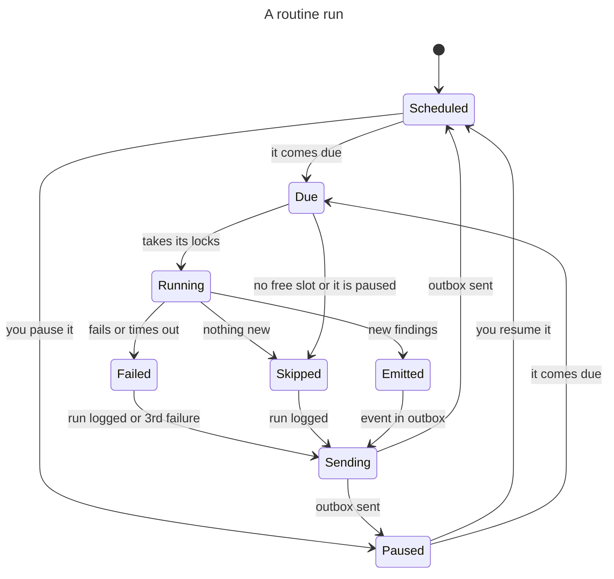

Arrows:
- start -> Scheduled
- Scheduled -> Due: it comes due
- Scheduled -> Paused: you pause it
- Paused -> Scheduled: you resume it
- Paused -> Due: it comes due
- Due -> Running: takes its locks
- Running -> Failed: fails or times out
- Running -> Skipped: nothing new
- Due -> Skipped: no free slot or it is paused
- Failed -> Sending: run logged or 3rd failure
- Skipped -> Sending: run logged
- Running -> Emitted: new findings
- Emitted -> Sending: event in outbox
- Sending -> Scheduled: outbox sent
- Sending -> Paused: outbox sent
