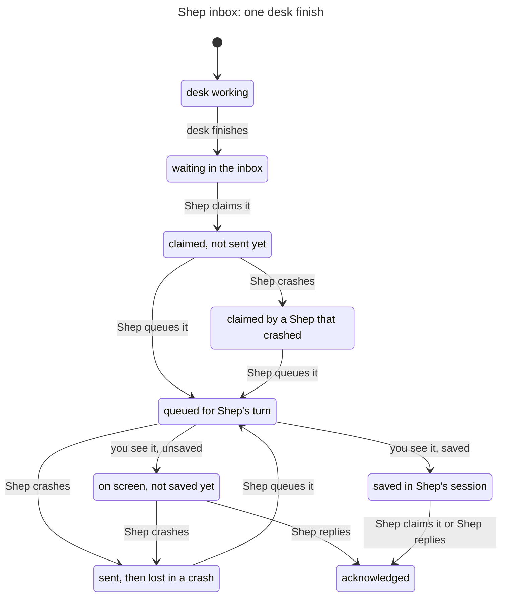

Arrows:
- start -> desk working
- desk working -> waiting in the inbox: desk finishes
- waiting in the inbox -> claimed, not sent yet: Shep claims it
- claimed, not sent yet -> claimed by a Shep that crashed: Shep crashes
- claimed, not sent yet -> queued for Shep's turn: Shep queues it
- queued for Shep's turn -> on screen, not saved yet: you see it, unsaved
- queued for Shep's turn -> sent, then lost in a crash: Shep crashes
- queued for Shep's turn -> saved in Shep's session: you see it, saved
- on screen, not saved yet -> sent, then lost in a crash: Shep crashes
- on screen, not saved yet -> acknowledged: Shep replies
- saved in Shep's session -> acknowledged: Shep claims it or Shep replies
- claimed by a Shep that crashed -> queued for Shep's turn: Shep queues it
- sent, then lost in a crash -> queued for Shep's turn: Shep queues it
